# ダイアログ

言語:

- 日本語（このページ）
- English: [dialog.md](dialog.md)
- 한국어: [dialog.ko.md](dialog.ko.md)

← [マニュアルトップへ戻る](index.ja.md)

---

## 目次

- [Android](#android)
  - [1.13.0 での変更](#1130-での変更)
  - [AndroidDialogManager](#androiddialogmanager)
- [iOS](#ios)
  - [iOSDialogManager](#iosdialogmanager)
- [Windows](#windows)
  - [1.12.0 での変更](#1120-での変更)
  - [WindowsDialogManager](#windowsdialogmanager)
- [macOS](#macos)
  - [MacDialogManager](#macdialogmanager)

---

## Android

### 1.13.0 での変更

1.13.0 から、Android のダイアログは native-toolkit の C ABI 2.0.0（`libntk.so`）で動きます。メソッド、イベント、その引数と既定値は変わりません。1.12.0 との違いは次のとおりです。

#### コードの直し方

- Android のコードの `using JonghyunKim.NativeToolkit.Runtime.Dialog;` を `using JonghyunKim.NativeToolkit.Runtime.Android.Dialog;` に書き換えてください。iOS と macOS のコードの行はそのままにしてください（型は移っていません）。
- Dialog の型は名前が変わっていないので、直すのは上の `using` の行だけです。Unity は自動では直しません。API Updater はこのパッケージの型への参照を書き換えないので、1.12.0 の名前のままのスクリプトはコンパイルに失敗します。このページの例のように `#if UNITY_ANDROID && !UNITY_EDITOR` の中に書いたコードは Editor ではコンパイルされないので、エラーは Android の Player をビルドしたときに初めて出ます。

#### Android の全機能に共通の破壊的変更

- **1.x のネイティブライブラリを同梱しなくなりました。** `android-native-toolkit-1.3.0.aar` と `unity-android-native-toolkit-1.3.0.aar` を外しました。パッケージに入っているのは `android-native-toolkit-2.0.0.aar` と `android-native-toolkit-capi-2.0.0.aar`（native-toolkit の C ABI 2.0.0）です。これらのクラス（`android.unity.*`、`android.library.*`）を直接呼んでいたコードは動きません。
- **「Configure Gradle Project」は無くなりました。** メニューの Tools > Native Toolkit > Android > Configure Gradle Project と、そのウィンドウを削除しました。実行時に要るライブラリ（`kotlin-stdlib` 2.2.21、`kotlinx-coroutines-core` 1.9.0 を含む 7 つ）は、ビルドが `unityLibrary/build.gradle` に自分で足します。Kotlin の Gradle プラグインは適用しなくなりました。独自の Gradle のテンプレートや EDM4U を使っている場合は、版がぶつからないか確かめてください。
- **64 ビットと IL2CPP だけに対応します。** ARMv7（32 ビット）も含むビルドはメッセージを出して止まります。Mono には対応しません。[Android の要件](index.ja.md#android-の要件)を見てください。

#### ダイアログの動作の違い

| 場面 | 1.12.0 | 1.13.0 |
| --- | --- | --- |
| 単一選択・複数選択のダイアログを、バックキーやダイアログの外のタップで閉じた | `checkedItem` / `checkedItems` に、その時点の選択が入った | どちらも `null` です。`buttonText = "Cancel"`、`isSuccess = true`、`errorMessage = ""` は変わりません |
| `checkedItem` が -1 より小さい、または項目数以上 | 何も選ばれていないダイアログが出て、肯定ボタンで渡した値がそのまま返った | ダイアログは出ず、すぐに `"checkedItem is out of range."` のイベントが出ます。Editor でも同じです。`-1`（未選択）はこれまでどおり使えます |
| `checkedItems` が項目より長い | 渡した長さのまま返った | 項目数で切ります |
| `checkedItems` が項目より短い | 対応していない（Android のメインスレッドで例外になり、アプリが終わると見られる） | 足りない分を `false` で埋めます |
| `singleChoiceItems` / `multiChoiceItems` に `null` の要素がある | そのまま Android に渡し、アプリが終わることがあった。Editor では警告だけで通った | ダイアログは出ず、すぐに `"singleChoiceItems cannot contain null."` / `"multiChoiceItems cannot contain null."` のイベントが出ます。Editor でも同じです |
| 文字列の途中の U+0000 | そのまま渡した | そこで切れます |
| 文字列の中の対になっていないサロゲート | そのまま | 渡す文字列も返ってくる文字列も、U+FFFD に置き換わります |
| アプリが前面にないときに呼ぶ | `"Failed to <method>: <例外の文言>"` | `"Failed to <method>: the app is not in the foreground."` |
| システムがダイアログを閉じた（宿主や Activity が終わった） | イベントは出なかった | 失敗のイベント `"Failed to <method>: the dialog was closed by the system."` が出ます |
| 前面の Activity が `FragmentActivity` でない | `"Failed to cast context to FragmentActivity"` | 透明な宿主の Activity にダイアログを出します。Unity の Activity は `FragmentActivity` なので、ふつうは当てはまりません |
| エラーの文言 | 例外の文言を含んだ | 下の表の決まった文言です |
| ログ | 検査の失敗はエラーとして出した。入力・ユーザー名・パスワードをそのまま出した | 検査の失敗は警告として出します。入力・ユーザー名・パスワードは長さだけを出します。サンプルのシーンも、パスワードは長さだけを表示します |
| `Initialize()` | ネイティブのブリッジにつないだ | ネイティブライブラリが使えるかをログに出すだけです。呼ぶ必要はありません |

`errorMessage` の文言は次のとおりです。`<method>` には 1.12.0 と同じ名前（`showDialog`、`showConfirmDialog`、`showSingleChoiceItemDialog`、`showMultiChoiceItemDialog`、`showTextInputDialog`、`showLoginDialog` のどれか）が入ります。「すぐ」は `Show*` メソッドが戻る前に、「後で」は戻った後にイベントが出ることを表します。

| 原因 | 時点 | `errorMessage` |
| --- | --- | --- |
| タイトル・メッセージ・選択肢が空（変更なし） | すぐ | `"Title cannot be null or empty."` / `"Message cannot be null or empty."` / `"singleChoiceItems cannot be null or empty."` / `"multiChoiceItems cannot be null or empty."` |
| `null` の要素 | すぐ | `"singleChoiceItems cannot contain null."` / `"multiChoiceItems cannot contain null."` |
| `checkedItem` が範囲外 | すぐ | `"checkedItem is out of range."` |
| ネイティブライブラリが使えない（1.12.0 では `"pluginInstance is null"`） | すぐ | `"Failed to <method>: the native library is not available (libntk.so ships for arm64-v8a and x86_64 only)."` |
| ネイティブライブラリがまだ初期化されていない | すぐ | `"Failed to <method>: the native library is not initialized yet."` |
| ライブラリが要求を拒んだ（このパッケージの不具合） | すぐ | `"Failed to <method>: the request was rejected (INVALID_PARAMETER)."`（または `NOT_SUPPORTED`） |
| ライブラリがそのほかの理由で呼び出しを受け付けなかった | すぐ | `"Failed to <method>: <name>."`（`<name>` はエラーの名前。`OUT_OF_MEMORY`、`UNKNOWN` など） |
| アプリが前面にない | 後で | `"Failed to <method>: the app is not in the foreground."` |
| ダイアログの宿主を起動できない | 後で | `"Failed to <method>: the dialog host could not be started."` |
| ダイアログを出せない | 後で | `"Failed to <method>: the dialog could not be shown."` |
| システムがダイアログを閉じた | 後で | `"Failed to <method>: the dialog was closed by the system."` |
| 受け付けた後のそのほかの失敗 | 後で | `"Failed to <method>: <name>."` |
| C# の例外（変更なし） | すぐ | `"Internal error: <例外の文言>"` |

### AndroidDialogManager

#### ShowDialog - 基本ダイアログ

- 名前空間をインポートします。

```csharp
// 実行ガード: Android (Player) のみ有効。Editor ではネイティブ呼び出しを行わないようにします。
#if UNITY_ANDROID && !UNITY_EDITOR
using JonghyunKim.NativeToolkit.Runtime.Android.Dialog;
#endif
```

- イベントを登録します。

```csharp
// 実行ガード: Android (Player) のみ有効。Editor ではネイティブ呼び出しを行わないようにします。
#if UNITY_ANDROID && !UNITY_EDITOR
AndroidDialogManager.Instance.DialogResult += OnDialogResult;
#endif
```

- ダイアログを表示します。

```csharp
// 実行ガード: Android (Player) のみ有効。Editor ではネイティブ呼び出しを行わないようにします。
#if UNITY_ANDROID && !UNITY_EDITOR
// タイトルを設定します。必須項目です。
string title = "Hello from Unity";
// メッセージを設定します。必須項目です。
string message = "This is a native Android dialog!";
// ボタンのテキストを設定します。未設定の場合、"OK" が使用されます。
string buttonText = "OK";
// ダイアログの外をタップした場合、キャンセル可能かを設定します。未設定の場合、true が使用されます。
bool cancelableOnTouchOutside = false;
// バックキーなどでダイアログがキャンセル可能かを設定します。未設定の場合、true が使用されます。
bool cancelable = false;
AndroidDialogManager.Instance.ShowDialog(
  title,
  message,
  buttonText,
  cancelableOnTouchOutside,
  cancelable
);
#endif
```

<p align="center">
  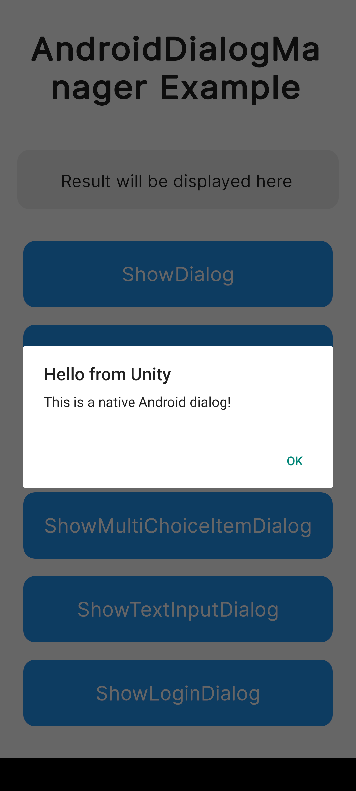
</p>
- ボタン押下時の結果はイベントで受け取ります。

```csharp
// buttonText:　押下したボタンのテキストを取得します。エラーの場合、null を返します。
// isSuccess: ダイアログ表示成功のプラグを取得します。成功の場合、true を返します。
// errorMessage: エラーが発生した場合、エラー内容を取得します。成功の場合、null を返します。

private void OnDialogResult(
  string? buttonText,
  bool isSuccess,
  string? errorMessage
)
```

#### ShowConfirmDialog - 確認ダイアログ

- 名前空間をインポートします。

```csharp
// 実行ガード: Android (Player) のみ有効。Editor ではネイティブ呼び出しを行わないようにします。
#if UNITY_ANDROID && !UNITY_EDITOR
using JonghyunKim.NativeToolkit.Runtime.Android.Dialog;
#endif
```

- イベントを登録します。

```csharp
// 実行ガード: Android (Player) のみ有効。Editor ではネイティブ呼び出しを行わないようにします。
#if UNITY_ANDROID && !UNITY_EDITOR
AndroidDialogManager.Instance.ConfirmDialogResult += OnConfirmDialogResult;
#endif
```

- ダイアログを表示します。

```csharp
// 実行ガード: Android (Player) のみ有効。Editor ではネイティブ呼び出しを行わないようにします。
#if UNITY_ANDROID && !UNITY_EDITOR
// タイトルを設定します。必須項目です。
string title = "Confirmation";
// メッセージを設定します。必須項目です。
string message = "Do you want to proceed with this action?";
// 否定ボタンのテキストを設定します。未設定の場合、"No" が使用されます。
string negativeButtonText = "No";
// 肯定ボタンのテキストを設定します。未設定の場合、"Yes" が使用されます。
string positiveButtonText = "Yes";
// ダイアログの外をタップした場合、キャンセル可能かを設定します。未設定の場合、true が使用されます。
bool cancelableOnTouchOutside = false;
// バックキーなどでダイアログがキャンセル可能かを設定します。未設定の場合、true が使用されます。
bool cancelable = false;
AndroidDialogManager.Instance.ShowConfirmDialog(
  title,
  message,
  negativeButtonText,
  positiveButtonText,
  cancelableOnTouchOutside,
  cancelable
);
#endif
```

<p align="center">
  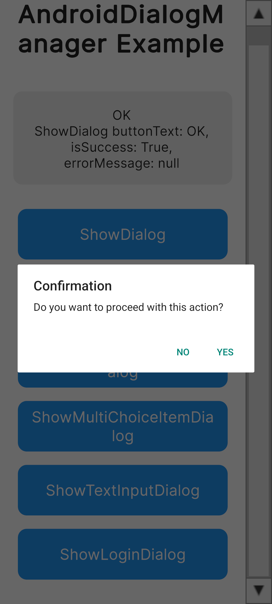
</p>
- ボタン押下時の結果はイベントで受け取ります。

```csharp
// buttonText:　押下したボタンのテキストを取得します。エラーの場合、null を返します。
// isSuccess: ダイアログ表示成功のプラグを取得します。成功の場合、true を返します。
// errorMessage: エラーが発生した場合、エラー内容を取得します。成功の場合、null を返します。

private void OnConfirmDialogResult(
  string? buttonText,
  bool isSuccess,
  string? errorMessage
)
```

#### ShowSingleChoiceDialog - シングル選択ダイアログ

- 名前空間をインポートします。

```csharp
// 実行ガード: Android (Player) のみ有効。Editor ではネイティブ呼び出しを行わないようにします。
#if UNITY_ANDROID && !UNITY_EDITOR
using JonghyunKim.NativeToolkit.Runtime.Android.Dialog;
#endif
```

- イベントを登録します。

```csharp
// 実行ガード: Android (Player) のみ有効。Editor ではネイティブ呼び出しを行わないようにします。
#if UNITY_ANDROID && !UNITY_EDITOR
AndroidDialogManager.Instance.SingleChoiceItemDialogResult += OnSingleChoiceItemDialogResult;
#endif
```

- ダイアログを表示します。

```csharp
// 実行ガード: Android (Player) のみ有効。Editor ではネイティブ呼び出しを行わないようにします。
#if UNITY_ANDROID && !UNITY_EDITOR
// タイトルを設定します。必須項目です。
string title = "Please select one";
// 選択肢を設定します。必須項目です。
string[] singleChoiceItems = { "Option 1", "Option 2", "Option 3" };
// デフォルト選択項目のindex番号を設定します。未設定の場合、0 が使用されます。
int checkedItem = 0;
// 否定ボタンのテキストを設定します。未設定の場合、"Cancel" が使用されます。
string negativeButtonText = "Cancel";
// 肯定ボタンのテキストを設定します。未設定の場合、"OK" が使用されます。
string positiveButtonText = "OK";
// ダイアログの外をタップした場合、キャンセル可能かを設定します。未設定の場合、true が使用されます。
bool cancelableOnTouchOutside = false;
// バックキーなどでダイアログがキャンセル可能かを設定します。未設定の場合、true が使用されます。
bool cancelable = false;
AndroidDialogManager.Instance.ShowSingleChoiceItemDialog(
  title,
  singleChoiceItems,
  checkedItem,
  negativeButtonText,
  positiveButtonText,
  cancelableOnTouchOutside,
  cancelable
);
#endif
```

<p align="center">
  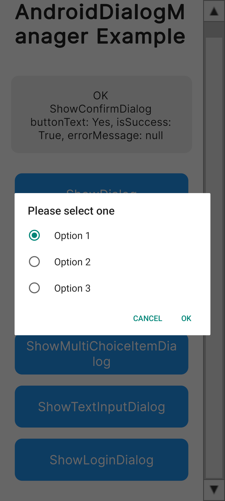
</p>
- ボタン押下時の結果はイベントで受け取ります。

```csharp
// buttonText:　押下したボタンのテキストを取得します。エラーの場合、null を返します。
// checkedItem: 選択された項目のindex番号を取得します。エラーの場合、否定ボタンを押した場合、何も選ばれていない場合、バックキーやダイアログの外のタップで閉じた場合は null を返します。
// isSuccess: ダイアログ表示成功のプラグを取得します。成功の場合、true を返します。
// errorMessage: エラーが発生した場合、エラー内容を取得します。成功の場合、null を返します。

private void OnSingleChoiceItemDialogResult(
  string? buttonText,
  int? checkedItem,
  bool isSuccess,
  string? errorMessage
)
```

#### ShowMultiChoiceDialog - マルチ選択ダイアログ

- 名前空間をインポートします。

```csharp
// 実行ガード: Android (Player) のみ有効。Editor ではネイティブ呼び出しを行わないようにします。
#if UNITY_ANDROID && !UNITY_EDITOR
using JonghyunKim.NativeToolkit.Runtime.Android.Dialog;
#endif
```

- イベントを登録します。

```csharp
// 実行ガード: Android (Player) のみ有効。Editor ではネイティブ呼び出しを行わないようにします。
#if UNITY_ANDROID && !UNITY_EDITOR
AndroidDialogManager.Instance.MultiChoiceItemDialogResult += OnMultiChoiceItemDialogResult;
#endif
```

- ダイアログを表示します。

```csharp
// 実行ガード: Android (Player) のみ有効。Editor ではネイティブ呼び出しを行わないようにします。
#if UNITY_ANDROID && !UNITY_EDITOR
// タイトルを設定します。必須項目です。
string title = "Multiple Selection";
// 選択肢を設定します。必須項目です。
string[] multiChoiceItems = { "Item 1", "Item 2", "Item 3", "Item 4" };
// デフォルト選択項目の選択状態を設定します。未設定の場合、すべて false が使用されます。
bool[] checkedItems = { false, true, false, true };
// 否定ボタンのテキストを設定します。未設定の場合、"Cancel" が使用されます。
string negativeButtonText = "Cancel";
// 肯定ボタンのテキストを設定します。未設定の場合、"OK" が使用されます。
string positiveButtonText = "OK";
// ダイアログの外をタップした場合、キャンセル可能かを設定します。未設定の場合、true が使用されます。
bool cancelableOnTouchOutside = false;
// バックキーなどでダイアログがキャンセル可能かを設定します。未設定の場合、true が使用されます。
bool cancelable = false;
AndroidDialogManager.Instance.ShowMultiChoiceItemDialog(
  title,
  multiChoiceItems,
  checkedItems,
  negativeButtonText,
  positiveButtonText,
  cancelableOnTouchOutside,
  cancelable
);
#endif
```

<p align="center">
  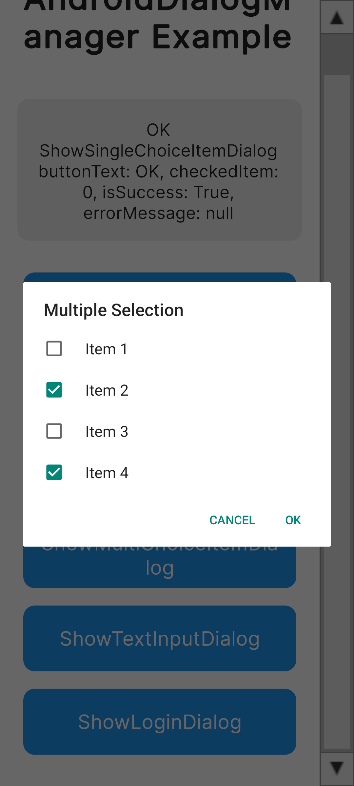
</p>
- ボタン押下時の結果はイベントで受け取ります。

```csharp
// buttonText:　押下したボタンのテキストを取得します。エラーの場合、null を返します。
// checkedItems: 選択された項目の選択状態を取得します。選択はtrue, 未選択はfalse。エラーの場合、否定ボタンを押した場合、バックキーやダイアログの外のタップで閉じた場合は null を返します。
// isSuccess: ダイアログ表示成功のプラグを取得します。成功の場合、true を返します。
// errorMessage: エラーが発生した場合、エラー内容を取得します。成功の場合、null を返します。

private void OnMultiChoiceItemDialogResult(
  string? buttonText,
  bool[]? checkedItems,
  bool isSuccess,
  string? errorMessage
)
```

#### ShowInputDialog - 入力ダイアログ

- 名前空間をインポートします。

```csharp
// 実行ガード: Android (Player) のみ有効。Editor ではネイティブ呼び出しを行わないようにします。
#if UNITY_ANDROID && !UNITY_EDITOR
using JonghyunKim.NativeToolkit.Runtime.Android.Dialog;
#endif
```

- イベントを登録します。

```csharp
// 実行ガード: Android (Player) のみ有効。Editor ではネイティブ呼び出しを行わないようにします。
#if UNITY_ANDROID && !UNITY_EDITOR
AndroidDialogManager.Instance.TextInputDialogResult += OnTextInputDialogResult;
#endif
```

- ダイアログを表示します。

```csharp
// 実行ガード: Android (Player) のみ有効。Editor ではネイティブ呼び出しを行わないようにします。
#if UNITY_ANDROID && !UNITY_EDITOR
// タイトルを設定します。必須項目です。
string title = "Text Input";
// メッセージを設定します。必須項目です。
string message = "Please enter your name";
// プレースホルダーを設定します。未設定の場合、空文字列が使用されます。
string placeholder = "Enter here...";
// 否定ボタンのテキストを設定します。未設定の場合、"Cancel" が使用されます。
string negativeButtonText = "Cancel";
// 肯定ボタンのテキストを設定します。未設定の場合、"OK" が使用されます。
string positiveButtonText = "OK";
// 入力値が空の場合、肯定ボタンが有効になるかを設定します。未設定の場合、false が使用されます。
bool enablePositiveButtonWhenEmpty = false;
// ダイアログの外をタップした場合、キャンセル可能かを設定します。未設定の場合、true が使用されます。
bool cancelableOnTouchOutside = false;
// バックキーなどでダイアログがキャンセル可能かを設定します。未設定の場合、true が使用されます。
bool cancelable = false;
AndroidDialogManager.Instance.ShowTextInputDialog(
  title,
  message,
  placeholder,
  negativeButtonText,
  positiveButtonText,
  enablePositiveButtonWhenEmpty,
  cancelableOnTouchOutside,
  cancelable
);
#endif
```

<p align="center">
  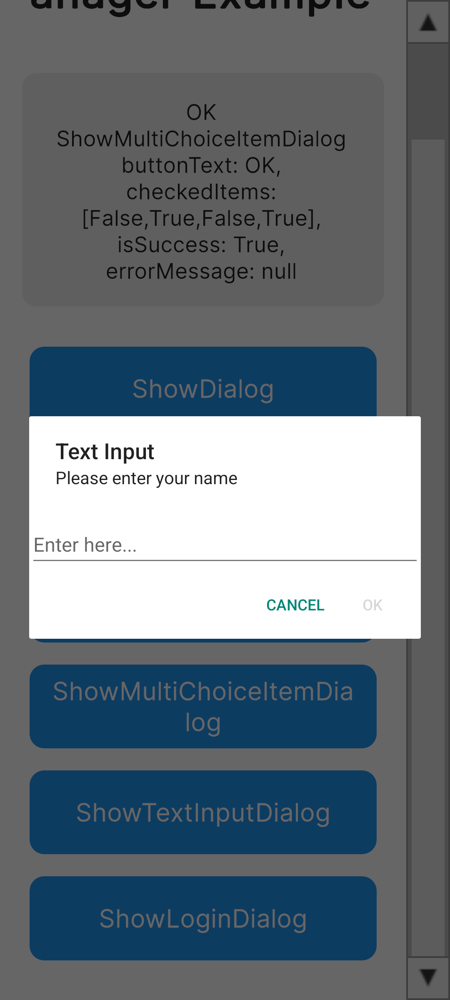
</p>
- ボタン押下時の結果はイベントで受け取ります。

```csharp
// buttonText:　押下したボタンのテキストを取得します。エラーの場合、null を返します。
// inputText: 入力されたテキストを取得します。エラーの場合、null を返します。
// isSuccess: ダイアログ表示成功のプラグを取得します。成功の場合、true を返します。
// errorMessage: エラーが発生した場合、エラー内容を取得します。成功の場合、null を返します。

private void OnTextInputDialogResult(
  string? buttonText,
  string? inputText,
  bool isSuccess,
  string? errorMessage
)
```

#### ShowLoginDialog - ログインダイアログ

- 名前空間をインポートします。

```csharp
// 実行ガード: Android (Player) のみ有効。Editor ではネイティブ呼び出しを行わないようにします。
#if UNITY_ANDROID && !UNITY_EDITOR
using JonghyunKim.NativeToolkit.Runtime.Android.Dialog;
#endif
```

- イベントを登録します。

```csharp
// 実行ガード: Android (Player) のみ有効。Editor ではネイティブ呼び出しを行わないようにします。
#if UNITY_ANDROID && !UNITY_EDITOR
AndroidDialogManager.Instance.LoginDialogResult += OnLoginDialogResult;
#endif
```

- ダイアログを表示します。

```csharp
// 実行ガード: Android (Player) のみ有効。Editor ではネイティブ呼び出しを行わないようにします。
#if UNITY_ANDROID && !UNITY_EDITOR
// タイトルを設定します。必須項目です。
string title = "Login";
// メッセージを設定します。必須項目です。
string message = "Please enter your credentials";
// ユーザ名のプレースホルダーを設定します。未設定の場合、"Username" が使用されます。
string usernameHint = "Username";
// パスワードのプレースホルダーを設定します。未設定の場合、"Password" が使用されます。
string passwordHint = "Password";
// 否定ボタンのテキストを設定します。未設定の場合、"Cancel" が使用されます。
string negativeButtonText = "Cancel";
// 肯定ボタンのテキストを設定します。未設定の場合、"Login" が使用されます。
string positiveButtonText = "Login";
// 入力値が空の場合、肯定ボタンが有効になるかを設定します。未設定の場合、false が使用されます。
bool enablePositiveButtonWhenEmpty = false;
// ダイアログの外をタップした場合、キャンセル可能かを設定します。未設定の場合、true が使用されます。
bool cancelableOnTouchOutside = false;
// バックキーなどでダイアログがキャンセル可能かを設定します。未設定の場合、true が使用されます。
bool cancelable = false;
AndroidDialogManager.Instance.ShowLoginDialog(
  title,
  message,
  usernameHint,
  passwordHint,
  negativeButtonText,
  positiveButtonText,
  enablePositiveButtonWhenEmpty,
  cancelableOnTouchOutside,
  cancelable
);
#endif
```

<p align="center">
  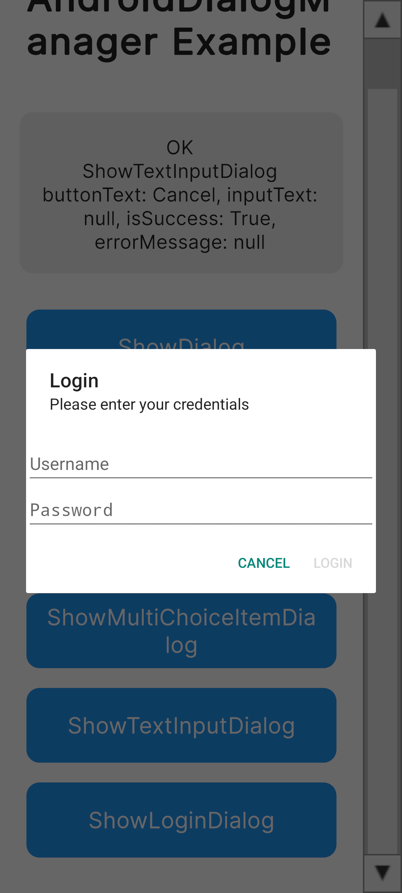
</p>
- ボタン押下時の結果はイベントで受け取ります。

```csharp
// buttonText:　押下したボタンのテキストを取得します。エラーの場合、null を返します。
// username: 入力されたユーザ名を取得します。エラーの場合、null を返します。
// password: 入力されたパスワードを取得します。エラーの場合、null を返します。
// isSuccess: ダイアログ表示成功のプラグを取得します。成功の場合、true を返します。
// errorMessage: エラーが発生した場合、エラー内容を取得します。成功の場合、null を返します。

private void OnLoginDialogResult(
  string? buttonText,
  string? username,
  string? password,
  bool isSuccess,
  string? errorMessage
)
```

---

## iOS

### iOSDialogManager

#### ShowDialog - 基本ダイアログ

- 名前空間をインポートします。

```csharp
// 実行ガード: iOS (Player) のみ有効。Editor ではネイティブ呼び出しを行わないようにします。
#if UNITY_IOS && !UNITY_EDITOR
using JonghyunKim.NativeToolkit.Runtime.Dialog;
#endif
```

- イベントを登録します。

```csharp
// 実行ガード: iOS (Player) のみ有効。Editor ではネイティブ呼び出しを行わないようにします。
#if UNITY_IOS && !UNITY_EDITOR
IosDialogManager.Instance.DialogResult += OnDialogResult;
#endif
```

- ダイアログを表示します。

```csharp
// 実行ガード: iOS (Player) のみ有効。Editor ではネイティブ呼び出しを行わないようにします。
#if UNITY_IOS && !UNITY_EDITOR
// タイトルを設定します。必須項目です。
string title = "Hello from Unity";
// メッセージを設定します。必須項目です。
string message = "This is a native iOS dialog!";
// ボタンのテキストを設定します。未設定の場合、"OK" が使用されます。
string buttonText = "OK";
IosDialogManager.Instance.ShowDialog(
  title,
  message,
  buttonText
);
#endif
```

<p align="center">
  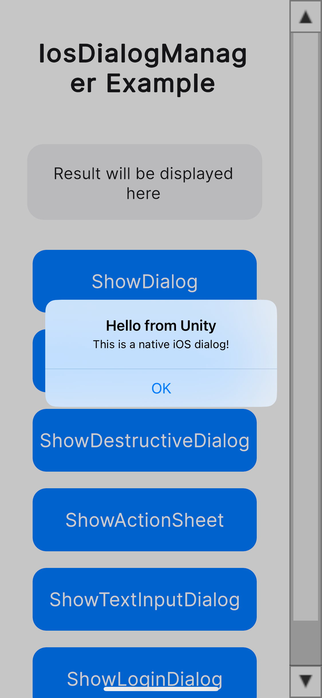
</p>
- ボタン押下時の結果はイベントで受け取ります。

```csharp
// buttonText:　押下したボタンのテキストを取得します。エラーの場合、null を返します。
// isSuccess: ダイアログ表示成功のプラグを取得します。成功の場合、true を返します。
// errorMessage: エラーが発生した場合、エラー内容を取得します。成功の場合、null を返します。

private void OnDialogResult(
  string? buttonText,
  bool isSuccess,
  string? errorMessage
)
```

#### ShowConfirmDialog - 確認ダイアログ

- 名前空間をインポートします。

```csharp
// 実行ガード: iOS (Player) のみ有効。Editor ではネイティブ呼び出しを行わないようにします。
#if UNITY_IOS && !UNITY_EDITOR
using JonghyunKim.NativeToolkit.Runtime.Dialog;
#endif
```

- イベントを登録します。

```csharp
// 実行ガード: iOS (Player) のみ有効。Editor ではネイティブ呼び出しを行わないようにします。
#if UNITY_IOS && !UNITY_EDITOR
IosDialogManager.Instance.ConfirmDialogResult += OnConfirmDialogResult;
#endif
```

- ダイアログを表示します。

```csharp
// 実行ガード: iOS (Player) のみ有効。Editor ではネイティブ呼び出しを行わないようにします。
#if UNITY_IOS && !UNITY_EDITOR
// タイトルを設定します。必須項目です。
string title = "Confirm Action";
// メッセージを設定します。必須項目です。
string message = "Are you sure you want to proceed?";
// 確認ボタンのテキストを設定します。未設定の場合、"OK" が使用されます。
string confirmButtonText = "Yes";
// キャンセルボタンのテキストを設定します。未設定の場合、"Cancel" が使用されます。
string cancelButtonText = "No";
IosDialogManager.Instance.ShowConfirmDialog(
  title,
  message,
  confirmButtonText,
  cancelButtonText
);
#endif
```

<p align="center">
  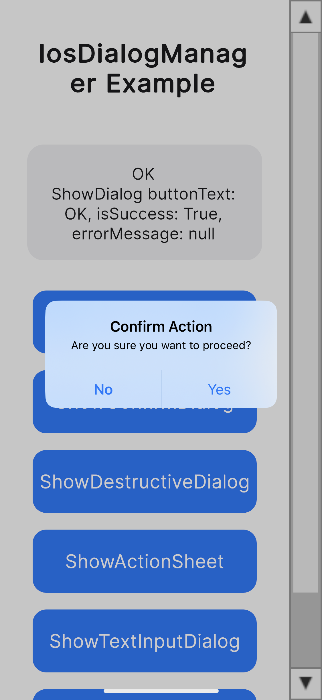
</p>
- ボタン押下時の結果はイベントで受け取ります。

```csharp
// buttonText:　押下したボタンのテキストを取得します。エラーの場合、null を返します。
// isSuccess: ダイアログ表示成功のプラグを取得します。成功の場合、true を返します。
// errorMessage: エラーが発生した場合、エラー内容を取得します。成功の場合、null を返します。

private void OnConfirmDialogResult(
  string? buttonText,
  bool isSuccess,
  string? errorMessage
)
```

#### ShowDestructiveDialog - ディストラクティブなダイアログ

- 名前空間をインポートします。

```csharp
// 実行ガード: iOS (Player) のみ有効。Editor ではネイティブ呼び出しを行わないようにします。
#if UNITY_IOS && !UNITY_EDITOR
using JonghyunKim.NativeToolkit.Runtime.Dialog;
#endif
```

- イベントを登録します。

```csharp
// 実行ガード: iOS (Player) のみ有効。Editor ではネイティブ呼び出しを行わないようにします。
#if UNITY_IOS && !UNITY_EDITOR
IosDialogManager.Instance.DestructiveDialogResult += OnDestructiveDialogResult;
#endif
```

- ダイアログを表示します。

```csharp
// 実行ガード: iOS (Player) のみ有効。Editor ではネイティブ呼び出しを行わないようにします。
#if UNITY_IOS && !UNITY_EDITOR
// タイトルを設定します。必須項目です。
string title = "Delete File";
// メッセージを設定します。必須項目です。
string message = "This action cannot be undone. Are you sure?";
// 破壊的操作の確認ボタンのテキストを設定します。未設定の場合、"Delete" が使用されます。
string destructiveButtonText = "Delete";
// キャンセルボタンのテキストを設定します。未設定の場合、"Cancel" が使用されます。
string cancelButtonText = "Cancel";
IosDialogManager.Instance.ShowDestructiveDialog(
  title,
  message,
  destructiveButtonText,
  cancelButtonText
);
#endif
```

<p align="center">
  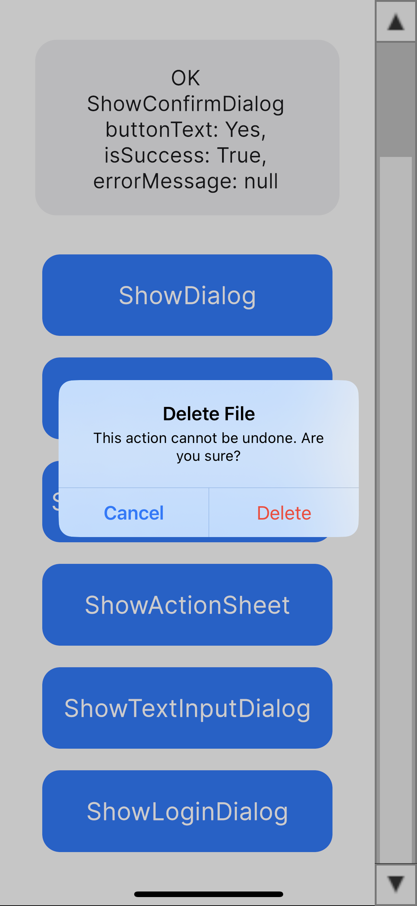
</p>
- ボタン押下時の結果はイベントで受け取ります。

```csharp
// buttonText:　押下したボタンのテキストを取得します。エラーの場合、null を返します。
// isSuccess: ダイアログ表示成功のプラグを取得します。成功の場合、true を返します。
// errorMessage: エラーが発生した場合、エラー内容を取得します。成功の場合、null を返します。

private void OnDestructiveDialogResult(
  string? buttonText,
  bool isSuccess,
  string? errorMessage
)
```

#### ShowActionSheet - アクションシート

- 名前空間をインポートします。

```csharp
// 実行ガード: iOS (Player) のみ有効。Editor ではネイティブ呼び出しを行わないようにします。
#if UNITY_IOS && !UNITY_EDITOR
using JonghyunKim.NativeToolkit.Runtime.Dialog;
#endif
```

- イベントを登録します。

```csharp
// 実行ガード: iOS (Player) のみ有効。Editor ではネイティブ呼び出しを行わないようにします。
#if UNITY_IOS && !UNITY_EDITOR
IosDialogManager.Instance.ActionSheetResult += OnActionSheetResult;
#endif
```

- アクションシートを表示します。

```csharp
// 実行ガード: iOS (Player) のみ有効。Editor ではネイティブ呼び出しを行わないようにします。
#if UNITY_IOS && !UNITY_EDITOR
// タイトルを設定します。必須項目です。
string title = "Select Source";
// メッセージを設定します。必須項目です。
string message = "Choose where to get the file from";
// 選択肢を設定します。必須項目です。
string[] options = { "Camera", "Photo Library", "Documents" };
// キャンセルボタンのテキストを設定します。未設定の場合、"Cancel" が使用されます。
string cancelButtonText = "Cancel";
IosDialogManager.Instance.ShowActionSheet(
  title,
  message,
  options,
  cancelButtonText
);
#endif
```

<p align="center">
  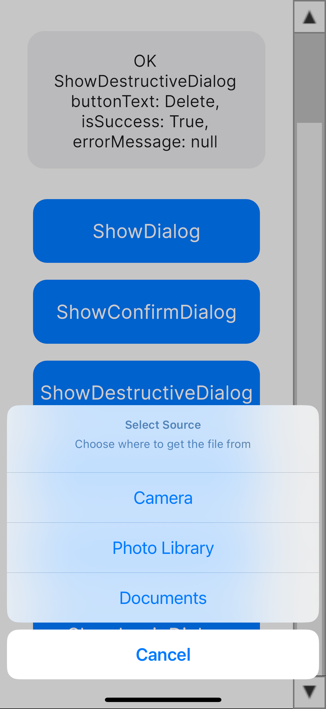
</p>
- ボタン押下時の結果はイベントで受け取ります。

```csharp
// buttonText:　押下したボタンのテキストを取得します。エラーの場合、null を返します。
// isSuccess: ダイアログ表示成功のプラグを取得します。成功の場合、true を返します。
// errorMessage: エラーが発生した場合、エラー内容を取得します。成功の場合、null を返します。

private void OnActionSheetResult(
  string? buttonText,
  bool isSuccess,
  string? errorMessage
)
```

#### ShowTextInputDialog - 入力ダイアログ

- 名前空間をインポートします。

```csharp
// 実行ガード: iOS (Player) のみ有効。Editor ではネイティブ呼び出しを行わないようにします。
#if UNITY_IOS && !UNITY_EDITOR
using JonghyunKim.NativeToolkit.Runtime.Dialog;
#endif
```

- イベントを登録します。

```csharp
// 実行ガード: iOS (Player) のみ有効。Editor ではネイティブ呼び出しを行わないようにします。
#if UNITY_IOS && !UNITY_EDITOR
IosDialogManager.Instance.TextInputDialogResult += OnTextInputDialogResult;
#endif
```

- ダイアログを表示します。

```csharp
// 実行ガード: iOS (Player) のみ有効。Editor ではネイティブ呼び出しを行わないようにします。
#if UNITY_IOS && !UNITY_EDITOR
// タイトルを設定します。必須項目です。
string title = "Enter Name";
// メッセージを設定します。必須項目です。
string message = "Please enter your name";
// プレースホルダーを設定します。未設定の場合、空文字列が使用されます。
string placeholder = "Your name here";
// 確認ボタンのテキストを設定します。未設定の場合、"OK" が使用されます。
string confirmButtonText = "OK";
// キャンセルボタンのテキストを設定します。未設定の場合、"Cancel" が使用されます。
string cancelButtonText = "Cancel";
// 入力値が空の場合、確認ボタンが有効になるかを設定します。未設定の場合、false が使用されます。
bool enableConfirmWhenEmpty = false;
IosDialogManager.Instance.ShowTextInputDialog(
  title,
  message,
  placeholder,
  confirmButtonText,
  cancelButtonText,
  enableConfirmWhenEmpty
);
#endif
```

<p align="center">
  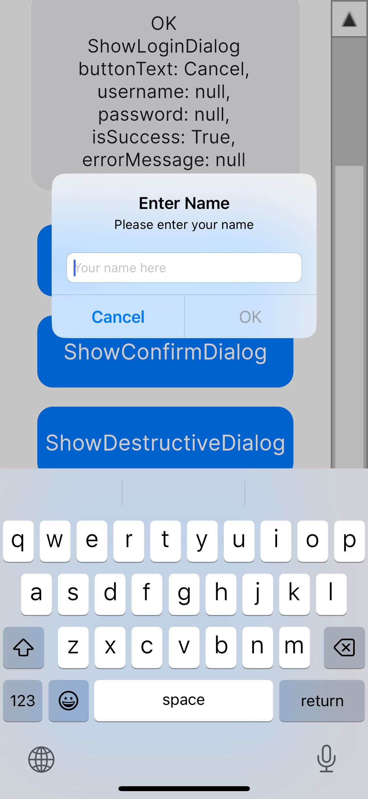
</p>
- ボタン押下時の結果はイベントで受け取ります。

```csharp
// buttonText:　押下したボタンのテキストを取得します。エラーの場合、null を返します。
// inputText: 入力されたテキストを取得します。エラーの場合、null を返します。
// isSuccess: ダイアログ表示成功のプラグを取得します。成功の場合、true を返します。
// errorMessage: エラーが発生した場合、エラー内容を取得します。成功の場合、null を返します。

private void OnTextInputDialogResult(
  string? buttonText,
  string? inputText,
  bool isSuccess,
  string? errorMessage
)
```

#### ShowLoginDialog - ログインダイアログ

- 名前空間をインポートします。

```csharp
// 実行ガード: iOS (Player) のみ有効。Editor ではネイティブ呼び出しを行わないようにします。
#if UNITY_IOS && !UNITY_EDITOR
using JonghyunKim.NativeToolkit.Runtime.Dialog;
#endif
```

- イベントを登録します。

```csharp
// 実行ガード: iOS (Player) のみ有効。Editor ではネイティブ呼び出しを行わないようにします。
#if UNITY_IOS && !UNITY_EDITOR
IosDialogManager.Instance.LoginDialogResult += OnLoginDialogResult;
#endif
```

- ダイアログを表示します。

```csharp
// 実行ガード: iOS (Player) のみ有効。Editor ではネイティブ呼び出しを行わないようにします。
#if UNITY_IOS && !UNITY_EDITOR
// タイトルを設定します。必須項目です。
string title = "Login Required";
// メッセージを設定します。必須項目です。
string message = "Please enter your credentials";
// ユーザ名のプレースホルダーを設定します。未設定の場合、"Username" が使用されます。
string usernamePlaceholder = "Username";
// パスワードのプレースホルダーを設定します。未設定の場合、"Password" が使用されます。
string passwordPlaceholder = "Password";
// ログインボタンのテキストを設定します。未設定の場合、"Login" が使用されます。
string loginButtonText = "Login";
// キャンセルボタンのテキストを設定します。未設定の場合、"Cancel" が使用されます。
string cancelButtonText = "Cancel";
// 入力値が空の場合、ログインボタンが有効になるかを設定します。未設定の場合、false が使用されます。
bool enableLoginWhenEmpty = false;
IosDialogManager.Instance.ShowLoginDialog(
  title,
  message,
  usernamePlaceholder,
  passwordPlaceholder,
  loginButtonText,
  cancelButtonText,
  enableLoginWhenEmpty
);
#endif
```

<p align="center">
  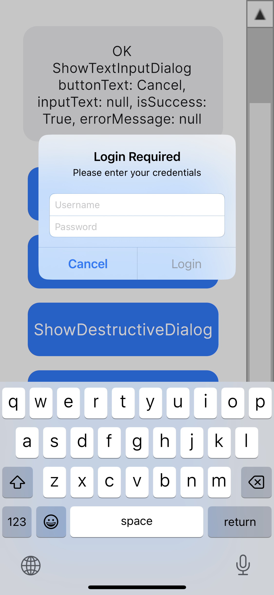
</p>
- ボタン押下時の結果はイベントで受け取ります。

```csharp
// buttonText:　押下したボタンのテキストを取得します。エラーの場合、null を返します。
// username: 入力されたユーザ名を取得します。エラーの場合、null を返します。
// password: 入力されたパスワードを取得します。エラーの場合、null を返します。
// isSuccess: ダイアログ表示成功のプラグを取得します。成功の場合、true を返します。
// errorMessage: エラーが発生した場合、エラー内容を取得します。成功の場合、null を返します。

private void OnLoginDialogResult(
  string? buttonText,
  string? username,
  string? password,
  bool isSuccess,
  string? errorMessage
)
```

---

## Windows

### 1.12.0 での変更

1.12.0 から、Windows のダイアログは native-toolkit の C ABI 2.0.0（`windows-native-toolkit-capi-2.0.0.dll`）で動きます。メソッド、イベント、その引数は変わりません。1.11.0 との違いは次のとおりです。

- **名前空間。** `WindowsDialogManager`、`Win32MessageBox`、`WindowsDialogErrorCodes` は `JonghyunKim.NativeToolkit.Runtime.Windows.Dialog` にあります。Windows のコードの `using JonghyunKim.NativeToolkit.Runtime.Dialog;` を書き換えてください。iOS / macOS の型の名前空間は変わりません。Android の型は 1.13.0 で移りました（[1.13.0 での変更](#1130-での変更)を見てください）。
- **Editor。** Windows の型は Editor でもコンパイルされます。Editor で呼ぶとダイアログは出ず、イベントで `-5` が返ります。
- **予約されたエラーコード。** `errorCode` には、OS の値のほかに下の値が入ります。OS の `HRESULT` も負の値なので、符号ではなく定数と比べてください。

| 定数（`WindowsDialogErrorCodes`） | 値 | 意味 |
| --- | --- | --- |
| `Cancelled` | -1 | ファイル・フォルダのダイアログでユーザーがキャンセルした（`isCancelled = true`、`isSuccess = true`） |
| `InvalidArgument` | -2 | ダイアログを出す前に拒んだ（空のタイトル・メッセージ、使えないフラグ、パターンの無いフィルタ） |
| `Unknown` | -3 | 詳しく言えない失敗 |
| `NativeUnavailable` | -4 | ネイティブライブラリが無い、関数が無い、読み込めない、または C ABI 2.x でない |
| `PlatformUnavailable` | -5 | Windows の Player でない（Editor など）。ダイアログは出ない |

| 場面 | 1.11.0 | 1.12.0 |
| --- | --- | --- |
| `bufferSize` | バッファの大きさとして使い、超えると失敗 | 無視されます。パス 1 本は 1023 文字まで、複数選択は全体で 32768 文字までで、超えると OS のエラーコードが返ります |
| 空のタイトル・メッセージ | 空のダイアログが出て、イベントが最大 3 回 | ダイアログは出ず、`-2` のイベントが 1 回 |
| `MB_SYSTEMMODAL`、`MB_TASKMODAL`、`MB_RIGHT`、`MB_RTLREADING` | そのまま Windows に渡した | ダイアログは出ず `-2`。使えるのは、ボタン 7 種、アイコン 4 種、既定ボタン 4 種、`MB_APPLMODAL`、`MB_TOPMOST`、`MB_HELP`（0x4000） |
| パターンの無いフィルタの組 | そのまま Windows に渡した | `-2` |
| パターンの中の空の要素（`"*.txt;;*.log"`） | そのまま Windows に渡した | `"*.txt;*.log"` に詰める |
| 組の無いフィルタ（`""`） | 空のフィルタ | 「すべてのファイル」の 1 組 |
| `ShowSaveFileDialog` の `defExt = ""` | 選んだフィルタの拡張子を Windows が足した（`new` → `new.txt`） | 入力したままの名前が返ります（`new` → `new`）。拡張子を付けたいときは `defExt` を渡してください（既定値の `"txt"` なら `new.txt`） |
| `ShowFolderDialog` の `title = ""` | 空のタイトル | システムのタイトル |
| ドライブ直下で複数のファイルを選ぶ | `C:\\a.txt` | `C:\a.txt` |
| メッセージボックスが 0 を返し、OS のエラーも無い | `(0, true, null)` | `(0, false, -3)` |
| ネイティブライブラリが無い・読み込めない | 呼び出しで例外 | 例外は出ず、イベントで `-4` |
| そのほかの C# 側の例外 | 呼び出し側に例外 | 例外は出ず、イベントで `-3` |
| 文字列の中の対になっていないサロゲート | そのまま | U+FFFD に置き換わる |

### WindowsDialogManager

#### ShowDialog - 基本ダイアログ

- 名前空間をインポートします。

```csharp
// 実行ガード: Windows (Player) のみ有効。Editor ではネイティブ呼び出しを行わないようにします。
#if UNITY_STANDALONE_WIN && !UNITY_EDITOR
using JonghyunKim.NativeToolkit.Runtime.Windows.Dialog;
#endif
```

- イベントを登録します。

```csharp
// 実行ガード: Windows (Player) のみ有効。Editor ではネイティブ呼び出しを行わないようにします。
#if UNITY_STANDALONE_WIN && !UNITY_EDITOR
WindowsDialogManager.Instance.AlertDialogResult += OnAlertDialogResult;
#endif
```

- ダイアログを表示します。

```csharp
// 実行ガード: Windows (Player) のみ有効。Editor ではネイティブ呼び出しを行わないようにします。
#if UNITY_STANDALONE_WIN && !UNITY_EDITOR
// タイトルを設定します。必須項目です。
string title = "Native Windows Dialog";
// メッセージを設定します。必須項目です。
string message = "This is a native Windows dialog!";
// ボタンの種類を設定します。ここでは OK と キャンセル ボタンを表示します。未設定の場合、MB_OK が使用されます。
uint buttons = Win32MessageBox.MB_OKCANCEL;
// アイコンを設定します。ここでは情報アイコンを表示します。未設定の場合、MB_ICONINFORMATION が使用されます。
uint icon = Win32MessageBox.MB_ICONINFORMATION;
// デフォルトボタンを設定します。ここでは2番目のボタンをデフォルトにします。未設定の場合、MB_DEFBUTTON1 が使用されます。
uint defbutton = Win32MessageBox.MB_DEFBUTTON2;
// オプションを設定します。ここではアプリケーションモーダルを指定します。未設定の場合、MB_APPLMODAL が使用されます。
uint options = Win32MessageBox.MB_APPLMODAL;
WindowsDialogManager.Instance.ShowDialog(
  title,
  message,
  buttons,
  icon,
  defbutton,
  options
);
#endif
```

<p align="center">
  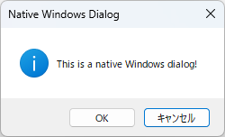
</p>
- 結果はイベントで受け取ります。

```csharp
// result: 押下したボタンの識別子を取得します。エラーの場合、null を返します。
// isSuccess: ダイアログ表示成功のフラグを取得します。成功の場合、true を返します。
// errorCode: エラーが発生した場合、エラーコードを取得します。成功の場合、null を返します。

private void OnAlertDialogResult(
  int? result,
  bool isSuccess,
  int? errorCode
)
```

#### ShowFileDialog - ファイル選択ダイアログ

- 名前空間をインポートします。

```csharp
// 実行ガード: Windows (Player) のみ有効。Editor ではネイティブ呼び出しを行わないようにします。
#if UNITY_STANDALONE_WIN && !UNITY_EDITOR
using JonghyunKim.NativeToolkit.Runtime.Windows.Dialog;
#endif
```

- イベントを登録します。

```csharp
// 実行ガード: Windows (Player) のみ有効。Editor ではネイティブ呼び出しを行わないようにします。
#if UNITY_STANDALONE_WIN && !UNITY_EDITOR
WindowsDialogManager.Instance.FileDialogResult += OnFileDialogResult;
#endif
```

- ダイアログを表示します。

```csharp
// 実行ガード: Windows (Player) のみ有効。Editor ではネイティブ呼び出しを行わないようにします。
#if UNITY_STANDALONE_WIN && !UNITY_EDITOR
// バッファサイズを設定します。未設定の場合、1024 が使用されます。
uint bufferSize = 1024;
// フィルタを設定します。各フィルタはヌル文字 (\0) で区切り、最後に二重のヌル文字で終了します。未設定の場合、"All Files\0*.*\0\0" が使用されます。
string filter = "All Files\0*.*\0\0";
WindowsDialogManager.Instance.ShowFileDialog(
  bufferSize,
  filter
);
#endif
```

<p align="center">
  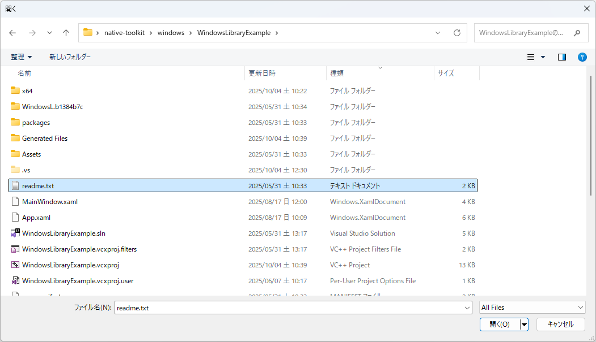
</p>
- 結果はイベントで受け取ります。

```csharp
// filePath: 選択されたファイルパスを取得します。キャンセルや失敗の場合は null を返します。
// isCancelled: ユーザがダイアログをキャンセルしたかどうかを取得します。
// isSuccess: ダイアログ表示成功のフラグを取得します。成功の場合、true を返します。
// errorCode: エラーが発生した場合、エラーコードを取得します。成功の場合、null を返します。

private void OnFileDialogResult(
  string? filePath,
  bool isCancelled,
  bool isSuccess,
  int? errorCode
)
```

#### ShowMultiFileDialog - 複数ファイル選択ダイアログ

- 名前空間をインポートします。

```csharp
// 実行ガード: Windows (Player) のみ有効。Editor ではネイティブ呼び出しを行わないようにします。
#if UNITY_STANDALONE_WIN && !UNITY_EDITOR
using JonghyunKim.NativeToolkit.Runtime.Windows.Dialog;
#endif
```

- イベントを登録します。

```csharp
// 実行ガード: Windows (Player) のみ有効。Editor ではネイティブ呼び出しを行わないようにします。
#if UNITY_STANDALONE_WIN && !UNITY_EDITOR
WindowsDialogManager.Instance.MultiFileDialogResult += OnMultiFileDialogResult;
#endif
```

- ダイアログを表示します。

```csharp
// 実行ガード: Windows (Player) のみ有効。Editor ではネイティブ呼び出しを行わないようにします。
#if UNITY_STANDALONE_WIN && !UNITY_EDITOR
// バッファサイズを設定します。未設定の場合、4096 が使用されます。
uint bufferSize = 4096;
// フィルタを設定します。各フィルタはヌル文字 (\0) で区切り、最後に二重のヌル文字で終了します。未設定の場合、"All Files\0*.*\0\0" が使用されます。
string filter = "All Files\0*.*\0\0";
WindowsDialogManager.Instance.ShowMultiFileDialog(
  bufferSize,
  filter
);
#endif
```

<p align="center">
  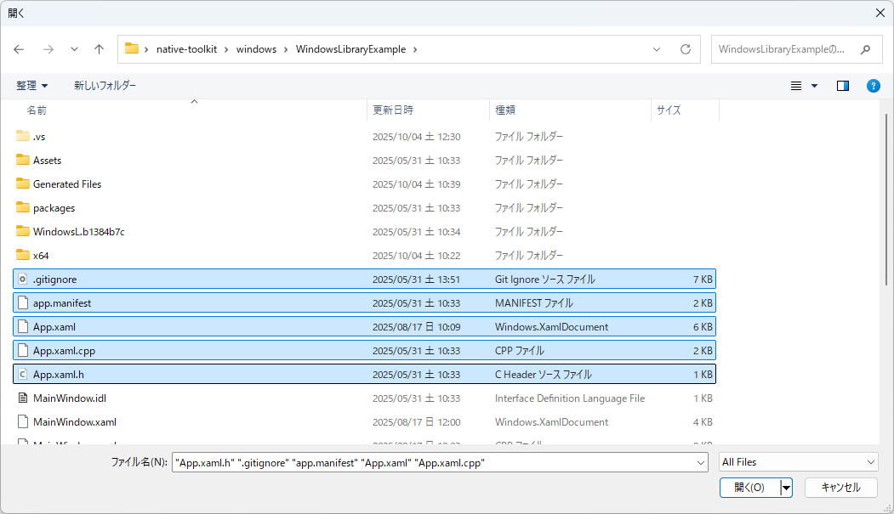
</p>
- 結果はイベントで受け取ります。

```csharp
// filePaths: 選択されたファイルパスの ArrayList を取得します。キャンセルや失敗の場合は null を返します。
// isCancelled: ユーザがダイアログをキャンセルしたかどうかを取得します。
// isSuccess: ダイアログ表示成功のフラグを取得します。成功の場合、true を返します。
// errorCode: エラーが発生した場合、エラーコードを取得します。成功の場合、null を返します。

private void OnMultiFileDialogResult(
  ArrayList? filePaths,
  bool isCancelled,
  bool isSuccess,
  int? errorCode
)
```

#### ShowFolderDialog - フォルダ選択ダイアログ

- 名前空間をインポートします。

```csharp
// 実行ガード: Windows (Player) のみ有効。Editor ではネイティブ呼び出しを行わないようにします。
#if UNITY_STANDALONE_WIN && !UNITY_EDITOR
using JonghyunKim.NativeToolkit.Runtime.Windows.Dialog;
#endif
```

- イベントを登録します。

```csharp
// 実行ガード: Windows (Player) のみ有効。Editor ではネイティブ呼び出しを行わないようにします。
#if UNITY_STANDALONE_WIN && !UNITY_EDITOR
WindowsDialogManager.Instance.FolderDialogResult += OnFolderDialogResult;
#endif
```

- ダイアログを表示します。

```csharp
// 実行ガード: Windows (Player) のみ有効。Editor ではネイティブ呼び出しを行わないようにします。
#if UNITY_STANDALONE_WIN && !UNITY_EDITOR
// バッファサイズを設定します。未設定の場合、1024 が使用されます。
uint bufferSize = 1024;
// タイトルを設定します。未設定の場合、"Select Folder" が使用されます。
string title = "Select Folder";
WindowsDialogManager.Instance.ShowFolderDialog(
  bufferSize,
  title
);
#endif
```

<p align="center">
  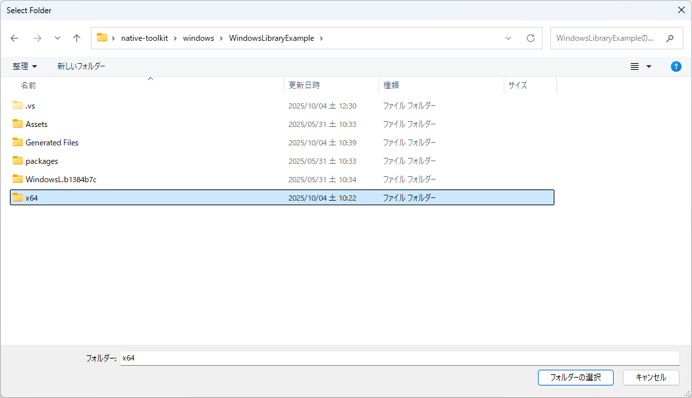
</p>
- 結果はイベントで受け取ります。

```csharp
// folderPath: 選択されたフォルダパスを取得します。キャンセルや失敗の場合は null を返します。
// isCancelled: ユーザがダイアログをキャンセルしたかどうかを取得します。
// isSuccess: ダイアログ表示成功のフラグを取得します。成功の場合、true を返します。
// errorCode: エラーが発生した場合、エラーコードを取得します。成功の場合、null を返します。

private void OnFolderDialogResult(
  string? folderPath,
  bool isCancelled,
  bool isSuccess,
  int? errorCode
)
```

#### ShowMultiFolderDialog - 複数フォルダ選択ダイアログ

- 名前空間をインポートします。

```csharp
// 実行ガード: Windows (Player) のみ有効。Editor ではネイティブ呼び出しを行わないようにします。
#if UNITY_STANDALONE_WIN && !UNITY_EDITOR
using JonghyunKim.NativeToolkit.Runtime.Windows.Dialog;
#endif
```

- イベントを登録します。

```csharp
// 実行ガード: Windows (Player) のみ有効。Editor ではネイティブ呼び出しを行わないようにします。
#if UNITY_STANDALONE_WIN && !UNITY_EDITOR
WindowsDialogManager.Instance.MultiFolderDialogResult += OnMultiFolderDialogResult;
#endif
```

- ダイアログを表示します。

```csharp
// 実行ガード: Windows (Player) のみ有効。Editor ではネイティブ呼び出しを行わないようにします。
#if UNITY_STANDALONE_WIN && !UNITY_EDITOR
// バッファサイズを設定します。未設定の場合、4096 が使用されます。
uint bufferSize = 4096;
// タイトルを設定します。未設定の場合、"Select Folders" が使用されます。
string title = "Select Folders";
WindowsDialogManager.Instance.ShowMultiFolderDialog(
  bufferSize,
  title
);
#endif
```

<p align="center">
  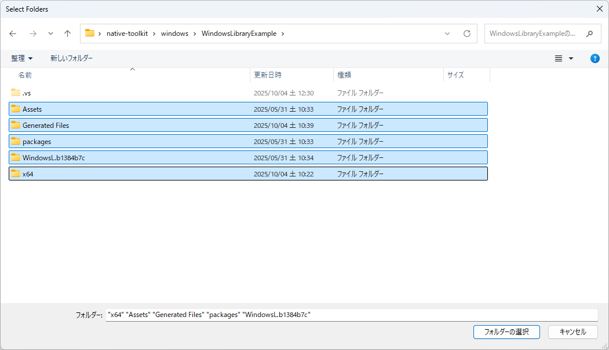
</p>
- 結果はイベントで受け取ります。

```csharp
// folderPaths: 選択されたフォルダパスの ArrayList を取得します。キャンセルや失敗の場合は null を返します。
// isCancelled: ユーザがダイアログをキャンセルしたかどうかを取得します。
// isSuccess: ダイアログ表示成功のフラグを取得します。成功の場合、true を返します。
// errorCode: エラーが発生した場合、エラーコードを取得します。成功の場合、null を返します。

private void OnMultiFolderDialogResult(
  ArrayList? folderPaths,
  bool isCancelled,
  bool isSuccess,
  int? errorCode
)
```

#### ShowSaveFileDialog - ファイル保存ダイアログ

- 名前空間をインポートします。

```csharp
// 実行ガード: Windows (Player) のみ有効。Editor ではネイティブ呼び出しを行わないようにします。
#if UNITY_STANDALONE_WIN && !UNITY_EDITOR
using JonghyunKim.NativeToolkit.Runtime.Windows.Dialog;
#endif
```

- イベントを登録します。

```csharp
// 実行ガード: Windows (Player) のみ有効。Editor ではネイティブ呼び出しを行わないようにします。
#if UNITY_STANDALONE_WIN && !UNITY_EDITOR
WindowsDialogManager.Instance.SaveFileDialogResult += OnSaveFileDialogResult;
#endif
```

- ダイアログを表示します。

```csharp
// 実行ガード: Windows (Player) のみ有効。Editor ではネイティブ呼び出しを行わないようにします。
#if UNITY_STANDALONE_WIN && !UNITY_EDITOR
// バッファサイズを設定します。未設定の場合、1024 が使用されます。
uint bufferSize = 1024;
// フィルタを設定します。各フィルタはヌル文字 (\0) で区切り、最後に二重のヌル文字で終了します。未設定の場合、"All Files\0*.*\0\0" が使用されます。
string filter = "All Files\0*.*\0\0";
// デフォルトの拡張子を設定します。未設定の場合、"txt" が使用されます。
string defExt = "txt";
WindowsDialogManager.Instance.ShowSaveFileDialog(
  bufferSize,
  filter,
  defExt
);
#endif
```

<p align="center">
  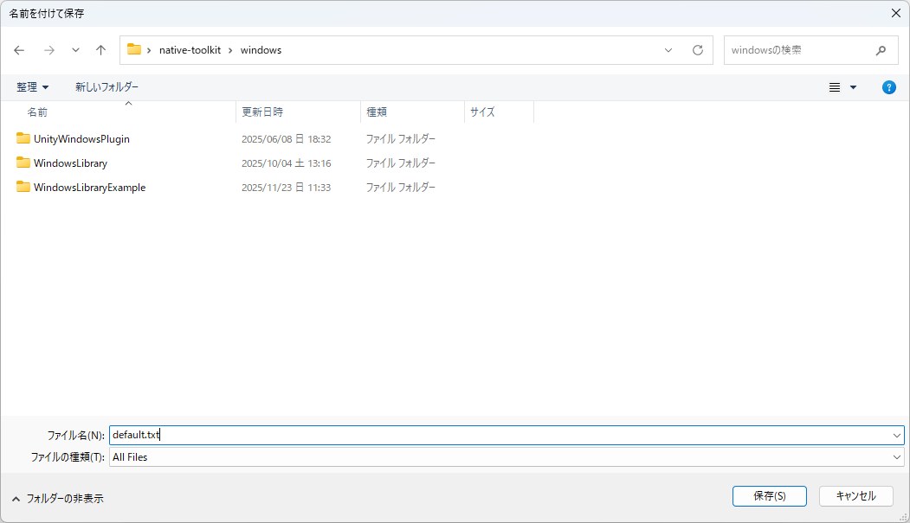
</p>
- 結果はイベントで受け取ります。

```csharp
// filePath: 保存先のファイルパスを取得します。キャンセルや失敗の場合は null を返します。
// isCancelled: ユーザがダイアログをキャンセルしたかどうかを取得します。
// isSuccess: ダイアログ表示成功のフラグを取得します。成功の場合、true を返します。
// errorCode: エラーが発生した場合、エラーコードを取得します。 成功の場合、null を返します。

private void OnSaveFileDialogResult(
  string? filePath,
  bool isCancelled,
  bool isSuccess,
  int? errorCode
)
```

---

## macOS

### MacDialogManager

#### ShowDialog - 基本ダイアログ

- 名前空間をインポートします。

```csharp
// 実行ガード: macOS (Player) のみ有効。Editor ではネイティブ呼び出しを行わないようにします。
#if UNITY_STANDALONE_OSX && !UNITY_EDITOR
using JonghyunKim.NativeToolkit.Runtime.Dialog;
#endif
```

- イベントを登録します。

```csharp
// 実行ガード: macOS (Player) のみ有効。Editor ではネイティブ呼び出しを行わないようにします。
#if UNITY_STANDALONE_OSX && !UNITY_EDITOR
MacDialogManager.Instance.AlertDialogResult += OnAlertDialogResult;
#endif
```

- ダイアログを表示します。

```csharp
// 実行ガード: macOS (Player) のみ有効。Editor ではネイティブ呼び出しを行わないようにします。
#if UNITY_STANDALONE_OSX && !UNITY_EDITOR
// タイトルを設定します。必須項目です。
string title = "Hello from Unity";
// メッセージを設定します。未設定の場合、表示されません。
string message = "This is a native macOS dialog!";
// ボタンを設定します。最低1個のボタンが必要です。
DialogButton[] buttons = {
  // title: ボタンのタイトルを設定します。必須項目です。
  // isDefault: デフォルトボタンに設定する場合、true を指定します。省略時は false です。1個のダイアログにつき、1つのデフォルトボタンのみ設定可能です。
  // keyEquivalent: ボタンのキーショートカットを設定します。省略時は null です。isDefault が true の場合、自動的に Enter キーが割り当てられます。
  new DialogButton(title: "OK", isDefault: true),
  new DialogButton(title: "Cancel", keyEquivalent: ""),
  new DialogButton(title: "Delete", keyEquivalent: "d")
};
// オプションを設定します。必須項目です。
DialogOptions options = new DialogOptions(
  // alertStyle: ダイアログのスタイルを設定します。必須項目です。
  alertStyle: DialogOptions.AlertStyle.Informational,
  // showsHelp: ヘルプボタンを表示する場合、true を指定します。省略時は false です。
  showsHelp: true,
  // showsSuppressionButton: サプレッションチェックボックスを表示する場合、true を指定します。省略時は false です。
  showsSuppressionButton: true,
  // suppressionButtonTitle: サプレッションチェックボックスのタイトルを設定します。省略時は OSデフォルトのタイトルが使用されます。showsSuppressionButton が false の場合、無視されます。
  suppressionButtonTitle: "Don't show this again",
  // icon: ダイアログに表示するアイコンを設定します。
  icon: new IconConfiguration(
    // 以下はアイコンのタイプごとの設定方法例です。必要に応じて設定してください。
    ...
  )
);

// アイコンのタイプがシステムシンボルアイコンの例です。
DialogOptions options = new DialogOptions(
  ...
  icon: new IconConfiguration(
    // type: アイコンのタイプがシステムシンボルです。必須項目です。
    type: IconConfiguration.IconType.SystemSymbol,
    // value: システムシンボルの名前を設定します。必須項目です。
    value: "info.square.fill",
    // mode: アイコンのレンダリングモードを設定します。必須項目です。
    mode: IconConfiguration.RenderingMode.Palette,
    // colors: アイコンのカラー配列を設定します。レンダリングモードが Palette の場合、1～3色を指定可能で必須です。レンダリングモードが Hierarchical の場合、1色が指定可能です。色は #RRGGBB または colorname 形式で指定します。
    colors: new List<string> { "white", "systemblue", "systemblue" },
    // size: アイコンのサイズをポイント単位で設定します。省略時は OSデフォルト値が使用されます。ダイアログでは制限により設定しても無効です。
    size: 64f,
    // weight: アイコンのウェイトを設定します。省略時は OSデフォルト値が使用されます。
    weight: IconConfiguration.Weight.Regular,
    // scale: アイコンのスケールを設定します。省略時は OSデフォルト値が使用されます。ダイアログでは制限により設定しても無効です。
    scale: IconConfiguration.Scale.Medium
  )
);

// アイコンのタイプがファイルパスの場合の例です。
DialogOptions options = new DialogOptions(
  ...
  icon: new IconConfiguration(
    // type: アイコンのタイプがファイルパスです。必須項目です。
    type: IconConfiguration.IconType.FilePath,
    // value: ファイルパスを設定します。必須項目です。
    value: "/Users/user/Downloads/test.png"
  )
);

// アイコンのタイプが名前付き画像の場合の例です。
DialogOptions options = new DialogOptions(
  ...
  icon: new IconConfiguration(
    // type: アイコンのタイプが名前付き画像です。必須項目です。
    type: IconConfiguration.IconType.NamedImage,
    // value: 名前付き画像の名前を設定します。必須項目です。
    value: "test-image"
  )
);

// アイコンのタイプがアプリアイコンの場合の例です。
DialogOptions options = new DialogOptions(
  ...
  icon: new IconConfiguration(
    // type: アイコンのタイプがアプリアイコンです。必須項目です。
    type: IconConfiguration.IconType.AppIcon
  )
);

// アイコンのタイプがシステム画像の場合の例です。
DialogOptions options = new DialogOptions(
  ...
  icon: new IconConfiguration(
    // type: アイコンのタイプがシステム画像です。必須項目です。
    type: IconConfiguration.IconType.SystemImage,
    // value: システム画像の名前を設定します。必須項目です。
    value: "cautionName"
  )
);

MacDialogManager.Instance.ShowDialog(
  title,
  message,
  buttons,
  options
);
#endif
```

<p align="center">
  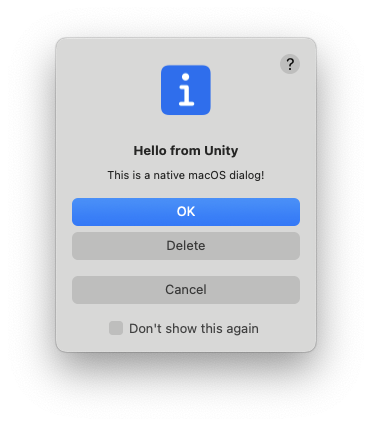
</p>
- ボタン押下時の結果はイベントで受け取ります。

```csharp
// buttonTitle: 押下したボタンのタイトルを取得します。エラーの場合、null を返します。
// buttonIndex: 押下したボタンの index を取得します。
// suppressionState: サプレッションチェックボックスの状態を取得します。
// isSuccess: ダイアログ表示成功のフラグを取得します。成功の場合、true を返します。
// errorMessage: エラーが発生した場合、エラー内容を取得します。成功の場合、null を返します。

private void OnAlertDialogResult(
  string? buttonTitle,
  int buttonIndex,
  bool suppressionState,
  bool isSuccess,
  string? errorMessage
)
```

#### ShowFileDialog - ファイル選択ダイアログ

- 名前空間をインポートします。

```csharp
// 実行ガード: macOS (Player) のみ有効。Editor ではネイティブ呼び出しを行わないようにします。
#if UNITY_STANDALONE_OSX && !UNITY_EDITOR
using JonghyunKim.NativeToolkit.Runtime.Dialog;
#endif
```

- イベントを登録します。

```csharp
// 実行ガード: macOS (Player) のみ有効。Editor ではネイティブ呼び出しを行わないようにします。
#if UNITY_STANDALONE_OSX && !UNITY_EDITOR
MacDialogManager.Instance.FileDialogResult += OnFileDialogResult;
#endif
```

- ダイアログを表示します。

```csharp
// 実行ガード: macOS (Player) のみ有効。Editor ではネイティブ呼び出しを行わないようにします。
#if UNITY_STANDALONE_OSX && !UNITY_EDITOR
// タイトルを設定します。必須項目です。
string title = "Select a file";
// メッセージを設定します。未設定の場合、表示されません。
string message = "Please select a file to open.";
// 許可するファイルの拡張子を設定します。未設定の場合、OS規定の値が使用されます。
string[] allowedContentTypes = { "txt", "png" };
// 初期ディレクトリを設定します。未設定の場合、OS規定の値が使用されます。
string? directoryPath = null;
MacDialogManager.Instance.ShowFileDialog(
  title,
  message,
  allowedContentTypes,
  directoryPath
);
#endif
```

<p align="center">
  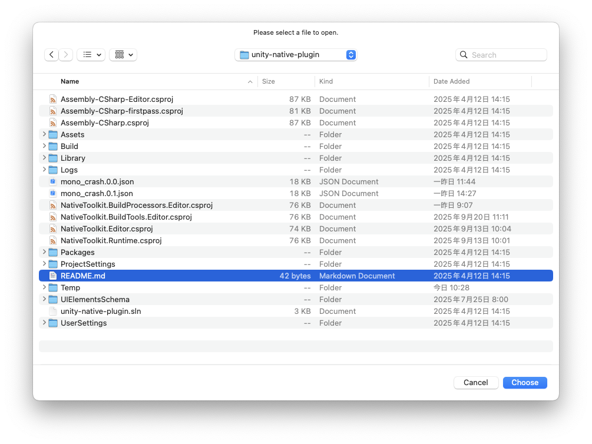
</p>
- 選択結果はイベントで受け取ります。

```csharp
// filePaths: 選択されたファイルパスの配列を取得します。エラーの場合、null を返します。
// fileCount: 返却されたファイル数を取得します。キャンセルされた場合は 0 です。
// directoryURL: 選択が行われたディレクトリ URL を取得します。エラーの場合、null を返します。
// isCancelled: ユーザがダイアログをキャンセルしたかどうかを取得します。
// isSuccess: ダイアログ表示成功のフラグを取得します。成功の場合、true を返します。
// errorMessage: エラーが発生した場合、エラー内容を取得します。成功の場合、null を返します。

private void OnFileDialogResult(
  string[]? filePaths,
  int fileCount,
  string? directoryURL,
  bool isCancelled,
  bool isSuccess,
  string? errorMessage
)
```

#### ShowMultiFileDialog - 複数ファイル選択ダイアログ

- 名前空間をインポートします。

```csharp
// 実行ガード: macOS (Player) のみ有効。Editor ではネイティブ呼び出しを行わないようにします。
#if UNITY_STANDALONE_OSX && !UNITY_EDITOR
using JonghyunKim.NativeToolkit.Runtime.Dialog;
#endif
```

- イベントを登録します。

```csharp
// 実行ガード: macOS (Player) のみ有効。Editor ではネイティブ呼び出しを行わないようにします。
#if UNITY_STANDALONE_OSX && !UNITY_EDITOR
MacDialogManager.Instance.MultiFileDialogResult += OnMultiFileDialogResult;
#endif
```

- ダイアログを表示します。

```csharp
// 実行ガード: macOS (Player) のみ有効。Editor ではネイティブ呼び出しを行わないようにします。
#if UNITY_STANDALONE_OSX && !UNITY_EDITOR
// タイトルを設定します。必須項目です。
string title = "Select files";
// メッセージを設定します。未設定の場合、表示されません。
string message = "Please select files to open.";
// 許可するファイルの拡張子を設定します。未設定の場合、OS規定の値が使用されます。
string[] allowedContentTypes = { "txt", "png" };
// 初期ディレクトリを設定します。未設定の場合、OS規定の値が使用されます。
string? directoryPath = null;
MacDialogManager.Instance.ShowMultiFileDialog(
  title,
  message,
  allowedContentTypes,
  directoryPath
);
#endif
```

<p align="center">
  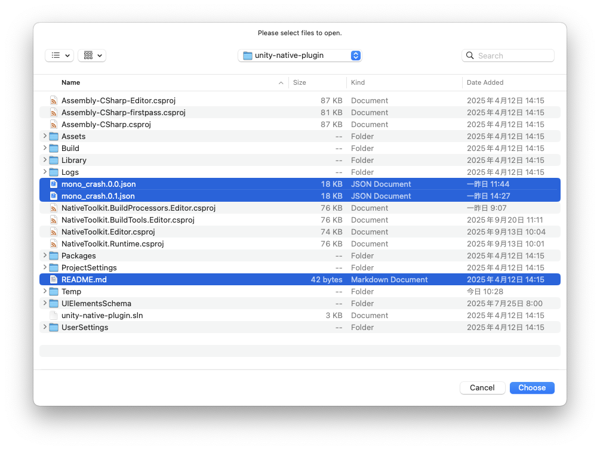
</p>
- 選択結果はイベントで受け取ります。

```csharp
// filePaths: 選択されたファイルパスの配列を取得します。エラーの場合、null を返します。
// fileCount: 返却されたファイル数を取得します。キャンセルされた場合は 0 です。
// directoryURL: 選択が行われたディレクトリ URL を取得します。エラーの場合、null を返します。
// isCancelled: ユーザがダイアログをキャンセルしたかどうかを取得します。
// isSuccess: ダイアログ表示成功のフラグを取得します。成功の場合、true を返します。
// errorMessage: エラーが発生した場合、エラー内容を取得します。成功の場合、null を返します。

private void OnMultiFileDialogResult(
  string[]? filePaths,
  int fileCount,
  string? directoryURL,
  bool isCancelled,
  bool isSuccess,
  string? errorMessage
)
```

#### ShowFolderDialog - フォルダ選択ダイアログ

- 名前空間をインポートします。

```csharp
// 実行ガード: macOS (Player) のみ有効。Editor ではネイティブ呼び出しを行わないようにします。
#if UNITY_STANDALONE_OSX && !UNITY_EDITOR
using JonghyunKim.NativeToolkit.Runtime.Dialog;
#endif
```

- イベントを登録します。

```csharp
// 実行ガード: macOS (Player) のみ有効。Editor ではネイティブ呼び出しを行わないようにします。
#if UNITY_STANDALONE_OSX && !UNITY_EDITOR
MacDialogManager.Instance.FolderDialogResult += OnFolderDialogResult;
#endif
```

- ダイアログを表示します。

```csharp
// 実行ガード: macOS (Player) のみ有効。Editor ではネイティブ呼び出しを行わないようにします。
#if UNITY_STANDALONE_OSX && !UNITY_EDITOR
// タイトルを設定します。必須項目です。
string title = "Select a folder";
// メッセージを設定します。未設定の場合、表示されません。
string message = "Please select a folder to open.";
// 初期ディレクトリを設定します。未設定の場合、OS規定の値が使用されます。
string? directoryPath = null;
MacDialogManager.Instance.ShowFolderDialog(
  title,
  message,
  directoryPath
);
#endif
```

<p align="center">
  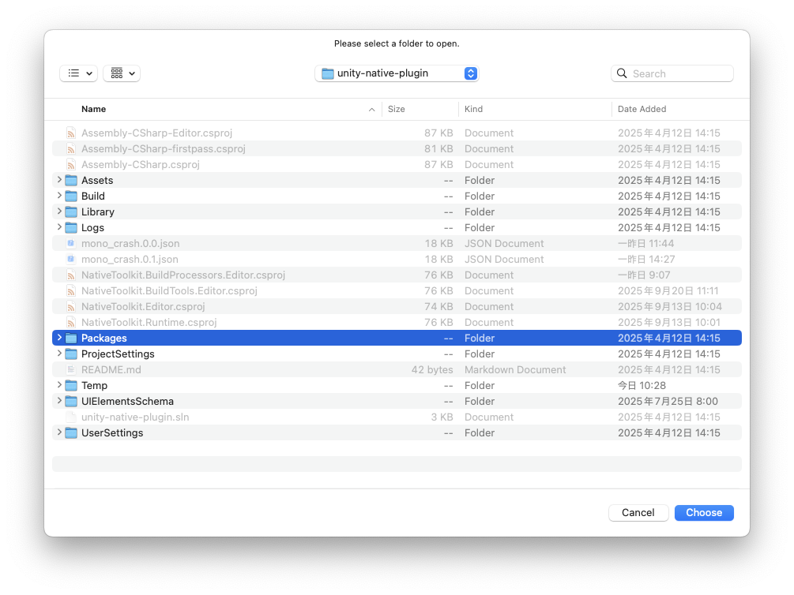
</p>
- 選択結果はイベントで受け取ります。

```csharp
// folderPaths: 選択されたフォルダパスの配列を取得します。エラーの場合、null を返します。
// folderCount: 返却されたフォルダ数を取得します。キャンセルされた場合は 0 です。
// directoryURL: 選択が行われたディレクトリ URL を取得します。エラーの場合、null を返します。
// isCancelled: ユーザがダイアログをキャンセルしたかどうかを取得します。
// isSuccess: ダイアログ表示成功のフラグを取得します。成功の場合、true を返します。
// errorMessage: エラーが発生した場合、エラー内容を取得します。成功の場合、null を返します。

private void OnFolderDialogResult(
  string[]? folderPaths,
  int folderCount,
  string? directoryURL,
  bool isCancelled,
  bool isSuccess,
  string? errorMessage
)
```

#### ShowMultiFolderDialog - 複数フォルダ選択ダイアログ

- 名前空間をインポートします。

```csharp
// 実行ガード: macOS (Player) のみ有効。Editor ではネイティブ呼び出しを行わないようにします。
#if UNITY_STANDALONE_OSX && !UNITY_EDITOR
using JonghyunKim.NativeToolkit.Runtime.Dialog;
#endif
```

- イベントを登録します。

```csharp
// 実行ガード: macOS (Player) のみ有効。Editor ではネイティブ呼び出しを行わないようにします。
#if UNITY_STANDALONE_OSX && !UNITY_EDITOR
MacDialogManager.Instance.MultiFolderDialogResult += OnMultiFolderDialogResult;
#endif
```

- ダイアログを表示します。

```csharp
// 実行ガード: macOS (Player) のみ有効。Editor ではネイティブ呼び出しを行わないようにします。
#if UNITY_STANDALONE_OSX && !UNITY_EDITOR
// タイトルを設定します。必須項目です。
string title = "Select folders";
// メッセージを設定します。未設定の場合、表示されません。
string message = "Please select folders to open.";
// 初期ディレクトリを設定します。未設定の場合、OS規定の値が使用されます。
string? directoryPath = null;
MacDialogManager.Instance.ShowMultiFolderDialog(
  title,
  message,
  directoryPath
);
#endif
```

<p align="center">
  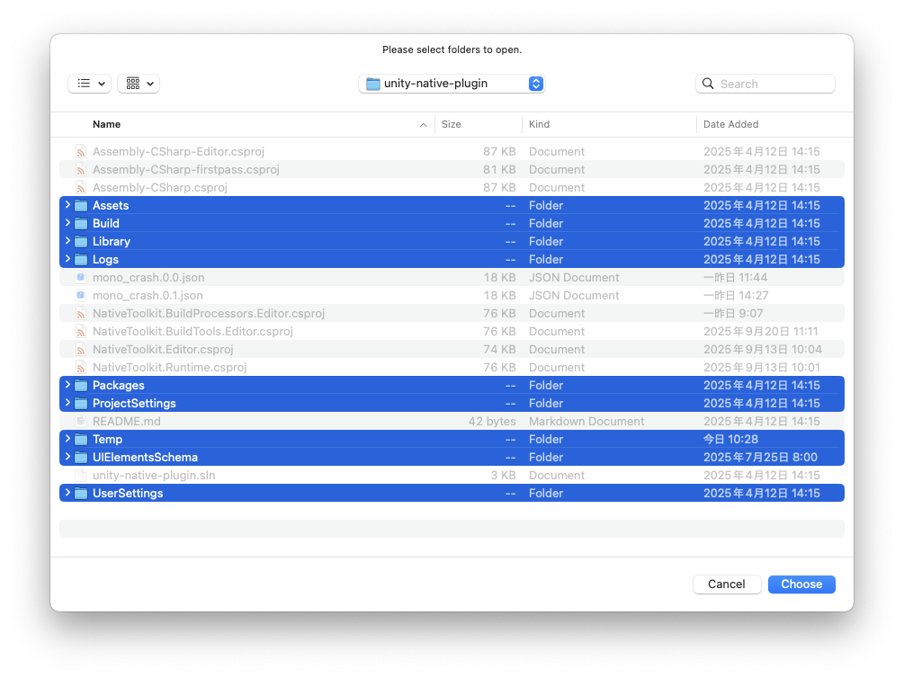
</p>
- 選択結果はイベントで受け取ります。

```csharp
// folderPaths: 選択されたフォルダパスの配列を取得します。エラーの場合、null を返します。
// folderCount: 返却されたフォルダ数を取得します。キャンセルされた場合は 0 です。
// directoryURL: 選択が行われたディレクトリ URL を取得します。エラーの場合、null を返します。
// isCancelled: ユーザがダイアログをキャンセルしたかどうかを取得します。
// isSuccess: ダイアログ表示成功のフラグを取得します。成功の場合、true を返します。
// errorMessage: エラーが発生した場合、エラー内容を取得します。成功の場合、null を返します。

private void OnMultiFolderDialogResult(
  string[]? folderPaths,
  int folderCount,
  string? directoryURL,
  bool isCancelled,
  bool isSuccess,
  string? errorMessage
)
```

#### ShowSaveFileDialog - ファイル保存ダイアログ

- 名前空間をインポートします。

```csharp
// 実行ガード: macOS (Player) のみ有効。Editor ではネイティブ呼び出しを行わないようにします。
#if UNITY_STANDALONE_OSX && !UNITY_EDITOR
using JonghyunKim.NativeToolkit.Runtime.Dialog;
#endif
```

- イベントを登録します。

```csharp
// 実行ガード: macOS (Player) のみ有効。Editor ではネイティブ呼び出しを行わないようにします。
#if UNITY_STANDALONE_OSX && !UNITY_EDITOR
MacDialogManager.Instance.SaveFileDialogResult += OnSaveFileDialogResult;
#endif
```

- ダイアログを表示します。

```csharp
// 実行ガード: macOS (Player) のみ有効。Editor ではネイティブ呼び出しを行わないようにします。
#if UNITY_STANDALONE_OSX && !UNITY_EDITOR
// タイトルを設定します。必須項目です。
string title = "Save File";
// メッセージを設定します。未設定の場合、表示されません。
string message = "Choose a destination";
// デフォルトのファイル名を設定します。未設定の場合、OS規定の値が使用されます。
string defaultFileName = "default";
// 許可するファイルの拡張子を設定します。未設定の場合、OS規定の値が使用されます。
string[] allowedContentTypes = { "txt" };
// 初期ディレクトリを設定します。未設定の場合、OS規定の値が使用されます。
string? directoryPath = null;
MacDialogManager.Instance.ShowSaveFileDialog(
  title,
  message,
  defaultFileName,
  allowedContentTypes,
  directoryPath
);
#endif
```

<p align="center">
  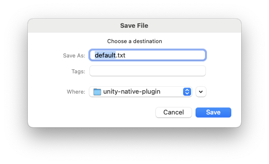
</p>
- 保存結果はイベントで受け取ります。

```csharp
// filePath: 保存先のファイルパスを取得します。キャンセルや失敗の場合は null を返します。
// fileCount: 返却されたパス数を取得します。成功時は 1、キャンセル時は 0 です。
// directoryURL: 保存が行われたディレクトリ URL を取得します。エラーの場合、null を返します。
// isCancelled: ユーザがダイアログをキャンセルしたかどうかを取得します。
// isSuccess: ダイアログ表示成功のフラグを取得します。成功の場合、true を返します。
// errorMessage: エラーが発生した場合、エラー内容を取得します。成功の場合、null を返します。

private void OnSaveFileDialogResult(
  string? filePath,
  int fileCount,
  string? directoryURL,
  bool isCancelled,
  bool isSuccess,
  string? errorMessage
)
```
