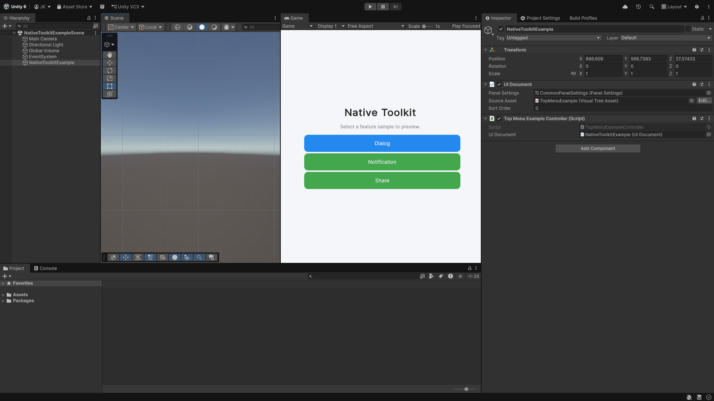
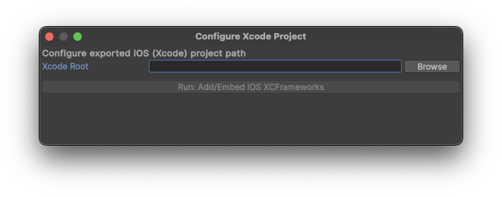
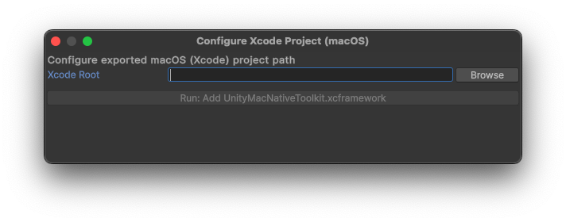

# Unity Native Toolkit (Unity 6)

[English](index.md) | [Korean](index.ko.md) | [Japanese](index.ja.md)

- A toolkit that provides native features for Unity 6+.
- The package includes native plugins and sample scenes for Android/iOS/Windows/macOS, and exposes native features such as dialogs, notifications, and sharing via singleton APIs per platform.
- On Android, the build adds the native libraries and their Gradle dependencies by itself. For iOS and macOS, editor windows add the native libraries to the built Xcode project.

# Version

## 1.13.0

# Supported OS Versions

- Android 12+
- iOS 18+
- Windows 11+
- macOS 15+

## Android requirements

- Scripting Backend: IL2CPP. Mono is not supported (Unity's Mono builds ARMv7 only on Android).
- Target Architectures: ARM64 (x86_64 also works). A build that also targets ARMv7 (32-bit) stops with a message before Gradle runs.
- Gradle: nothing to set up. The build adds the runtime dependencies of the native libraries to `unityLibrary/build.gradle`.

## Changes in 1.13.0 (Android)

Since 1.13.0 every Android feature runs on native-toolkit's C ABI 2.0.0. The Android types moved from `JonghyunKim.NativeToolkit.Runtime.<Feature>` to `JonghyunKim.NativeToolkit.Runtime.Android.<Feature>`, the Android types without the `Android` prefix were renamed, and the 1.x native libraries and "Configure Gradle Project" were removed. Unity does not update your scripts for you. What to change, per feature: [Dialog](dialog.md#changes-in-1130), [Notification](notification.md#changes-in-1130), [Share](share.md#changes-in-1130), [Clipboard](clipboard.md#changes-in-1130).

# Features

## Android

- Dialog features
  - Basic dialog
  - Confirmation dialog
  - Single choice dialog
  - Multi choice dialog
  - Text input dialog
  - Login dialog

- Notification features
  - Immediate notifications
  - Scheduled notifications
  - Progress foreground service
  - Notification actions
  - Full-screen notifications
  - Custom view notifications

- Share features
  - Share text / URL
  - Share image / multiple images
  - Share file / multiple files
  - Custom Chooser actions (API 34+)
  - Rich preview
  - Direct Share target registration
  - Share with callback
  - Cancel pending callback

- Clipboard features
  - Copy plain text / HTML text / URI / multiple text
  - Sensitive-content preview suppression (Android 13+)
  - Read clipboard content / check for a clip / get metadata without touching the clip body
  - Observe clipboard changes
  - Game use cases: invite codes, pasting a code, copying a screenshot

## iOS

- Dialog features
  - Basic dialog
  - Confirmation dialog
  - Destructive dialog
  - Action sheet
  - Text input dialog
  - Login dialog
- Notification features
  - Request permission / check authorization status / open notification settings
  - Immediate notifications (including attachment sample)
  - Scheduled notifications (time interval / calendar / location)
  - Update / cancel / remove delivered / fetch state
  - Badge count management
  - Category registration / actions / text input actions
- Share features
  - Share text / URL / URL with preview
  - Share image / multiple images
  - Share file / multiple files
  - Share text and URL together
  - Share with subject
  - Exclude specific activities from the share sheet
- Clipboard features
  - Copy plain text / HTML text / URL / image file / image data / color / custom data
  - Copy multiple text items and multi-representation items
  - Copy options: local only and expiration
  - Append items without replacing the content
  - Read items, read raw data by type, and take a snapshot without reading the content
  - Load an item as text, URL, image, or file, and cancel running loads
  - Detect data patterns and detected values in the pasteboard text
  - Named and unique pasteboards: create, use, and remove
  - Observe clipboard changes and check for a change on foreground return

## Windows

- Dialog features
  - Basic dialog
  - File picker dialog
  - Multi-file picker dialog
  - Folder picker dialog
  - Multi-folder picker dialog
  - Save file dialog

- Notification features
  - Immediate notifications
  - Scheduled notifications
  - Cancel scheduled notifications
  - Progress-bar notifications
  - Remove notifications by tag or remove all
  - Query notification permission setting
  - Open system notification settings
  - Notification activation events (including cold-start activation)

- Clipboard features
  - Copy plain text / HTML / files / image / custom format
  - Copy several formats in one write
  - Exclude a copy from clipboard history, from the cloud clipboard, or from both
  - Paste plain text / HTML / files / image / custom format
  - Inspect the available formats, the preferred one, and whether one is present
  - Deferred rendering: hand over a provider per format and build the bytes on demand
  - Clipboard history: read, restore, delete, clear unpinned, and cancel a request
  - Clipboard and history change events

## macOS

- Dialog features
  - Basic dialog
  - File picker dialog
  - Multi-file picker dialog
  - Folder picker dialog
  - Multi-folder picker dialog
  - Save file dialog

- Notification features
  - Request permission / check authorization status / open system notification settings
  - Immediate notifications
  - Scheduled notifications (time interval / calendar)
  - Update / cancel / remove delivered notifications
  - Fetch scheduled and delivered notification lists
  - Badge count management
  - Category registration / actions / text input actions

- Share features
  - Share text / URL
  - Share image / multiple images
  - Share file / multiple files
  - Share text and URL together
  - Share excluding services
  - Share via a named service (e.g. Mail)

- Clipboard features
  - Copy plain text / HTML / URL / custom data
  - Copy multiple items and multiple representations
  - Append to the clipboard with ownership
  - Read the clipboard, read one type, and take a snapshot without reading payloads
  - Detect patterns, values and metadata (macOS 15.4 or later)
  - Named and unique pasteboards
  - Observe clipboard changes and check for a change on foreground return
  - Local-only copies that stay off Universal Clipboard

# Getting Started

## Installation

- Open Unity 6.
- Window -> Package Manager.
- Select "install from Git URL...".
- Enter the Git URL for this package:
  - https://github.com/jonghyunkim/unity-native-plugin.git?path=/Packages/com.jonghyunkim.nativetoolkit#1.13.0
- Click "install".
- Requirements:
  - Unity 6+
  - Dependencies: Localization, Addressables, Input System

## Samples

- Open Unity 6.
- Window -> Package Manager.
- Unity Package Manager -> Native Toolkit -> Samples -> Import.
- Tools -> Native Toolkit -> Sample.
  

    
  

- Android sample
  - The sample UI appears in the Game view.
  - From Build Profiles, run "Android Profile" -> Export.
  - Install the sample app from Android Studio.
    - <a href="https://developer.android.com/studio" target="_blank" rel="noopener noreferrer">Reference</a>

- iOS sample
  - The sample UI appears in the Game view.
  - From Build Profiles, run "iOS Profile" -> Build.
  - Tools -> Native Toolkit -> iOS -> Configure Xcode Project.
  

    
  

  - Click "Browse" and select the built iOS project.
  - Click "Run: Add/Embed iOS XCFrameworks" to add NativeToolkit libraries.
  - Install the sample app from Xcode.
    - <a href="https://developer.apple.com/xcode" target="_blank" rel="noopener noreferrer">Reference</a>

- Windows sample
  - The sample UI appears in the Game view.
  - From Build Profiles, run "Windows Profile" -> Build.
  - Run "Unity NativeToolkit.exe" from the build output folder.

- macOS sample
  - The sample UI appears in the Game view.
  - From Build Profiles, run "macOS Profile" -> Build.
  - Tools -> Native Toolkit -> macOS -> Configure Xcode Project.
  

    
  

  - Click "Browse" and select the built macOS project.
  - Click "Run: Add UnityMacNativeToolkit.xcframework" to add NativeToolkit libraries.
  - Install the sample app from Xcode.
    - <a href="https://developer.apple.com/xcode" target="_blank" rel="noopener noreferrer">Reference</a>

# API Usage

- [Dialog](dialog.md)
- [Notification](notification.md)
- [Share](share.md)
- [Clipboard](clipboard.md)
