# 通知機能

言語:

- 日本語（このページ）
- English: [notification.md](notification.md)
- 한국어: [notification.ko.md](notification.ko.md)

← [マニュアルトップへ戻る](index.ja.md)

---

## 目次

- [Android](#android)
  - [1.13.0 での変更](#1130-での変更)
  - [セットアップ](#セットアップ)
  - [権限](#権限)
  - [チャンネル管理](#チャンネル管理)
  - [基本的な通知操作](#基本的な通知操作)
  - [通知スタイル](#通知スタイル)
  - [カスタムビュースタイル](#カスタムビュースタイル)
  - [インタラクション](#インタラクション)
  - [プログレス通知](#プログレス通知)
  - [フォアグラウンドサービス通知](#フォアグラウンドサービス通知)
  - [スケジュール通知](#スケジュール通知)
- [iOS](#ios)
  - [概要](#概要)
  - [サポート機能](#サポート機能)
    - [基本セットアップ](#基本セットアップ)
    - [即座通知を表示する](#即座通知を表示する)
    - [添付付き即座通知（アプリアイコン）](#添付付き即座通知アプリアイコン)
    - [スケジュール通知を登録する](#スケジュール通知を登録する)
    - [カテゴリ / アクションを登録する](#カテゴリ--アクションを登録する)
    - [イベントを受け取る](#イベントを受け取る)
- [Windows](#windows)
  - [1.12.0 での変更](#1120-での変更)
  - [セットアップ](#セットアップ-1)
  - [初期化](#初期化)
  - [通知を表示する](#通知を表示する)
  - [スケジュール通知](#スケジュール通知-2)
  - [進捗を更新する](#進捗を更新する)
  - [通知を削除する](#通知を削除する)
  - [クエリ](#クエリ-1)
  - [イベントを受け取る](#イベントを受け取る-1)
- [macOS](#macos)
  - [サポート機能](#サポート機能-1)
  - [基本セットアップ](#基本セットアップ-1)
  - [権限](#権限-1)
  - [通知を表示する](#通知を表示する)
  - [更新・キャンセル・削除](#更新キャンセル削除)
  - [スケジュール通知](#スケジュール通知-1)
  - [クエリ](#クエリ)
  - [バッジ](#バッジ)
  - [カテゴリとアクション](#カテゴリとアクション)
  - [イベントを受け取る](#イベントを受け取る-1)

---

## Android

### 1.13.0 での変更

1.13.0 から、Android の通知は 1.x の Kotlin のブリッジではなく、native-toolkit の C ABI 2.0.0 で動きます。`AndroidNotificationManager` のメソッド、イベント、定数は変わらず、今も `AndroidNotificationJsonBuilder` で組み立てた JSON を受け取り、1.12.0 と同じ規則で読みます。直すことと、1.12.0 との違いは次のとおりです。

#### コードの直し方

- Android のコードの `using JonghyunKim.NativeToolkit.Runtime.Notification;` を `using JonghyunKim.NativeToolkit.Runtime.Android.Notification;` に書き換えてください。iOS と macOS のコードの行はそのままにしてください（型は移っていません）。
- 下の表の型の名前を書き換えてください。Unity は自動では直しません。API Updater はこのパッケージの型への参照を書き換えないので、1.12.0 の名前のままのスクリプトはコンパイルに失敗します。このページの例のように `#if UNITY_ANDROID && !UNITY_EDITOR` の中に書いたコードは Editor ではコンパイルされないので、エラーは Android の Player をビルドしたときに初めて出ます。
- 1.12.0 の名前で `[SerializeReference]` に保存したデータは、新しい型として値ごと読み込まれます。改名した型は、1.12.0 の名前を `[MovedFrom]` で記録しています。

名前が変わった型です。`AndroidNotificationManager` と `AndroidNotificationJsonBuilder` は名前が変わらず、名前空間だけが移りました。

| 1.12.0 | 1.13.0 |
| --- | --- |
| `NotificationResult` | `AndroidNotificationResult` |
| `NotificationActionResult` | `AndroidNotificationActionResult` |
| `NotificationReceivedResult` | `AndroidNotificationReceivedResult` |
| `NotificationResourcePayload` | `AndroidNotificationResourcePayload` |
| `ChannelPayload` | `AndroidChannelPayload` |
| `NotificationPayload` | `AndroidNotificationPayload` |
| `NotificationActionPayload` | `AndroidNotificationActionPayload` |
| `ScheduledNotificationEnvelopePayload` | `AndroidScheduledNotificationEnvelopePayload` |
| `NotificationSchedulePayload` | `AndroidNotificationSchedulePayload` |
| `NotificationProgressPayload` | `AndroidNotificationProgressPayload` |
| `NotificationStylePayload` | `AndroidNotificationStylePayload` |
| `NotificationMessagePayload` | `AndroidNotificationMessagePayload` |
| `NotificationDataEntryPayload` | `AndroidNotificationDataEntryPayload` |
| `NotificationViewActionPayload` | `AndroidNotificationViewActionPayload` |

#### Android の全機能に共通の破壊的変更

- **1.x のネイティブライブラリを同梱しなくなりました。** `android-native-toolkit-1.3.0.aar` と `unity-android-native-toolkit-1.3.0.aar` を外しました。パッケージに入っているのは `android-native-toolkit-2.0.0.aar` と `android-native-toolkit-capi-2.0.0.aar`（native-toolkit の C ABI 2.0.0）です。これらのクラス（`android.unity.*`、`android.library.*`）を直接呼んでいたコードは動きません。
- **「Configure Gradle Project」は無くなりました。** メニューの Tools > Native Toolkit > Android > Configure Gradle Project と、そのウィンドウを削除しました。実行時に要るライブラリ（`kotlin-stdlib` 2.2.21、`kotlinx-coroutines-core` 1.9.0 を含む 7 つ）は、ビルドが `unityLibrary/build.gradle` に自分で足します。Kotlin の Gradle プラグインは適用しなくなりました。独自の Gradle のテンプレートや EDM4U を使っている場合は、版がぶつからないか確かめてください。
- **64 ビットと IL2CPP だけに対応します。** ARMv7（32 ビット）も含むビルドはメッセージを出して止まります。Mono には対応しません。[Android の要件](index.ja.md#android-の要件)を見てください。

#### 通知の変更

- **1.12.0 のために足した `<service>` の行を消してください。** 1.12.0 のマニュアルは、`AndroidManifest.xml` に `<service android:name="android.library.notification.presentation.progress.ProgressForegroundService" ... />` を足すよう案内していました。このクラスは 1.x のライブラリにあったもので、今はありません。この行を消してください。フォアグラウンドサービスはライブラリが自分のマニフェストで宣言するので、プログレス通知のためにアプリのマニフェストに書くものはありません。
- **権限が無いときの通知の表示は失敗になりました。** `POST_NOTIFICATIONS` の権限が無いとき（Android 13 以降）や、アプリの通知がオフのとき、`ShowNotification`、`UpdateNotification`、過ぎた時刻への `ScheduleNotification` は `NotificationOperationCompleted` で失敗を知らせます。1.12.0 は成功を知らせ、何も表示しませんでした。先に `HasPermission()` と `AreNotificationsEnabled()` を確かめるか、`RequestPermission` を呼んでください。
- **見つからないリソースの名前は失敗になりました。** アイコン、画像、レイアウト、ビューの ID は名前で指定し、通知を表示・更新・予約するとき、またはプログレスのメソッドに渡したときに探します。アプリに無い名前はその呼び出しを失敗させ、何も表示しません。1.12.0 はアプリのアイコンや既定のスタイルで代えていました。`AndroidNotificationResourcePayload` の `type` は使わなくなりました（アイコンと画像は `drawable`、次に `mipmap` から探します）。名前でしか参照されないリソースはリソースの縮小で消えることがあるので、`tools:keep` で残してください（[名前で指定するリソースを残す](#名前で指定するリソースを残す)）。
- **1.12.0 が保存した予約は消えます。** 1.13.0 でアプリが初めて起動したとき、ライブラリは 1.12.0 が保存した予約を読めないため、そのアラームを取り消して 1 回だけ削除します。更新の後に予約し直してください。`persistAcrossBoot = false` で作った 1.12.0 の予約は見つけられません。Android に残りますが、発火しても何も表示しません。
- **1.12.0 が表示した通知は反応しなくなります。** 更新の前に出した通知は通知シェードに残りますが、更新の後は本体をタップしてもボタンを押しても何も起きません（タップを受け取っていたクラスが無くなったため）。
- **`IsNotificationScheduled` が見るのは再起動の後も残る予約だけです。** 1.12.0 と同じく、`IsNotificationScheduled` と `CancelAllScheduledNotifications` は `persistAcrossBoot = true`（既定）で作った予約だけを見つけます。それ以外の予約は `CancelScheduledNotification` で ID を指定して取り消してください。

#### 1.12.0 との動作の違い

`{op}` は `showNotification` などの操作の名前です。

| 場面 | 1.12.0 | 1.13.0 |
| --- | --- | --- |
| 通知の権限が無い、またはアプリの通知がオフのときの表示、更新、過ぎた時刻への予約 | 成功（何も表示しない） | 失敗: `Failed to {op}: notifications are not allowed for this app (permission or app notification setting).` |
| アプリに無いリソースの名前（アイコン、画像、レイアウト、ビューの ID） | アプリのアイコン、項目の省略、既定のスタイルで代えた | 失敗: `Failed to {op}: a resource named in the notification was not found.` 何も表示しない |
| リソースの `type` | その種類だけを探した | 使わない。`drawable`、次に `mipmap`（レイアウトは `layout`、ビューの ID は `id`） |
| プラットフォームの範囲の外の値（`groupAlertBehavior`、`timestamp`、`timeoutAfter`、`semanticAction`、`alarmType`、振動の負の値、メッセージの負の時刻） | 検査せずに渡した | `Invalid argument for {op}: Please verify the input parameters.` |
| JSON の構文の誤り、`null` や空の JSON | `Failed to {op}:` と JSON パーサーの文言 | `Failed to {op}: the JSON could not be read.` |
| 緩い JSON（引用符の無いキー、単引用符、コメント） | 受け付けた | 構文の誤り |
| 型の違う JSON の値（文字列で書いた数など） | 変換した | 無いものとして扱う。整数の項目の小数は 0 の方向に切り捨てる |
| 文字列でない `data` の値、`lines` の中の `null` | 文字列にした（`null` は `"null"`） | 捨てる |
| `AndroidNotificationActionResult.Data` の値 | JSON のエスケープが残った（`a\"b`、`c\/d`） | 送ったとおりの値 |
| 本体のタップや、`launchApp` のアクション | アプリが前面に来なかった（Android 16 で確認） | アプリが開く |
| タップからアプリを開く Intent の action | アクション ID | 無い（ランチャーの Intent） |
| アプリを開く Intent のフラグ（タップとフルスクリーンインテント） | `NEW_TASK \| CLEAR_TOP` | `NEW_TASK \| RESET_TASK_IF_NEEDED` |
| Manager が無い間のタップ（アプリの起動前を含む） | 捨てた | 32 件まで保ち、Manager を初めて作った後のフレームで届く。`Instance` を初めて読んだフレームで `NotificationActionTapped` を購読する |
| Unity のメインスレッド以外からの呼び出し | `{op} could not be started.` | 受け付ける（`RequestPermission` と、`Instance` の最初の読み出しは今もメインスレッドで） |
| `OpenNotificationSettings` | アプリの詳細の画面に落ちた | アプリの通知の設定の画面を開く |
| アプリが背面にあるときに設定の画面を開く | 別のスレッドから呼ぶと（背面では Unity のメインスレッドが止まっている）、`{op} could not be started.` で失敗した | `Failed to {op}: the app is not in the foreground.` |
| アプリが背面にあるときのプログレスのメソッド | システムの例外の文言で失敗した | `Failed to {op}: the system did not allow the foreground service from the background.` |
| `DeleteChannel(null)` | `NullPointerException` の文言で失敗した | 成功（チャンネル `""` を消す） |
| 正確なアラームの権限が無く不正確にした予約の、再起動の後 | 権限があれば正確に戻した | 不正確のまま |
| Manager を破棄する前後に届く結果とイベント | 破棄した Manager で発生した | その時点で生きている Manager で発生し、無ければ捨てる |
| 1.12.0 が保存した予約 | 残った | 最初の起動で 1 回だけ取り消して削除する |
| 1.12.0 が表示した通知 | タップとボタンに反応した | 反応しない |
| Editor での型 | ビルドターゲットが Android のときだけあった | どのビルドターゲットでもある（Editor では今も操作は何もせず、開始できなかったと知らせる） |

変わらないもの: メソッド、イベント、`Operation*` と `Action*` の定数、JSON の形。正確なアラームの権限が無いときに、正確な予約を不正確にすること。1.12.0 の JSON の補正（たとえば 0〜4 の外の `importance` は 3 に、`priority` は -2〜2 に丸めます）。

### セットアップ

#### AndroidManifest.xml

使用する機能に必要な権限を追加します。

```xml
<!-- Android 13 以降で通知を送信するために必要 -->
<uses-permission android:name="android.permission.POST_NOTIFICATIONS" />

<!-- スケジュール通知（正確なアラーム）に必要 -->
<uses-permission android:name="android.permission.SCHEDULE_EXACT_ALARM" />
<uses-permission android:name="android.permission.RECEIVE_BOOT_COMPLETED" />

<!-- フォアグラウンドサービスに必要 -->
<uses-permission android:name="android.permission.FOREGROUND_SERVICE" />
<uses-permission android:name="android.permission.FOREGROUND_SERVICE_DATA_SYNC" />
```

#### 名前空間のインポート

```csharp
// 実行ガード: Android (Player) のみ有効。Editor ではネイティブ呼び出しを行わないようにします。
#if UNITY_ANDROID && !UNITY_EDITOR
using JonghyunKim.NativeToolkit.Runtime.Android.Notification;
#endif
```

> **注記:** `AndroidChannelPayload` / `AndroidNotificationPayload` などの DTO と `AndroidNotificationJsonBuilder` はランタイムに含まれています。`JsonUtility.ToJson(...)` ではなく、`AndroidNotificationJsonBuilder` を使うと optional フィールドや `data` を含む spec 準拠 JSON を組み立てられます。

#### 名前で指定するリソースを残す

通知のアイコン、画像、レイアウト、ビューの ID は名前で指定し、通知を表示・更新・予約するとき、またはプログレスのメソッドに渡したときに探します。アイコンと画像は `drawable`、次に `mipmap`、レイアウトは `layout`、ビューの ID は `id` から探します。`AndroidNotificationResourcePayload` の `type` は使いません。アプリに無い名前は、その呼び出しを `Failed to {op}: a resource named in the notification was not found.` で失敗させ、何も表示しません。

リソースの縮小は、名前でしか参照されないリソースを消します。ビルドでリソースを縮小する場合は、`tools:keep` で残してください。たとえば Android ライブラリのフォルダ（`Assets/Plugins/Android/com.jonghyunkim.nativetoolkit.androidlib/` など）の `res/raw/keep.xml` に書きます。

```xml
<resources xmlns:tools="http://schemas.android.com/tools"
    tools:keep="@drawable/my_image,@layout/nt_notification_custom_view_sample,@layout/nt_notification_custom_view_sample_expanded" />
```

---

### 権限

```csharp
#if UNITY_ANDROID && !UNITY_EDITOR
// 通知権限が付与されているか（Android 13 以降）
bool hasPermission = AndroidNotificationManager.Instance.HasPermission();

// アプリの通知が有効か
bool enabled = AndroidNotificationManager.Instance.AreNotificationsEnabled();

// 正確なアラームのスケジュールが許可されているか（Android 12 以降）
bool canSchedule = AndroidNotificationManager.Instance.CanScheduleExactAlarms();

// POST_NOTIFICATIONS 権限をリクエスト（Android 13 以降）
AndroidNotificationManager.Instance.RequestPermission(granted =>
{
    if (granted) { /* 権限が付与された */ }
});

// 設定画面を開く
AndroidNotificationManager.Instance.OpenNotificationSettings();
AndroidNotificationManager.Instance.OpenAppDetailsSettings();
AndroidNotificationManager.Instance.OpenExactAlarmSettings();
#endif
```

---

### チャンネル管理

通知を送信する前に、通知チャンネルを作成する必要があります。

#### チャンネルを作成する

```csharp
#if UNITY_ANDROID && !UNITY_EDITOR
string channelJson = AndroidNotificationJsonBuilder.BuildChannelJson(new AndroidChannelPayload
{
    id = "my_channel",
    name = "マイチャンネル",
    importance = 3,             // 3 = DEFAULT
    description = "サンプル通知チャンネル",
    showBadge = true,
    enableLights = true,
    lightColor = unchecked((int)0xFF4CAF50),
    enableVibration = true,
    vibrationPattern = new long[] { 0, 250, 200, 250 },
    lockscreenVisibility = 1,   // 1 = PUBLIC
    groupId = "my_group",
    groupName = "マイグループ"
});

AndroidNotificationManager.Instance.CreateChannel(channelJson);
#endif
```

チャンネルの重要度レベル:

| 値  | レベル  | 説明                     |
| --- | ------- | ------------------------ |
| 1   | MIN     | 音なし、ヘッドアップなし |
| 2   | LOW     | 音なし                   |
| 3   | DEFAULT | 音あり                   |
| 4   | HIGH    | 音あり＋ヘッドアップ     |

#### チャンネルを削除する

```csharp
#if UNITY_ANDROID && !UNITY_EDITOR
AndroidNotificationManager.Instance.DeleteChannel("my_channel");
#endif
```

#### イベントで結果を受け取る

```csharp
#if UNITY_ANDROID && !UNITY_EDITOR
AndroidNotificationManager.Instance.NotificationOperationCompleted += OnOperationCompleted;
#endif

private void OnOperationCompleted(AndroidNotificationResult result)
{
    // result.Operation    — どの操作が完了したかを示す
    // result.IsSuccess    — 成功の場合 true
    // result.ErrorMessage — 失敗の場合に非 null
}
```

---

### 基本的な通知操作

#### 表示

```csharp
#if UNITY_ANDROID && !UNITY_EDITOR
string notificationJson = AndroidNotificationJsonBuilder.BuildNotificationJson(new AndroidNotificationPayload
{
    id = 1101,
    title = "エネルギー回復",
    message = "あなたの部隊は完全に回復しました。すぐに次のレイドへ戻れます。",
    tag = "energy",
    channel = CreateGameplayChannelReference(),
    smallIcon = CreateUnityAppIconResource(),
    largeIcon = CreateUnityAppIconResource(),
    subText = "レイド準備完了",
    autoCancel = true,
    priority = 1,
    category = "recommendation",
    ticker = "Energy refilled",
    number = 3,
    style = new AndroidNotificationStylePayload
    {
        type = "bigText",
        bigText = "あなたの部隊は完全に回復しました。スタミナ上限があふれる前に次のレイドへ戻りましょう。",
        bigContentTitle = "エネルギー回復",
        summaryText = "レイド準備完了"
    }
});

AndroidNotificationManager.Instance.ShowNotification(notificationJson);
#endif
```

<p align="center">
    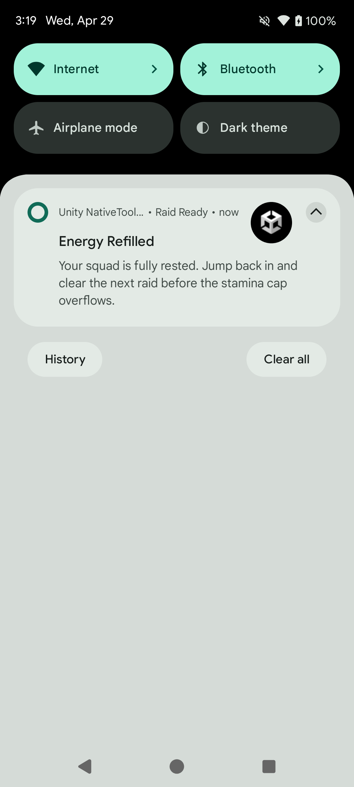
</p>

> **注意:** 通知ペイロードの `channel` フィールドは、チャンネルが存在しない場合に作成するために使用されます。既に作成済みのチャンネルには `id` と `name` のみ渡すことができます。

> **注意:** これらのコード例は、`AndroidNotificationManagerExampleController` と同じ `CreateGameplayChannelReference()` と `CreateUnityAppIconResource()` をそのまま使う形にそろえています。

> **注意:** `POST_NOTIFICATIONS` の権限が無いとき（Android 13 以降）や、アプリの通知がオフのとき、`ShowNotification` と `UpdateNotification` は失敗し、`NotificationOperationCompleted` に `Failed to {op}: notifications are not allowed for this app (permission or app notification setting).` が届きます。先に `HasPermission()` と `AreNotificationsEnabled()` を確かめてください。

#### 更新

同じ `id` / `tag` のペイロードを渡すと、表示中の通知を上書きします。

```csharp
#if UNITY_ANDROID && !UNITY_EDITOR
string updatedNotificationJson = AndroidNotificationJsonBuilder.BuildNotificationJson(new AndroidNotificationPayload
{
    id = 1101,
    title = "デイリー報酬の受け取り準備完了",
    message = "ログイン継続報酬のチェストが街で待っています。",
    tag = "energy",
    channel = CreateGameplayChannelReference(),
    smallIcon = CreateUnityAppIconResource(),
    largeIcon = CreateUnityAppIconResource(),
    subText = "街の報酬",
    autoCancel = true,
    priority = 1,
    style = new AndroidNotificationStylePayload
    {
        type = "bigPicture",
        picture = CreateUnityAppIconResource(),
        largeIcon = CreateUnityAppIconResource(),
        hideExpandedLargeIcon = false,
        bigText = "ログイン継続報酬のチェストが街で待っています。今受け取って報酬倍率を維持しましょう。",
        bigContentTitle = "デイリー報酬の受け取り準備完了",
        summaryText = "街の報酬"
    }
});

AndroidNotificationManager.Instance.UpdateNotification(updatedNotificationJson);
#endif
```

<p align="center">
    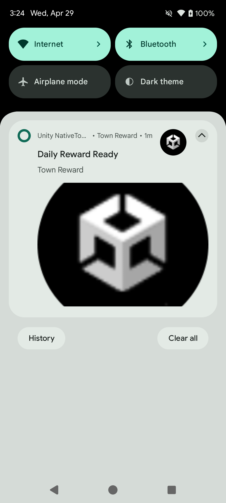
</p>

#### キャンセル

```csharp
#if UNITY_ANDROID && !UNITY_EDITOR
// 特定の通知をキャンセル
AndroidNotificationManager.Instance.CancelNotification(1001);
AndroidNotificationManager.Instance.CancelNotification(1001, "energy");

// すべての通知をキャンセル
AndroidNotificationManager.Instance.CancelAllNotifications();
#endif
```

---

### 通知スタイル

通知ペイロードの `style` フィールドを設定します。

#### デフォルト

```csharp
// style フィールドなし — 標準の通知として表示されます。
```

#### BigText

展開時に長いテキストを表示します。

```csharp
style = new AndroidNotificationStylePayload
{
    type = "bigText",
    bigText = "展開時に表示される長い本文テキストです。",
    bigContentTitle = "展開時のタイトル",
    summaryText = "サマリー"
}
```

#### Inbox

展開時に複数行をリスト形式で表示します。`lines` に各行を配列で渡します。

```csharp
style = new AndroidNotificationStylePayload
{
    type = "inbox",
    lines = new[] { "項目 1", "項目 2", "項目 3" },
    bigContentTitle = "展開時のタイトル",
    summaryText = "3 件"
}
```

#### BigPicture

展開時に画像を表示します。`picture` に画像リソース参照を渡します。

```csharp
style = new AndroidNotificationStylePayload
{
    type = "bigPicture",
    picture = new AndroidNotificationResourcePayload { name = "my_image", type = "drawable" },
    bigContentTitle = "展開時のタイトル",
    summaryText = "画像の説明"
}
```

---

### カスタムビュースタイル

カスタム Android レイアウトを使用して通知を表示します。

#### DecoratedCustomView

折りたたみ・展開用のレイアウトリソース名を指定します。レイアウト XML は `Assets/Plugins/Android/com.jonghyunkim.nativetoolkit.androidlib/res/layout/` に配置します（リソース名の衝突を避けるため `nt_` プレフィックスを使用）。

```csharp
#if UNITY_ANDROID && !UNITY_EDITOR
string notificationJson = AndroidNotificationJsonBuilder.BuildNotificationJson(new AndroidNotificationPayload
{
    id = 1601,
    title = "カスタムレイアウト通知",
    message = "展開してカスタムビューを確認し、Dismiss を押してください。",
    channel = CreateGameplayChannelReference(),
    smallIcon = CreateUnityAppIconResource(),
    autoCancel = true,
    style = new AndroidNotificationStylePayload
    {
        type = "decoratedCustomView",
        customViewLayout = "nt_notification_custom_view_sample",         // 折りたたみレイアウト
        bigCustomViewLayout = "nt_notification_custom_view_sample_expanded", // 展開レイアウト（任意）
        viewActions = new[]
        {
            new AndroidNotificationViewActionPayload
            {
                type = "setClickIntent",
                viewId = "nt_notification_btn_dismiss",  // レイアウト内のビュー ID
                actionId = "com.jonghyunkim.nativetoolkit.ACTION_CUSTOM_VIEW_DISMISS"  // NotificationActionTapped で受信
            }
        }
    }
});

AndroidNotificationManager.Instance.ShowNotification(notificationJson);
#endif
```

<p align="center">
    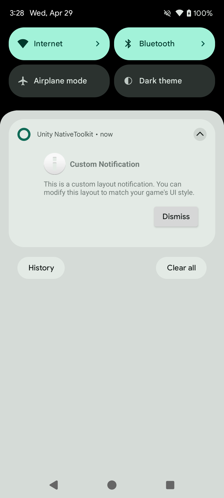
</p>

> **注意:** `RemoteViews` の制約により、クリック可能な要素には `Button` ではなく `LinearLayout` + `TextView` を使用してください。

---

### インタラクション

#### NotificationOperationCompleted イベント

各操作（表示、キャンセル、スケジュールなど）の完了後に発火します。

```csharp
#if UNITY_ANDROID && !UNITY_EDITOR
AndroidNotificationManager.Instance.NotificationOperationCompleted += OnOperationCompleted;
#endif

private void OnOperationCompleted(AndroidNotificationResult result)
{
    // result.Operation    — 例: AndroidNotificationManager.OperationShowNotification
    // result.IsSuccess    — 成功の場合 true
    // result.ErrorMessage — 失敗の場合に非 null
}
```

操作定数:

| 定数                                                                    | 説明                                     |
| ----------------------------------------------------------------------- | ---------------------------------------- |
| `AndroidNotificationManager.OperationShowNotification`                  | `ShowNotification` 完了                  |
| `AndroidNotificationManager.OperationUpdateNotification`                | `UpdateNotification` 完了                |
| `AndroidNotificationManager.OperationCancelNotification`                | `CancelNotification` 完了                |
| `AndroidNotificationManager.OperationCancelAllNotifications`            | `CancelAllNotifications` 完了            |
| `AndroidNotificationManager.OperationScheduleNotification`              | `ScheduleNotification` 完了              |
| `AndroidNotificationManager.OperationCancelScheduledNotification`       | `CancelScheduledNotification` 完了       |
| `AndroidNotificationManager.OperationCancelAllScheduledNotifications`   | `CancelAllScheduledNotifications` 完了   |
| `AndroidNotificationManager.OperationStartProgressForegroundService`    | `StartProgressForegroundService` 完了    |
| `AndroidNotificationManager.OperationUpdateProgressForegroundService`   | `UpdateProgressForegroundService` 完了   |
| `AndroidNotificationManager.OperationCompleteProgressForegroundService` | `CompleteProgressForegroundService` 完了 |
| `AndroidNotificationManager.OperationStopProgressForegroundService`     | `StopProgressForegroundService` 完了     |

#### NotificationActionTapped イベント

ユーザーが通知本体、アクションボタン、または通知を削除したときに発火します。

```csharp
#if UNITY_ANDROID && !UNITY_EDITOR
AndroidNotificationManager.Instance.NotificationActionTapped += OnActionTapped;
#endif

private void OnActionTapped(AndroidNotificationActionResult result)
{
    bool isBodyTap = result.ActionId == AndroidNotificationManager.ActionBodyTap;
    bool isDismiss = result.ActionId == AndroidNotificationManager.ActionNotificationDismissed;

    // result.NotificationId — 通知 ID
    // result.ActionId       — アクション識別子
    // result.Data           — Dictionary<string, string> カスタムデータ（null の場合あり）
}
```

カスタムデータを送信するには、`data` エントリを追加して `AndroidNotificationJsonBuilder` に渡します:

```csharp
payload.data = new[]
{
    new AndroidNotificationDataEntryPayload { key = "screen", value = "battle" },
    new AndroidNotificationDataEntryPayload { key = "matchId", value = "match_5678" }
};

string json = AndroidNotificationJsonBuilder.BuildNotificationJson(payload);
```

#### NotificationReceived イベント

スケジュール通知がアプリのフォアグラウンド中に発火したときに受信します。

```csharp
#if UNITY_ANDROID && !UNITY_EDITOR
AndroidNotificationManager.Instance.NotificationReceived += OnNotificationReceived;
#endif

private void OnNotificationReceived(AndroidNotificationReceivedResult result)
{
    // result.NotificationId — 通知 ID
    // result.Tag            — タグ（null の場合あり）
    // result.ChannelId      — チャンネル ID
}
```

#### アクションボタン

通知にアクションボタンを追加します。

```csharp
AndroidNotificationPayload payload = new AndroidNotificationPayload
{
    id = 1401,
    title = "マッチ成立",
    message = "ランクマッチの準備ができました。30 秒以内に参加してください。",
    channel = CreateGameplayChannelReference(),
    smallIcon = CreateUnityAppIconResource(),
    autoCancel = true,
    priority = 1,
    launchAction = "open_battle_screen",
    actions = new[]
    {
        new AndroidNotificationActionPayload
        {
            title = "今すぐプレイ",
            actionId = "com.jonghyunkim.nativetoolkit.ACTION_PLAY_NOW",
            icon = CreateUnityAppIconResource(),
            launchApp = true,
            showsUserInterface = true
        },
        new AndroidNotificationActionPayload
        {
            title = "閉じる",
            actionId = "com.jonghyunkim.nativetoolkit.ACTION_DISMISS",
            launchApp = false,
            showsUserInterface = false
        }
    },
    data = new[]
    {
        new AndroidNotificationDataEntryPayload { key = "screen", value = "battle" },
        new AndroidNotificationDataEntryPayload { key = "matchId", value = "match_5678" }
    }
};

string notificationJson = AndroidNotificationJsonBuilder.BuildNotificationJson(payload);
```

<p align="center">
    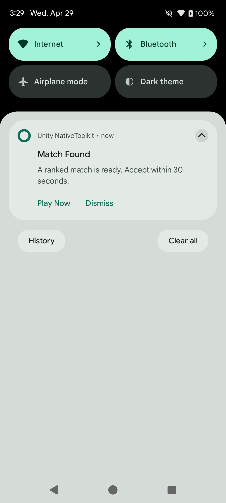
</p>

#### フルスクリーンインテント

デバイスがロック中またはスリープ中にフルスクリーンアクティビティを起動します（アラームや着信通知など）。`fullScreenIntent = true` を設定し、高優先度チャンネル（`importance = 4`）を使用します。

```csharp
new AndroidNotificationPayload
{
    id = 1501,
    title = "マッチ開始",
    message = "マッチが今すぐ始まります。ゲーム画面を起動します。",
    channel = CreateGameplayChannelReference(),
    smallIcon = CreateUnityAppIconResource(),
    priority = 2,
    category = "call",
    fullScreenIntent = true,
    autoCancel = true
}
```

<p align="center">
    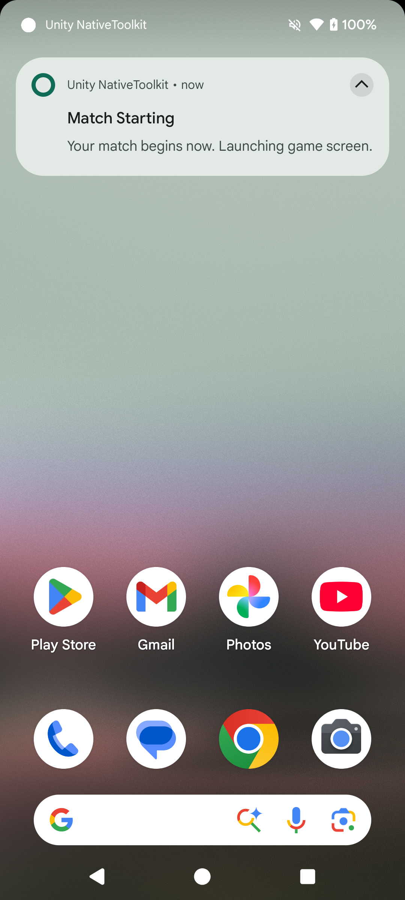
</p>

> **注意:** デバイスの状態や Android のポリシーによっては、フルスクリーンではなくヘッドアップ通知として表示される場合があります。

---

### プログレス通知

ダウンロードや長時間処理のプログレスバーを表示します。

```csharp
#if UNITY_ANDROID && !UNITY_EDITOR
// 確定的プログレスバーで開始
AndroidNotificationManager.Instance.StartProgressForegroundService(AndroidNotificationJsonBuilder.BuildNotificationJson(new AndroidNotificationPayload
{
    id = 1301,
    title = "ギルドバトル用アセットをダウンロード中",
    message = "次のマッチに向けてアリーナを準備しています。",
    channel = CreateGameplayChannelReference(),
    smallIcon = CreateUnityAppIconResource(),
    ongoing = true,
    autoCancel = false,
    progress = new AndroidNotificationProgressPayload { max = 100, current = _currentProgressValue, indeterminate = false },
    style = new AndroidNotificationStylePayload
    {
        type = "bigText",
        bigText = "次のマッチに向けてアリーナを準備しています。アセットのダウンロードが終わるまでアプリを終了しないでください。",
        bigContentTitle = "ギルドバトル用アセットをダウンロード中",
        summaryText = "バックグラウンドダウンロード"
    }
}));

// プログレスを更新
AndroidNotificationManager.Instance.UpdateProgressForegroundService(AndroidNotificationJsonBuilder.BuildNotificationJson(new AndroidNotificationPayload
{
    id = 1301,
    title = "レジェンダリー装備を鍛造中",
    message = "鍛冶場が最大出力で稼働しています。",
    channel = CreateGameplayChannelReference(),
    smallIcon = CreateUnityAppIconResource(),
    ongoing = true,
    autoCancel = false,
    onlyAlertOnce = true,
    progress = new AndroidNotificationProgressPayload { max = 100, current = progressValue, indeterminate = false },
    style = new AndroidNotificationStylePayload
    {
        type = "bigText",
        bigText = "鍛冶場が最大出力で稼働しています。完成したらすぐ装備できるよう準備してください。",
        bigContentTitle = "レジェンダリー装備を鍛造中",
        summaryText = "鍛造アップデート"
    }
}));

// 完了 — サービスを停止して通常の通知に降格
AndroidNotificationManager.Instance.CompleteProgressForegroundService(AndroidNotificationJsonBuilder.BuildNotificationJson(new AndroidNotificationPayload
{
    id = 1301,
    title = "鍛造完了",
    message = "レジェンダリーソードの受け取り準備ができました。",
    channel = CreateGameplayChannelReference(),
    smallIcon = CreateUnityAppIconResource(),
    ongoing = false,
    autoCancel = true,
    progress = new AndroidNotificationProgressPayload { max = 100, current = 100, indeterminate = false },
    style = new AndroidNotificationStylePayload
    {
        type = "bigText",
        bigText = "レジェンダリーソードの受け取り準備ができました。次の戦闘前に鍛冶場へ戻って装備しましょう。",
        bigContentTitle = "鍛造完了",
        summaryText = "鍛造完了"
    }
}));

// 強制停止 — 通知も削除
AndroidNotificationManager.Instance.StopProgressForegroundService();
#endif
```

<p align="center">
    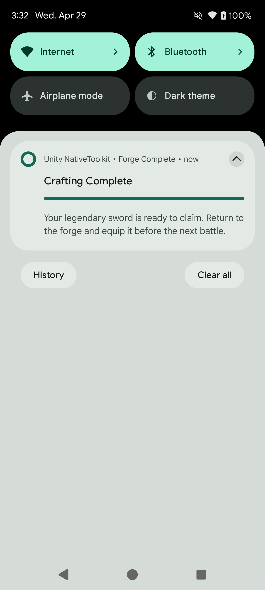
</p>

---

### フォアグラウンドサービス通知

フォアグラウンドサービス（種類は `dataSync`）はライブラリが自分のマニフェストで宣言するので、`<service>` の行を足す必要はありません。1.12.0 のために足した行は消してください（[1.13.0 での変更](#1130-での変更)）。

`StartProgressForegroundService`、`UpdateProgressForegroundService`、`CompleteProgressForegroundService`、`StopProgressForegroundService` の使い方は[プログレス通知](#プログレス通知)を参照してください。

---

### スケジュール通知

指定した時刻に自動的に通知を表示します。

```csharp
#if UNITY_ANDROID && !UNITY_EDITOR
long triggerTime = DateTimeOffset.UtcNow.AddSeconds(15).ToUnixTimeMilliseconds();

string scheduleJson = AndroidNotificationJsonBuilder.BuildScheduledNotificationJson(new AndroidScheduledNotificationEnvelopePayload
{
    notification = new AndroidNotificationPayload
    {
        id = 1201,
        title = "ギルドバトル間もなく開始",
        message = "チームキューが15秒後にオープンします。ギルドメンバーを集めて出撃準備をしてください。",
        tag = "guild-battle",
        channel = CreateGameplayChannelReference(),
        smallIcon = CreateUnityAppIconResource(),
        autoCancel = true,
        priority = 1,
        groupKey = "guild-events",
        sortKey = "001",
        style = new AndroidNotificationStylePayload
        {
            type = "bigText",
            bigText = "チームキューが15秒後にオープンします。ロードアウトを最終確認し、出撃準備を整えてください。",
            bigContentTitle = "ギルドバトル間もなく開始",
            summaryText = "ギルドイベント"
        }
    },
    schedule = new AndroidNotificationSchedulePayload
    {
        triggerAtMillis = triggerTime,
        exact = true,           // 正確なアラーム（SCHEDULE_EXACT_ALARM が必要）
        allowWhileIdle = true,  // Doze モード中でも発火
        persistAcrossBoot = true,
        alarmType = 0           // RTC_WAKEUP
    }
});

AndroidNotificationManager.Instance.ScheduleNotification(scheduleJson);
#endif
```

<p align="center">
    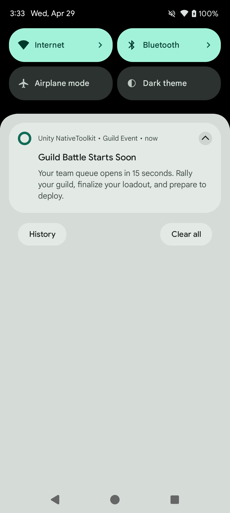
</p>

#### スケジュール通知をキャンセルする

```csharp
#if UNITY_ANDROID && !UNITY_EDITOR
AndroidNotificationManager.Instance.CancelScheduledNotification(1201, "guild-battle");
AndroidNotificationManager.Instance.CancelAllScheduledNotifications();
#endif
```

#### スケジュール状態を確認する

```csharp
#if UNITY_ANDROID && !UNITY_EDITOR
bool isScheduled = AndroidNotificationManager.Instance.IsNotificationScheduled(1201, "guild-battle");
#endif
```

> **注意:** `IsNotificationScheduled` と `CancelAllScheduledNotifications` が見るのは、`persistAcrossBoot = true`（既定）で作った予約だけです。`persistAcrossBoot = false` で作った予約は、`CancelScheduledNotification` で ID を指定して取り消してください。

---

## iOS

### 概要

iOS 通知は `IosNotificationManager` を通じて利用します。サンプル画面では、権限リクエスト、即座通知、添付付き通知、スケジュール通知、カテゴリ/アクション、バッジ操作まで確認できます。

#### サポート機能

- 通知権限リクエスト / 権限状態確認 / 設定画面遷移
- 即座通知（添付ファイル付き通知を含む）
- スケジュール通知（時間間隔 / カレンダー / 位置情報）
- 通知更新 / キャンセル / 配信済み削除 / 一覧取得
- バッジ数設定
- カテゴリ登録 / 通知アクション / テキスト入力アクション

#### 基本セットアップ

```csharp
#if UNITY_IOS && !UNITY_EDITOR
IosNotificationManager.Instance.RequestPermission(result =>
{
    if (result.IsSuccess)
    {
        Debug.Log("iOS notification permission granted");
    }
    else
    {
        Debug.LogError($"Permission failed: {result.ErrorMessage}");
    }
});

IosNotificationManager.Instance.GetAuthorizationStatus(status =>
{
    Debug.Log($"Authorization status: {status}");
});
#endif
```

<a id="ios-basic-setup-sample"></a>

<p align="center">
    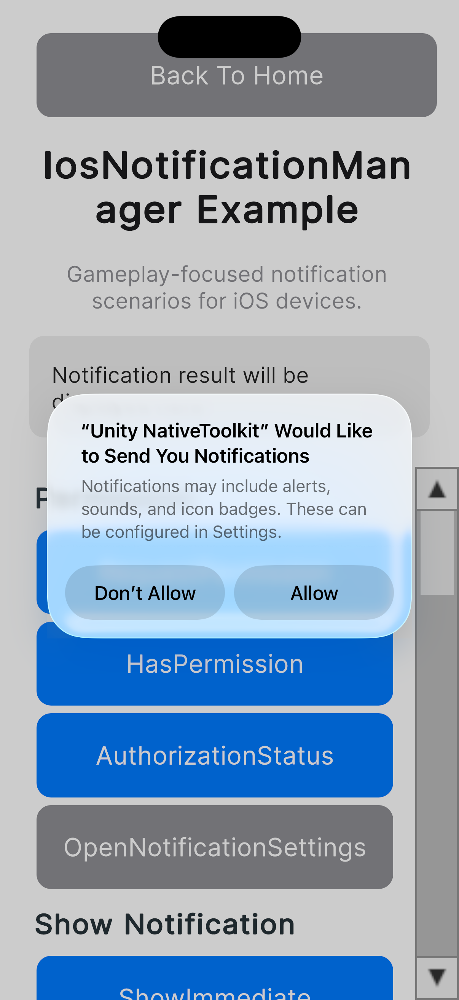
</p>

#### 即座通知を表示する

```csharp
#if UNITY_IOS && !UNITY_EDITOR
var content = new NotificationContentPayload
{
    id = "sample-notification",
    title = "Energy Refilled",
    body = "Your squad is fully rested. Jump back in and clear the next raid.",
    sound = "default",
    categoryIdentifier = "sample-category"
};

var contentJson = IosNotificationJsonBuilder.BuildContentJson(content);
IosNotificationManager.Instance.ShowNotification(contentJson, null, result =>
{
    Debug.Log($"ShowNotification: {result.IsSuccess}");
});
#endif
```

<a id="ios-show-immediate-sample"></a>

<p align="center">
    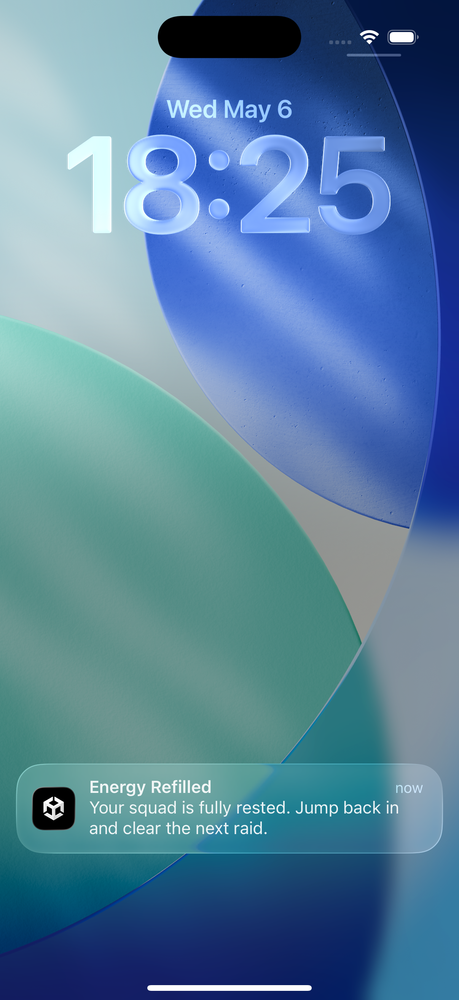
</p>

#### 添付付き即座通知（アプリアイコン）

```csharp
#if UNITY_IOS && !UNITY_EDITOR
var content = new NotificationContentPayload
{
    id = "sample-notification",
    title = "Immediate Notification with Attachment",
    body = "Displayed with app icon attachment.",
    sound = "default",
    attachments = new[]
    {
        new NotificationAttachmentPayload
        {
            identifier = "app-icon",
            fileURL = appIconFileUrl
        }
    }
};

var contentJson = IosNotificationJsonBuilder.BuildContentJson(content);
IosNotificationManager.Instance.ShowNotification(contentJson, null, null);
#endif
```

<a id="ios-show-attachment-sample"></a>

<p align="center">
    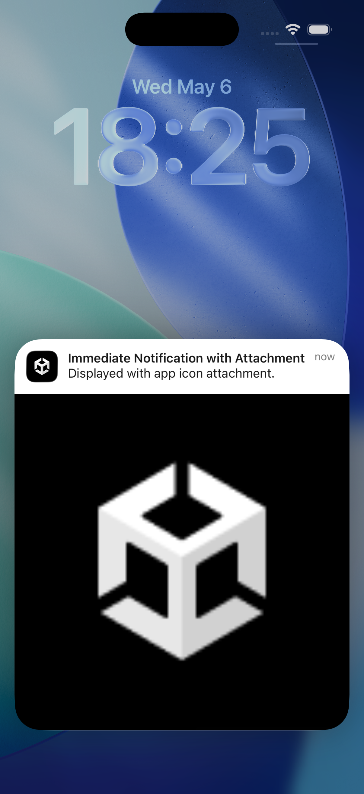
</p>

#### スケジュール通知を登録する

```csharp
#if UNITY_IOS && !UNITY_EDITOR
var content = new NotificationContentPayload
{
    id = "scheduled-notification",
    title = "Guild Battle Starts Soon",
    body = "Battle queue opens in 10 seconds. Finalize your loadout and deploy.",
    sound = "default"
};

var trigger = new TimeIntervalTriggerPayload
{
    repeats = false,
    interval = 10.0
};

string contentJson = IosNotificationJsonBuilder.BuildContentJson(content);
string triggerJson = IosNotificationJsonBuilder.BuildTimeIntervalTriggerJson(trigger);

IosNotificationManager.Instance.ScheduleNotification(
    contentJson,
    triggerJson,
    "scheduled-notification",
    result => Debug.Log($"ScheduleNotification: {result.IsSuccess}"));
#endif
```

<a id="ios-schedule-sample"></a>

<p align="center">
    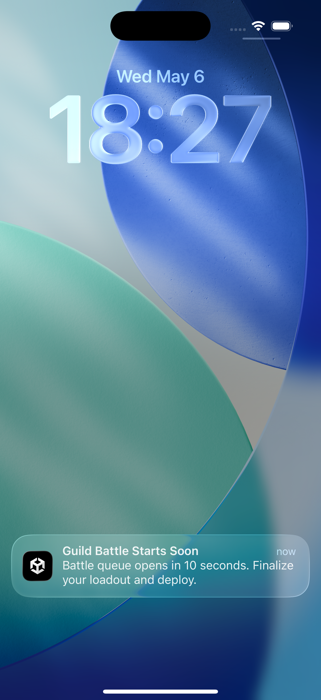
</p>

カレンダー通知は `CalendarTriggerPayload`、位置情報通知は `LocationTriggerPayload` を使って同様に登録できます。

#### カテゴリ / アクションを登録する

```csharp
#if UNITY_IOS && !UNITY_EDITOR
var category = new IosNotificationCategoryPayload
{
    identifier = "sample-category",
    actions = new[]
    {
        new IosNotificationActionPayload
        {
            identifier = "open",
            title = "Open",
            options = new[] { "foreground" }
        }
    },
    textInputActions = new[]
    {
        new IosNotificationTextInputActionPayload
        {
            identifier = "reply",
            title = "Reply",
            buttonTitle = "Send",
            textInputPlaceholder = "Type a message"
        }
    }
};

string categoryJson = IosNotificationJsonBuilder.BuildCategoryJson(category);
IosNotificationManager.Instance.RegisterCategory(categoryJson, null);
#endif
```

<a id="ios-category-sample"></a>

<p align="center">
    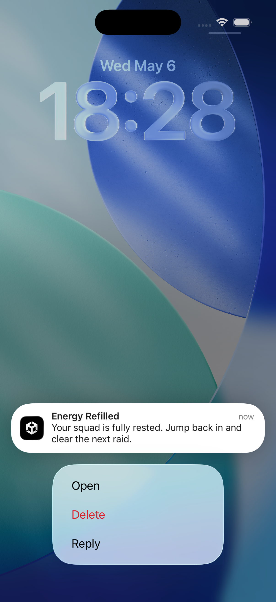
</p>

#### イベントを受け取る

```csharp
#if UNITY_IOS && !UNITY_EDITOR
IosNotificationManager.Instance.NotificationOperationCompleted += result =>
{
    Debug.Log($"Operation={result.Operation}, Success={result.IsSuccess}");
};

IosNotificationManager.Instance.NotificationActionReceived += result =>
{
    Debug.Log($"Action={result.ActionId}, Notification={result.NotificationId}");
};

IosNotificationManager.Instance.NotificationTextInputActionReceived += result =>
{
    Debug.Log($"TextInput={result.UserText}");
};
#endif
```

<a id="ios-events-sample"></a>

<p align="center">
    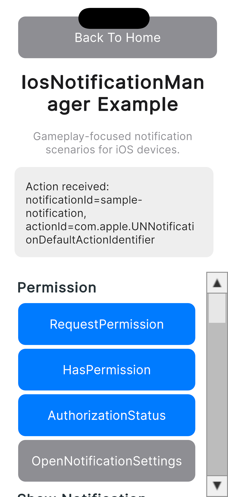
</p>

---

## Windows

Windows 通知は `WindowsNotificationManager` を通じて提供されます。サンプルシーンでは、初期化、即時通知、スケジュール通知、進捗バー通知、通知の削除、通知許可のクエリを、Unity でビルドされたアンパッケージ Win32 アプリ上でデモします。

### 1.12.0 での変更

1.12.0 から、Windows の通知は native-toolkit の C ABI 2.0.0（`windows-native-toolkit-capi-2.0.0.dll`）で動きます。メソッド、イベント、JSON のペイロードとその単位は変わりません。1.11.0 との違いは次のとおりです。

- **名前空間。** `WindowsNotificationManager` と、ペイロード・ビルダー・結果の型は `JonghyunKim.NativeToolkit.Runtime.Windows.Notification` にあります。Windows のコードの `using JonghyunKim.NativeToolkit.Runtime.Notification;` を書き換えてください。iOS / macOS の型の名前空間は変わりません。Android の型は 1.13.0 で `JonghyunKim.NativeToolkit.Runtime.Android.Notification` に移りました（[1.13.0 での変更](#1130-での変更)）。
- **クリックが届くようになりました。** パッケージ化していないアプリ（Unity の Windows スタンドアロンビルドはすべてこれ）で、アプリが動いている間に通知やそのボタンをクリックすると、`NotificationInvoked` が発生します。1.11.0 ではクリックが届きませんでした。アプリが動いていないときにクリックするとアプリが起動し、`Initialize` の後にクリックが 1 回届きます。
- **登録。** `Initialize` は `HKCU\Software\Classes\AppUserModelId\<displayName>\CustomActivator` も書き込み、これによってクリックがこの実行ファイルに届きます。**同じ `displayName` を使うアプリどうしはクリックを奪い合います。** ビルドごとに別の表示名にしてください。
- **エラーコード `-4`**（「Native library unavailable」）。`Initialize` だけが返します。ネイティブライブラリが無い、関数が無い、読み込めない、または C ABI 2.x でないときです。Manager は作られないので、以後の操作は `1` で失敗します。
- **Editor。** Editor では、Windows の通知の API は何もせず、何も報告しません。

| 場面 | 1.11.0 | 1.12.0 |
| --- | --- | --- |
| JSON のキーが無い・型が違う・`null` | `5` | `7` |
| `double` に収まらない JSON の数値（`1e400`、`1e-400`） | `5` | `3` |
| JSON の小数で 0 に丸まる値 | 0 として成功 | `3` |
| コンテナが 512 を超えて入れ子になった JSON | `5` | `3` |
| `null` のペイロード | プロセスが落ちた | `3` |
| 文字列の中の `NUL` | 最後まで渡した | `NUL` の手前で切れる |
| 範囲外の `timestamp`・`expiration`・`scheduledTimeUnixMs` | 検査せずに渡した | `7` |
| 引数が 2 つ以上あるボタンの引数 | 順序が決まっていなかった | JSON に書いた順 |
| `UpdateNotificationProgress` の `valueStr` や `status` が `null` | その項目は変えなかった | その項目を `""` にする |
| ネイティブライブラリが無い・読み込めない | どのメソッドでも例外 | `Initialize` は `-4`、ほかのメソッドは `1` |
| そのほかの C# 側の例外 | 呼び出し側に例外 | `5` |
| Manager を破棄した後 | Windows App SDK のランタイムは初期化されたまま | 1 回終了させ、新しい Manager の `Initialize` で初期化し直す |
| 文字列の中の対になっていないサロゲート | そのまま | U+FFFD に置き換わる |

変わらないもの: 2 回目の `Initialize` は成功します。`timestamp` は秒のままです。`Audio.Src` は今もネイティブ側が読まないので、何を入れても既定の音が鳴ります。

### サポート機能

- Windows App SDK ランタイムの初期化と通知コールバックの登録
- 即時通知の表示
- スケジュール通知の登録
- スケジュール通知のキャンセル
- 進捗バー通知の表示と更新
- タグ指定または全件での通知削除
- 通知許可設定のクエリ
- システム通知設定を開く
- 通知アクティベーションイベントの受信（コールドスタート起動を含む）

### セットアップ

#### 要件

- Windows 11 以降
- [Windows App Runtime 1.7.2 (1.7.250513003)](https://learn.microsoft.com/ja-jp/windows/apps/windows-app-sdk/downloads-archive) がターゲットマシンにインストール済みであること
- `StreamingAssets/app-icon.png` — このパスに通知アイコンを配置すると Unity がビルド出力に自動的に含めます

#### 名前空間のインポート

```csharp
using JonghyunKim.NativeToolkit.Runtime.Windows.Notification;
```

> **注意:** すべての Windows 通知 API 呼び出しを `#if UNITY_STANDALONE_WIN && !UNITY_EDITOR` で囲み、エディター上でネイティブ呼び出しが実行されないようにしてください。

### 初期化

他の通知 API を呼び出す前に `Initialize` を一度呼び出してください。アンパッケージアプリ（すべての Unity Windows スタンドアロンビルド）の場合は `isPackaged: false` を渡し、表示名とアイコン URI を指定してください。

```csharp
#if UNITY_STANDALONE_WIN && !UNITY_EDITOR
string iconPath = System.IO.Path.Combine(Application.streamingAssetsPath, "app-icon.png");
string iconUri  = new Uri(iconPath).AbsoluteUri; // file:/// URI 形式

WindowsNotificationManager.Instance.Initialize(
    isPackaged: false,
    displayName: Application.productName,
    iconUri: iconUri,
    onResult: result =>
    {
        if (result.IsSuccess)
            Debug.Log("Windows 通知を初期化しました");
        else
            Debug.LogError($"Initialize 失敗: {result.ErrorMessage}");
    });
#endif
```

> **注意:** `iconUri` はアンパッケージアプリで必須です。`new Uri(path).AbsoluteUri` により、Windows App SDK が要求する `file:///` 形式の URI が生成されます。


### 通知を表示する

#### 即時通知

```csharp
#if UNITY_STANDALONE_WIN && !UNITY_EDITOR
var payload = new WindowsNotificationPayload
{
    Title   = "エナジー補充完了",
    Body    = "部隊の休息が完了しました。次のレイドに挑みましょう。",
    Tag     = "win-sample-notification",
    Group   = "win-sample-group",
    Buttons = new List<WindowsNotificationButtonPayload>
    {
        new() { Label = "開く", Args = new Dictionary<string, string> { ["action"] = "open" } }
    }
};

string json = WindowsNotificationJsonBuilder.BuildNotificationPayload(payload);
WindowsNotificationManager.Instance.ShowNotification(json, result =>
{
    Debug.Log($"ShowNotification: {result.IsSuccess}");
});
#endif
```

<p align="center">
  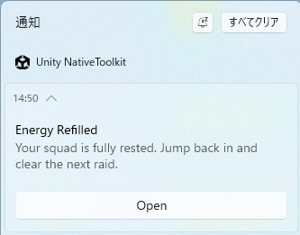
</p>

### スケジュール通知

#### 通知をスケジュールする

```csharp
#if UNITY_STANDALONE_WIN && !UNITY_EDITOR
var payload = new WindowsNotificationPayload
{
    Title   = "ギルドバトル間もなく開始",
    Body    = "1分後にバトルキューが開きます。編成を確認して出撃してください。",
    Tag     = "win-sample-notification",
    Group   = "win-sample-group",
    Buttons = new List<WindowsNotificationButtonPayload>
    {
        new() { Label = "開く", Args = new Dictionary<string, string> { ["action"] = "open" } }
    }
};

string json = WindowsNotificationJsonBuilder.BuildNotificationPayload(payload);
long scheduledTimeUnixMs = DateTimeOffset.UtcNow.AddMinutes(1).ToUnixTimeMilliseconds();

WindowsNotificationManager.Instance.ScheduleNotification(json, scheduledTimeUnixMs, result =>
{
    Debug.Log($"ScheduleNotification: {result.IsSuccess}");
});
#endif
```

<p align="center">
  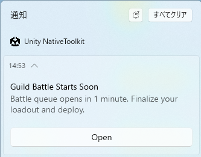
</p>

#### スケジュール通知をキャンセルする

```csharp
#if UNITY_STANDALONE_WIN && !UNITY_EDITOR
WindowsNotificationManager.Instance.CancelScheduledNotification(
    "win-sample-notification",
    "win-sample-group",
    result => Debug.Log($"CancelScheduled: {result.IsSuccess}"));
#endif
```


### 進捗を更新する

先に進捗バー通知を表示してから `UpdateNotificationProgress` を呼び出してください。両方の呼び出しで同じ `tag` と `group` を使用する必要があります。`sequenceNumber` は更新のたびに増加させてください。

#### 進捗通知を表示する

```csharp
#if UNITY_STANDALONE_WIN && !UNITY_EDITOR
uint sequenceNumber = 0; // 新しい進捗通知を表示するときにリセット

var payload = new WindowsNotificationPayload
{
    Title    = "ダウンロード中...",
    Tag      = "win-sample-notification",
    Group    = "win-sample-group",
    Progress = new WindowsNotificationProgressPayload
    {
        Value    = 0.3,
        ValueStr = "30%",
        Status   = "ダウンロード中"
    }
};

string json = WindowsNotificationJsonBuilder.BuildNotificationPayload(payload);
WindowsNotificationManager.Instance.ShowNotification(json, result =>
{
    Debug.Log($"ShowProgressNotification: {result.IsSuccess}");
});
#endif
```

<p align="center">
  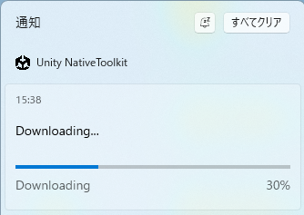
</p>

#### 進捗を更新する

```csharp
#if UNITY_STANDALONE_WIN && !UNITY_EDITOR
sequenceNumber++; // 前回の値より大きい値を指定する必要があります

WindowsNotificationManager.Instance.UpdateNotificationProgress(
    tag:            "win-sample-notification",
    group:          "win-sample-group",
    value:          0.5,
    valueStr:       "50%",
    status:         "ダウンロード中...",
    sequenceNumber: sequenceNumber,
    onResult: result =>
    {
        if (!result.IsSuccess && result.ErrorCode == 4)
            Debug.LogWarning("進捗通知が見つかりません。先に ShowProgressNotification を呼び出してください。");
        else
            Debug.Log($"UpdateProgress: {result.IsSuccess}");
    });
#endif
```

> **注意:** `UpdateNotificationProgress` を呼び出す前に `ShowProgressNotification` を呼び出してください。進捗通知が通知センターにない場合、エラーコード `4`（`NOTIFICATION_ERROR_PROGRESS_NOT_FOUND`）が返されます。

<p align="center">
  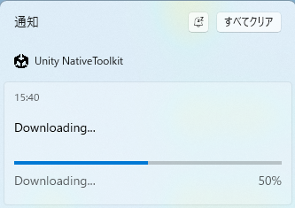
</p>

### 通知を削除する

```csharp
#if UNITY_STANDALONE_WIN && !UNITY_EDITOR
// タグとグループに一致する通知を削除する
WindowsNotificationManager.Instance.RemoveNotificationsByTag(
    "win-sample-notification",
    "win-sample-group",
    result => Debug.Log($"RemoveByTag: {result.IsSuccess}"));

// 通知センターのすべての通知を削除する
WindowsNotificationManager.Instance.RemoveAllNotifications(result =>
{
    Debug.Log($"RemoveAll: {result.IsSuccess}");
});
#endif
```


### クエリ

#### 通知許可設定

`GetNotificationSetting` は同期的に即座に値を返します。

```csharp
#if UNITY_STANDALONE_WIN && !UNITY_EDITOR
WindowsNotificationSetting setting = WindowsNotificationManager.Instance.GetNotificationSetting();
Debug.Log($"NotificationSetting: {setting}");
// Enabled / DisabledForApplication / DisabledForUser / DisabledByGroupPolicy / DisabledByManifest / Unknown
#endif
```

#### 通知設定を開く

```csharp
#if UNITY_STANDALONE_WIN && !UNITY_EDITOR
WindowsNotificationManager.Instance.OpenNotificationSettings(result =>
{
    Debug.Log($"OpenNotificationSettings: {result.IsSuccess}");
});
#endif
```


### イベントを受け取る

`OnEnable` でサブスクライブし、`OnDisable` でアンサブスクライブしてください。

```csharp
#if UNITY_STANDALONE_WIN && !UNITY_EDITOR
private void OnEnable()
{
    WindowsNotificationManager.Instance.NotificationOperationCompleted += OnOperationCompleted;
    WindowsNotificationManager.Instance.NotificationInvoked            += OnNotificationInvoked;
}

private void OnDisable()
{
    WindowsNotificationManager.Instance.NotificationOperationCompleted -= OnOperationCompleted;
    WindowsNotificationManager.Instance.NotificationInvoked            -= OnNotificationInvoked;
}

private void OnOperationCompleted(WindowsNotificationResult result)
{
    Debug.Log($"Operation={result.Operation}, IsSuccess={result.IsSuccess}");
}

private void OnNotificationInvoked(string argsJson)
{
    // ユーザーが通知またはアクションボタンをクリックしたときに発火します。
    // コールドスタート時にも発火します: 通知クリックでアプリが起動した場合は
    // シーンロード後に Initialize() を呼び出すとアクティベーション引数を受け取れます。
    // argsJson 例: {"action":"open"}
    Debug.Log($"NotificationInvoked: {argsJson}");
}
#endif
```

#### オペレーション定数

| 定数 | 説明 |
|---|---|
| `WindowsNotificationManager.OperationInitialize` | `Initialize` 完了 |
| `WindowsNotificationManager.OperationShow` | `ShowNotification` 完了 |
| `WindowsNotificationManager.OperationSchedule` | `ScheduleNotification` 完了 |
| `WindowsNotificationManager.OperationCancelScheduled` | `CancelScheduledNotification` 完了 |
| `WindowsNotificationManager.OperationUpdateProgress` | `UpdateNotificationProgress` 完了 |
| `WindowsNotificationManager.OperationRemoveByTag` | `RemoveNotificationsByTag` 完了 |
| `WindowsNotificationManager.OperationRemoveAll` | `RemoveAllNotifications` 完了 |
| `WindowsNotificationManager.OperationOpenSettings` | `OpenNotificationSettings` 完了 |

---

## macOS

macOS 通知は `MacNotificationManager` を通じて提供されます。サンプルシーンでは、権限フロー、即座通知、スケジュール通知、カテゴリ・アクション登録、バッジ管理、クエリ操作を確認できます。

### サポート機能

- 権限リクエスト / 認証ステータス確認 / システム通知設定を開く
- 即座通知
- スケジュール通知（時間間隔 / カレンダー）
- 通知の更新 / キャンセル / 配信済み通知の削除
- スケジュール済み・配信済み通知の一覧取得
- バッジカウント管理
- カテゴリ登録 / アクション / テキスト入力アクション

### 基本セットアップ

```csharp
// Guard: macOS Standalone のみ。エディタでのネイティブ呼び出しを防ぎます。
#if UNITY_STANDALONE_OSX && !UNITY_EDITOR
using JonghyunKim.NativeToolkit.Runtime.Notification;
#endif
```

---

### 権限

```csharp
#if UNITY_STANDALONE_OSX && !UNITY_EDITOR
// 通知権限をリクエストする
MacNotificationManager.Instance.RequestPermission(result =>
{
    if (result.IsSuccess)
    {
        Debug.Log("macOS 通知権限が許可されました");
    }
    else
    {
        Debug.LogError($"権限リクエスト失敗: {result.ErrorMessage}");
    }
});

// 通知権限が許可されているか確認する
MacNotificationManager.Instance.HasPermission(hasPermission =>
{
    Debug.Log($"HasPermission: {hasPermission}");
});

// 認証ステータスの詳細を取得する
MacNotificationManager.Instance.GetAuthorizationStatus(result =>
{
    var status = MacNotificationAuthorizationStatusParser.ParseJson(result.Json);
    Debug.Log($"AuthorizationStatus: {status}");
});

// システム通知設定を開く
MacNotificationManager.Instance.OpenSettings(result =>
{
    Debug.Log($"OpenSettings: {result.IsSuccess}");
});
#endif
```

<p align="center">
    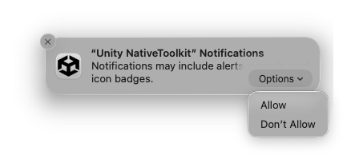
</p>

---

### 通知を表示する

#### 即座通知

```csharp
#if UNITY_STANDALONE_OSX && !UNITY_EDITOR
var content = new NotificationContentPayload
{
    id = "mac-sample-notification",
    title = "Energy Refilled",
    body = "Your squad is fully rested. Jump back in and clear the next raid.",
    categoryIdentifier = "mac-sample-category"
};
var contentJson = MacNotificationJsonBuilder.BuildContentJson(content);
MacNotificationManager.Instance.ShowNotification(contentJson, null, result =>
{
    if (result.IsSuccess)
    {
        Debug.Log("通知を表示しました");
    }
    else
    {
        Debug.LogError($"ShowNotification 失敗: {result.ErrorMessage}");
    }
});
#endif
```

<p align="center">
    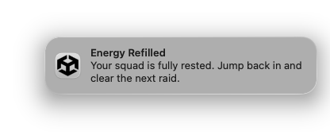
</p>

#### 時間間隔トリガー

```csharp
#if UNITY_STANDALONE_OSX && !UNITY_EDITOR
var content = new NotificationContentPayload
{
    id = "mac-sample-notification",
    title = "Guild Battle Countdown",
    body = "Your team queue opens in 5 seconds. Rally your party and get ready."
};
var trigger = new TimeIntervalTriggerPayload { interval = 5.0, repeats = false };
var contentJson = MacNotificationJsonBuilder.BuildContentJson(content);
var triggerJson = MacNotificationJsonBuilder.BuildTimeIntervalTriggerJson(trigger);
MacNotificationManager.Instance.ShowNotification(contentJson, triggerJson, result =>
{
    Debug.Log($"ShowNotification: {result.IsSuccess}");
});
#endif
```

<p align="center">
    
</p>

#### カレンダートリガー

```csharp
#if UNITY_STANDALONE_OSX && !UNITY_EDITOR
var now = DateTime.Now.AddMinutes(1);
var content = new NotificationContentPayload
{
    id = "mac-sample-notification",
    title = "Daily Reward Ready",
    body = "Your login streak chest is ready in town. Claim it before reset."
};
var trigger = new CalendarTriggerPayload
{
    year = now.Year,
    month = now.Month,
    day = now.Day,
    hour = now.Hour,
    minute = now.Minute,
    second = now.Second,
    repeats = false
};
var contentJson = MacNotificationJsonBuilder.BuildContentJson(content);
var triggerJson = MacNotificationJsonBuilder.BuildCalendarTriggerJson(trigger);
MacNotificationManager.Instance.ShowNotification(contentJson, triggerJson, result =>
{
    Debug.Log($"ShowNotification: {result.IsSuccess}");
});
#endif
```

<p align="center">
    
</p>

---

### 更新・キャンセル・削除

#### 更新

```csharp
#if UNITY_STANDALONE_OSX && !UNITY_EDITOR
var content = new NotificationContentPayload
{
    id = "mac-sample-notification",
    title = "Town Entry Bonus",
    body = "Welcome back to town. Your blacksmith bonus is now available."
};
var contentJson = MacNotificationJsonBuilder.BuildContentJson(content);
MacNotificationManager.Instance.UpdateNotification("mac-sample-notification", contentJson, null, result =>
{
    Debug.Log($"UpdateNotification: {result.IsSuccess}");
});
#endif
```

#### キャンセル

```csharp
#if UNITY_STANDALONE_OSX && !UNITY_EDITOR
// ID を指定してペンディング中の通知をキャンセルする
MacNotificationManager.Instance.CancelNotification("mac-sample-notification");

// ペンディング中のすべての通知をキャンセルする
MacNotificationManager.Instance.CancelAllNotifications();
#endif
```

#### 配信済み通知を削除する

```csharp
#if UNITY_STANDALONE_OSX && !UNITY_EDITOR
// 通知センターから特定の配信済み通知を削除する
MacNotificationManager.Instance.RemoveDeliveredNotification("mac-sample-notification");

// 通知センターからすべての配信済み通知を削除する
MacNotificationManager.Instance.RemoveAllDeliveredNotifications();
#endif
```

<p align="center">
    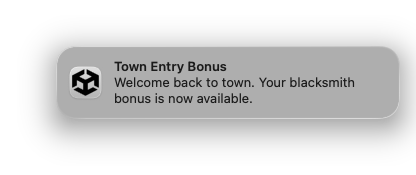
</p>

---

### スケジュール通知

ゲームループをブロックせずに、将来の時刻に通知を予約します。

#### 時間間隔

```csharp
#if UNITY_STANDALONE_OSX && !UNITY_EDITOR
var content = new NotificationContentPayload
{
    id = "mac-sample-notification",
    title = "Guild Battle Starts Soon",
    body = "Battle queue opens in 10 seconds. Finalize your loadout and deploy."
};
var trigger = new TimeIntervalTriggerPayload { interval = 10.0, repeats = false };
var contentJson = MacNotificationJsonBuilder.BuildContentJson(content);
var triggerJson = MacNotificationJsonBuilder.BuildTimeIntervalTriggerJson(trigger);
MacNotificationManager.Instance.ScheduleNotification(contentJson, triggerJson, result =>
{
    Debug.Log($"ScheduleNotification: {result.IsSuccess}");
});
#endif
```

#### カレンダー

```csharp
#if UNITY_STANDALONE_OSX && !UNITY_EDITOR
var future = DateTime.Now.AddMinutes(1);
var content = new NotificationContentPayload
{
    id = "mac-sample-notification",
    title = "Daily Reward Window",
    body = "Your daily reward window is open. Check in now to keep your streak."
};
var trigger = new CalendarTriggerPayload
{
    year = future.Year,
    month = future.Month,
    day = future.Day,
    hour = future.Hour,
    minute = future.Minute,
    second = future.Second,
    repeats = false
};
var contentJson = MacNotificationJsonBuilder.BuildContentJson(content);
var triggerJson = MacNotificationJsonBuilder.BuildCalendarTriggerJson(trigger);
MacNotificationManager.Instance.ScheduleNotification(contentJson, triggerJson, result =>
{
    Debug.Log($"ScheduleNotification: {result.IsSuccess}");
});
#endif
```

#### スケジュールをキャンセルする

```csharp
#if UNITY_STANDALONE_OSX && !UNITY_EDITOR
// ID を指定してスケジュール済み通知をキャンセルする
MacNotificationManager.Instance.CancelScheduledNotification("mac-sample-notification");

// すべてのスケジュール済み通知をキャンセルする
MacNotificationManager.Instance.CancelAllScheduledNotifications();
#endif
```

<p align="center">
    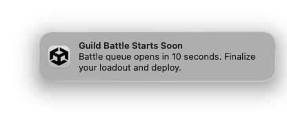
</p>

---

### クエリ

```csharp
#if UNITY_STANDALONE_OSX && !UNITY_EDITOR
// スケジュール済み（ペンディング中）通知を取得する
MacNotificationManager.Instance.GetScheduledNotifications(result =>
{
    Debug.Log($"GetScheduled: {result.Json}");
});

// 通知センターにある配信済み通知を取得する
MacNotificationManager.Instance.GetDeliveredNotifications(result =>
{
    Debug.Log($"GetDelivered: {result.Json}");
});
#endif
```

---

### バッジ

```csharp
#if UNITY_STANDALONE_OSX && !UNITY_EDITOR
// バッジカウントを 1 に設定する
MacNotificationManager.Instance.SetBadgeCount(1, result =>
{
    Debug.Log($"SetBadgeCount(1): {result.IsSuccess}");
});

// バッジをクリアする
MacNotificationManager.Instance.SetBadgeCount(0, result =>
{
    Debug.Log($"SetBadgeCount(0): {result.IsSuccess}");
});
#endif
```

---

### カテゴリとアクション

`categoryIdentifier` を使用する通知を送信する前に、アクションボタン付きのカテゴリを登録してください。

```csharp
#if UNITY_STANDALONE_OSX && !UNITY_EDITOR
var category = new MacNotificationCategoryPayload
{
    id = "mac-sample-category",
    actions = new[]
    {
        new MacNotificationActionPayload
        {
            id = "open",
            title = "Open",
            isForeground = true,
            isTextInput = false
        },
        new MacNotificationActionPayload
        {
            id = "delete",
            title = "Delete",
            isForeground = false,
            isTextInput = false
        },
        new MacNotificationActionPayload
        {
            id = "reply",
            title = "Reply",
            isForeground = false,
            isTextInput = true,
            textInputPlaceholder = "Type a message"
        }
    }
};
string categoryJson = MacNotificationJsonBuilder.BuildCategoryJson(category);
MacNotificationManager.Instance.RegisterCategory(categoryJson, result =>
{
    Debug.Log($"RegisterCategory: {result.IsSuccess}");
});
#endif
```

アクションボタンを表示するには、通知バナーにカーソルを合わせて Options (▼) ボタンをクリックしてください。

#### カテゴリを削除する

```csharp
#if UNITY_STANDALONE_OSX && !UNITY_EDITOR
MacNotificationManager.Instance.RemoveCategory("mac-sample-category", result =>
{
    Debug.Log($"RemoveCategory: {result.IsSuccess}");
});
#endif
```

<p align="center">
    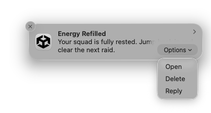
</p>

---

### イベントを受け取る

`OnEnable` でサブスクライブし、`OnDisable` でサブスクライブ解除してください。

```csharp
#if UNITY_STANDALONE_OSX && !UNITY_EDITOR
private void OnEnable()
{
    MacNotificationManager.Instance.NotificationActionReceived += OnNotificationActionReceived;
    MacNotificationManager.Instance.NotificationTextInputActionReceived += OnNotificationTextInputActionReceived;
}

private void OnDisable()
{
    MacNotificationManager.Instance.NotificationActionReceived -= OnNotificationActionReceived;
    MacNotificationManager.Instance.NotificationTextInputActionReceived -= OnNotificationTextInputActionReceived;
}

private void OnNotificationActionReceived(MacNotificationActionResult result)
{
    Debug.Log($"Action: notificationId={result.NotificationId}, actionId={result.ActionId}");
}

private void OnNotificationTextInputActionReceived(MacNotificationTextInputActionResult result)
{
    Debug.Log($"TextInput: notificationId={result.NotificationId}, actionId={result.ActionId}, userText={result.UserText}");
}
#endif
```

<p align="center">
    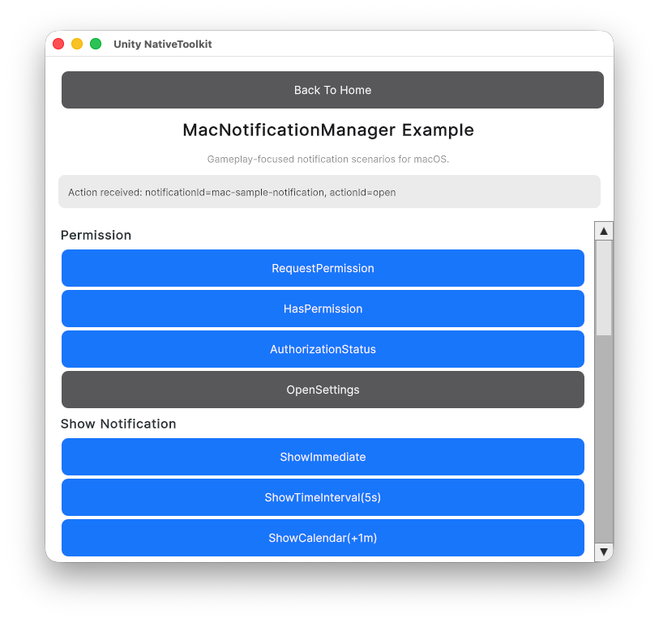
</p>
