# 공유 기능

언어:

- [English](share.md)
- [日本語](share.ja.md)
- 한국어（이 페이지）

← [매뉴얼 상단으로 돌아가기](index.ko.md)

---

## 목차

- [Android](#android)
  - [1.13.0 변경 사항](#1130-변경-사항)
  - [설정](#설정)
  - [텍스트 공유](#텍스트-공유)
  - [URL 공유](#url-공유)
  - [커스텀 Chooser 액션 공유 (API 34+)](#커스텀-chooser-액션-공유-api-34)
  - [제목·주제 포함 공유](#제목주제-포함-공유)
  - [리치 프리뷰 공유](#리치-프리뷰-공유)
  - [이미지 공유](#이미지-공유)
  - [다중 이미지 공유](#다중-이미지-공유)
  - [파일 공유](#파일-공유)
  - [다중 파일 공유](#다중-파일-공유)
  - [다이렉트 공유 타겟](#다이렉트-공유-타겟)
  - [콜백 포함 공유](#콜백-포함-공유)
  - [대기 중 콜백 취소](#대기-중-콜백-취소)
  - [이벤트 수신](#이벤트-수신)
  - [에러 처리](#에러-처리)
- [iOS](#ios)
  - [설정](#설정-1)
  - [텍스트 공유](#텍스트-공유-1)
  - [URL 공유](#url-공유-1)
  - [프리뷰 포함 URL 공유](#프리뷰-포함-url-공유)
  - [이미지 공유](#이미지-공유-1)
  - [다중 이미지 공유](#다중-이미지-공유-1)
  - [파일 공유](#파일-공유-1)
  - [다중 파일 공유](#다중-파일-공유-1)
  - [텍스트와 URL 공유](#텍스트와-url-공유)
  - [제목 포함 공유](#제목-포함-공유)
  - [특정 액티비티 제외 공유](#특정-액티비티-제외-공유)
  - [결과 수신](#결과-수신)
  - [에러 처리](#에러-처리-1)
- [macOS](#macos)
  - [설정](#설정-2)
  - [텍스트 공유](#텍스트-공유-2)
  - [URL 공유](#url-공유-2)
  - [이미지 공유](#이미지-공유-2)
  - [파일 공유](#파일-공유-2)
  - [다중 이미지 공유](#다중-이미지-공유-2)
  - [다중 파일 공유](#다중-파일-공유-2)
  - [텍스트와 URL 공유](#텍스트와-url-공유-1)
  - [서비스 제외 공유](#서비스-제외-공유)
  - [지정 서비스 경유 공유 (Mail)](#지정-서비스-경유-공유-mail)
  - [결과 수신](#결과-수신-1)
  - [에러 처리](#에러-처리-2)

---

## Android

### 1.13.0 변경 사항

1.13.0부터 Android 공유 기능은 1.x의 Kotlin 브리지가 아니라 native-toolkit의 C ABI 2.0.0으로 동작합니다. `AndroidShareManager`의 메서드와 이벤트, Payload의 필드, 결과의 프로퍼티는 바뀌지 않았습니다. 올바른 입력으로 공유하면 이전과 같은 Sharesheet가 열립니다. 아래에서 설명하는 FileProvider와 다이렉트 공유 매니페스트 설정도 바뀌지 않았습니다. 고쳐야 할 부분과 1.12.0과 다른 점은 다음과 같습니다.

#### 코드 수정 방법

- Android 코드의 `using JonghyunKim.NativeToolkit.Runtime.Share;`를 `using JonghyunKim.NativeToolkit.Runtime.Android.Share;`로 바꿔 주세요. iOS와 macOS 코드의 줄은 그대로 두세요(해당 타입은 옮겨지지 않았습니다).
- 아래 표의 타입 이름을 바꿔 주세요. Unity는 자동으로 고쳐 주지 않습니다. API Updater는 이 패키지의 타입에 대한 참조를 다시 쓰지 않으므로, 1.12.0의 이름을 그대로 쓰는 스크립트는 컴파일에 실패합니다. 이 페이지의 예처럼 `#if UNITY_ANDROID && !UNITY_EDITOR` 안에 작성한 코드는 Editor에서 컴파일되지 않으므로, 오류는 Android Player를 빌드할 때 처음 나타납니다.
- 1.12.0의 이름으로 `[SerializeReference]`에 저장한 데이터는 새 타입으로 값과 함께 불러와집니다. 이름이 바뀐 타입은 1.12.0의 이름을 `[MovedFrom]`으로 기록하고 있습니다.

Android 공유 기능의 타입은 모두 `JonghyunKim.NativeToolkit.Runtime.Share`에서 `JonghyunKim.NativeToolkit.Runtime.Android.Share`로 옮겨졌습니다. `AndroidShareManager`는 이름이 그대로이고, 나머지 타입은 이름이 바뀌었습니다.

| 1.12.0 | 1.13.0 |
| --- | --- |
| `ShareOperationResult` | `AndroidShareOperationResult` |
| `ShareCallbackResult` | `AndroidShareCallbackResult` |
| `ShareChooserActionResult` | `AndroidShareChooserActionResult` |
| `ShareChooserActionCallbackCoordinator` | `AndroidShareChooserActionCallbackCoordinator` |
| `ChooserActionPayload` | `AndroidChooserActionPayload` |
| `ShareTextPayload` | `AndroidShareTextPayload` |
| `ShareImagePayload` | `AndroidShareImagePayload` |
| `ShareImagesPayload` | `AndroidShareImagesPayload` |
| `ShareFilePayload` | `AndroidShareFilePayload` |
| `ShareFilesPayload` | `AndroidShareFilesPayload` |
| `DirectShareTargetPayload` | `AndroidDirectShareTargetPayload` |
| `RemoveDirectShareTargetsPayload` | `AndroidRemoveDirectShareTargetsPayload` |

#### Android 전체 기능에 공통인 호환성이 깨지는 변경

- **1.x 네이티브 라이브러리를 더 이상 포함하지 않습니다.** `android-native-toolkit-1.3.0.aar`와 `unity-android-native-toolkit-1.3.0.aar`를 제거했습니다. 패키지에 포함된 것은 `android-native-toolkit-2.0.0.aar`와 `android-native-toolkit-capi-2.0.0.aar`(native-toolkit의 C ABI 2.0.0)입니다. 이 라이브러리의 클래스(`android.unity.*`, `android.library.*`)를 직접 호출하던 코드는 동작하지 않습니다.
- **"Configure Gradle Project"가 없어졌습니다.** 메뉴 Tools > Native Toolkit > Android > Configure Gradle Project와 그 창을 삭제했습니다. 실행 시 필요한 라이브러리(`kotlin-stdlib` 2.2.21, `kotlinx-coroutines-core` 1.9.0을 포함한 7개)는 빌드가 `unityLibrary/build.gradle`에 직접 추가합니다. Kotlin Gradle 플러그인은 더 이상 적용하지 않습니다. 직접 만든 Gradle 템플릿이나 EDM4U를 사용한다면 버전이 충돌하지 않는지 확인해 주세요.
- **64비트와 IL2CPP만 지원합니다.** ARMv7(32비트)도 포함하는 빌드는 메시지를 표시하고 중단됩니다. Mono는 지원하지 않습니다. [Android 요구 사항](index.ko.md#android-요구-사항)을 참고해 주세요.

#### 공유 기능의 그 밖의 변경 사항

- **`AndroidShareJsonBuilder`를 삭제했습니다.** 1.12.0에서는 `AndroidShareManager`가 이 클래스로 Payload에서 JSON을 만들어 Kotlin 브리지에 전달했습니다. 이제는 Manager가 Payload를 그대로 네이티브 라이브러리에 전달하므로, 이 JSON을 사용하는 곳이 없습니다. 이 페이지의 예처럼 Payload 객체(`AndroidShareTextPayload` 등)를 `AndroidShareManager`의 메서드에 전달해 주세요. JSON 문자열을 대신하는 것은 없습니다.
- **알려진 차이.** 다음 경우에는 1.12.0과 동작이 다릅니다. 대부분은 올바르지 않은 입력, 다른 스레드에서의 호출, 연달아 하는 호출과 관련된 것입니다.

| 상황 | 1.12.0 | 1.13.0 |
| --- | --- | --- |
| Unity 메인 스레드가 아닌 스레드에서 호출 | 받아들이지 않았습니다. 오류 로그가 2줄 출력되고 `<op> could not be started.`로 실패했습니다 | 받아들입니다. 결과는 Unity 메인 스레드에서 전달됩니다. `AndroidShareManager.Instance`는 먼저 Unity 메인 스레드에서 가져와 주세요(처음 가져올 때 GameObject를 만듭니다) |
| 앱이 백그라운드에 있을 때 공유 | 측정하지 않았습니다 | `Failed to <op>: the app is not in the foreground.`로 실패합니다 |
| `RegisterDirectShareTarget`과 `RemoveDirectShareTargets` | Android 메인 스레드에서 비동기로 동작했습니다 | 호출한 스레드에서 동기로 동작하므로, 아이콘 디코딩과 시스템 호출만큼 호출이 길어집니다. 결과는 이전처럼 나중에 이벤트로 전달됩니다 |
| 서로 다른 호출의 결과 순서 | 호출한 순서 | 호출 시점에 정해지는 결과(검사 실패, 다이렉트 공유, `CancelPendingShareCallback`의 성공)가 먼저 호출한 공유의 결과보다 먼저 전달될 수 있습니다. 예를 들어 `ShareWithCallback`과 같은 프레임에 `CancelPendingShareCallback`을 호출하면, 취소의 성공이 `onStarted`보다 먼저 전달될 수 있습니다 |
| 호출 시점에 정해지는 결과의 호출별 콜백 | 같은 작업의 앞선 호출의 완료가 나중 호출의 콜백으로 전달될 수 있었습니다 | 그 호출에서 전달한 콜백으로 전달됩니다 |
| 사용자가 앱을 고르는 중의 `CancelPendingShareCallback` | 대기를 해제한 후에 성공을 보고했습니다 | 취소를 대기열에 넣은 시점(대기를 해제하기 전)에 성공을 보고합니다. 같은 순간에 선택된 앱은 그 후에 전달될 수 있습니다 |
| 공유 이벤트 핸들러나 콜백 안에서 호출하고 결과가 C#에서 정해지는 경우(Editor에서의 모든 호출과 기기에서의 검사 실패) | 같은 프레임에 결과가 전달되었습니다 | 다음 프레임 이후에 전달됩니다 |
| 여러 스레드에서 동시에 호출 | Android 메인 스레드에서 순서대로 처리했습니다 | 호출별 콜백, Chooser 액션 탭의 전달 대상, 취소가 호출한 순서와 다를 수 있습니다 |
| 이미지로 읽을 수 없는 Chooser 액션 아이콘 | 그 액션을 건너뛰었습니다 | 앞부분의 바이트가 이미지 형식과 맞지 않으면 그 액션을 건너뜁니다. 맞더라도 이미지가 손상되어 있으면 공유 전체가 `Failed to shareText: a chooser action icon could not be read as an image.`로 실패합니다. API 33 이하에서도 실패합니다 |
| PNG, JPEG, WebP, GIF, BMP, ICO, HEIF, AVIF 이외 형식(WBMP 등)의 Chooser 액션 아이콘 | 표시했습니다 | 그 액션을 건너뜁니다 |
| `intentAction`이 같은 Chooser 액션 | 모두 표시하고, 어느 것을 탭해도 같은 ID를 보고했습니다 | 첫 번째 것만 표시합니다 |
| 이전 `ShareText`의 Chooser 액션 | 다음 `ShareText`가 네이티브 측에 도달했을 때나 Manager를 파괴했을 때 멈췄습니다 | 다음 `ShareText`가 성공했을 때 멈춥니다. 다음 `ShareText`가 실패했을 때와 Manager를 다시 만든 후에는 이전 액션을 여전히 탭할 수 있으며, 현재의 `onChooserAction`으로 전달됩니다 |
| 오래된 Sharesheet에서 선택한 앱 | 보고했습니다(버그) | 보고하지 않습니다 |
| `AndroidShareManager` 파괴 전후에 도착하는 결과 | 파괴 전에 대기열에 들어간 결과는 파괴된 Manager로 전달되었고, 이후의 것은 버렸습니다 | 결과를 전달하는 시점에 살아 있는 Manager로 전달합니다(다시 만들었다면 새 Manager). 없으면 버립니다. Chooser 액션의 탭은 탭한 시점에 살아 있던 Manager의 구독자와 콜백에 한 번 전달됩니다 |
| 여러 파일(`ShareImages`, `ShareFiles`)의 오류 메시지 | 오류의 원인이 된 경로 | `File not found:`는 존재하지 않는 첫 번째 경로를, `File cannot be shared:`는 모든 경로를 나타냅니다 |
| 시스템이 받아들이지 않는 다이렉트 공유 타겟 | `Failed to register Direct Share target: <이유>` | `Failed to register Direct Share target: the system did not accept the shortcut.` |
| 네이티브 측의 보안 제한이나 그 밖의 예외 | `Security restriction while executing <op>: ...`처럼 예외 문구를 포함한 메시지 | `Failed to <op>: UNKNOWN.` 같은 고정된 메시지 |
| null인 Payload, 파일 목록, ID 목록, Chooser 액션 | `NullReferenceException` | `ArgumentNullException`. 아무것도 등록하지 않습니다 |
| `filePaths`나 `ids`의 null 요소 | `null`이라는 경로로 다뤘습니다(`File not found: null`) | `Failed to <op>: filePaths must not contain null`(`ids`라면 `ids must not contain null`)로 실패합니다 |
| 필수 문자열(`text`, `filePath`, `id` 등)의 null과 Chooser 액션의 `label`, `iconBase64`, `intentAction`의 null | 측정하지 않았습니다 | 빈 값과 같이 실패합니다(예: `Failed to <op>: text is required`). null 값을 가진 Chooser 액션은 버립니다 |
| Base64 아이콘(`iconBase64`) | Android의 `Base64.DEFAULT`로 읽었습니다 | 패딩이 있는 표준 Base64만 읽습니다. 앞뒤 공백은 무시합니다. `Convert.ToBase64String`의 출력은 읽을 수 있습니다 |
| 문자열 중간의 U+0000 | 그대로 전달했습니다 | 거기서 잘립니다(U+0000으로 시작하는 `text`는 `text is required`로 실패합니다) |
| 짝이 맞지 않는 서로게이트 | 그대로 전달했습니다 | U+FFFD로 바뀝니다 |
| Android 이외의 빌드 타깃의 Editor | `AndroidShareManager`가 없었습니다 | 있습니다. 모든 호출이 `<op> could not be started.`로 실패합니다 |
| 로그 | 본문과 Base64 아이콘을 포함한 JSON 전체 | 본문과 `subject`는 길이만 출력합니다 |
| `Initialize()` | 브리지를 가져오고 리스너를 등록했습니다 | 리스너를 등록하기만 합니다. 여러 번 호출해도 괜찮습니다 |

### 설정

#### 네임스페이스 가져오기

```csharp
// 가드: Android (Player) 전용. 에디터에서의 네이티브 호출을 방지합니다.
#if UNITY_ANDROID && !UNITY_EDITOR
using JonghyunKim.NativeToolkit.Runtime.Android.Share;
#endif
```

#### AndroidManifest.xml (다이렉트 공유에 필요)

앱이 Android 공유 시트의 다이렉트 공유 타겟으로 나타나도록 하려면, Android 라이브러리 프로젝트 매니페스트(예: `Assets/Plugins/Android/<your-app>.androidlib/AndroidManifest.xml`)에 다음을 추가합니다. `RegisterDirectShareTarget`을 사용하는 경우에만 필요합니다.

```xml
<manifest xmlns:android="http://schemas.android.com/apk/res/android"
    package="com.example.your.androidlib">
    <application>
        <activity android:name="com.unity3d.player.UnityPlayerGameActivity" android:exported="true">
            <intent-filter>
                <action android:name="android.intent.action.SEND" />
                <category android:name="android.intent.category.DEFAULT" />
                <data android:mimeType="*/*" />
            </intent-filter>
            <meta-data
                android:name="android.app.shortcuts"
                android:resource="@xml/shortcuts" />
        </activity>
    </application>
</manifest>
```

동일한 Android 라이브러리 프로젝트에 `res/xml/shortcuts.xml`을 추가합니다:

```xml
<?xml version="1.0" encoding="utf-8"?>
<shortcuts xmlns:android="http://schemas.android.com/apk/res/android">
    <share-target android:targetClass="com.unity3d.player.UnityPlayerGameActivity">
        <data android:mimeType="*/*" />
        <category android:name="android.shortcut.conversation" />
    </share-target>
</shortcuts>
```

#### 이미지·파일 공유 시 파일 경로

`ShareImage`, `ShareImages`, `ShareFile`, `ShareFiles`에 전달하는 파일은 네이티브 FileProvider가 적용되는 디렉터리에 있어야 합니다. `Application.persistentDataPath`(외부 파일 디렉터리에 매핑되며, FileProvider 설정에서 `<external-files-path>`로 선언됨)를 사용하세요. `Application.temporaryCachePath`(외부 캐시 디렉터리)는 FileProvider 적용 대상이 아니므로 사용할 수 없습니다.

```csharp
string path = Path.Combine(Application.persistentDataPath, "my_image.png");
```

---

### 텍스트 공유

```csharp
#if UNITY_ANDROID && !UNITY_EDITOR
AndroidShareManager.Instance.ShareText(new AndroidShareTextPayload
{
    text = "Hello from Unity! 일반 텍스트 공유 샘플입니다."
});
#endif
```

<p align="center">
    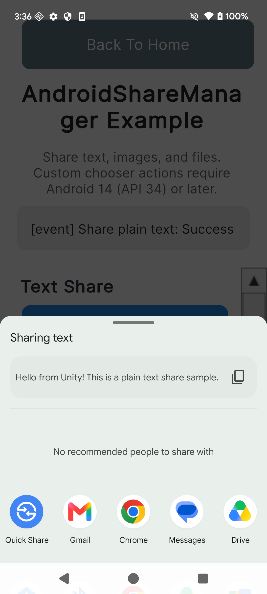
</p>

---

### URL 공유

```csharp
#if UNITY_ANDROID && !UNITY_EDITOR
AndroidShareManager.Instance.ShareText(new AndroidShareTextPayload
{
    text = "https://unity.com",
    mimeType = "text/plain"
});
#endif
```

<p align="center">
    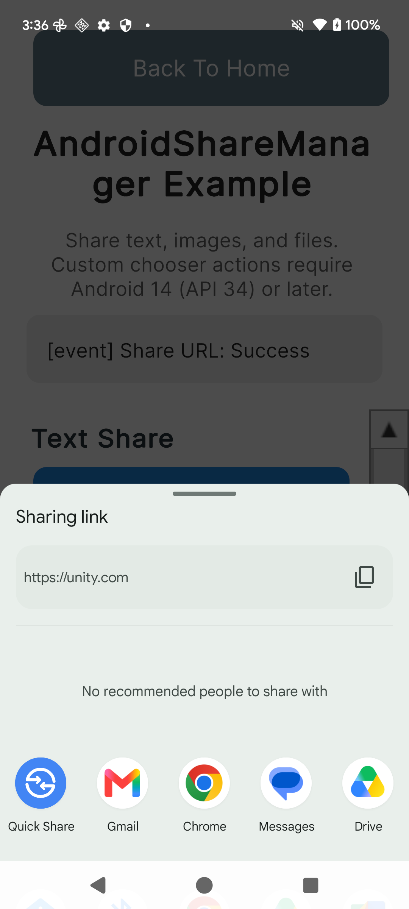
</p>

---

### 커스텀 Chooser 액션 공유 (API 34+)

커스텀 Chooser 액션은 Android 공유 Chooser 다이얼로그에 추가 버튼으로 표시됩니다. Android 14 (API 34) 이상이 필요합니다. 이전 API 레벨에서는 커스텀 액션 없이 공유가 진행됩니다.

각 액션에는 `label`, `iconBase64`(PNG나 JPEG 같은 이미지를 표준 Base64로 인코딩한 것), `intentAction`이 필요합니다. 하나라도 빠진 액션은 표시되지 않습니다. `intentAction`에는 액션마다 `android.intent.action.SEND` 이외의 고유한 값을 지정하세요. 같은 값을 가진 액션은 첫 번째 것만 표시되고, `SEND` 액션은 탭해도 보고되지 않습니다. 탭 이벤트는 `ShareChooserActionTapped`(전역 이벤트) 또는 `ShareText`의 `onChooserAction` 파라미터(호출별 콜백)로 받을 수 있습니다.

```csharp
#if UNITY_ANDROID && !UNITY_EDITOR
// Chooser 액션 탭을 수신하기 위해 전역 이벤트를 구독합니다.
AndroidShareManager.Instance.ShareChooserActionTapped += result =>
{
    Debug.Log($"Chooser 액션 탭됨: {result.ActionId}");
};

AndroidShareManager.Instance.ShareText(new AndroidShareTextPayload
{
    text = "커스텀 Chooser 액션 공유 (Android 14 / API 34+ 전용).",
    chooserActions = new[]
    {
        new AndroidChooserActionPayload
        {
            label = "저장",
            iconBase64 = iconBase64, // base64 인코딩된 PNG/JPEG
            intentAction = "com.jonghyunkim.nativetoolkit.SHARE_CUSTOM_ACTION_SAVE"
        },
        new AndroidChooserActionPayload
        {
            label = "열기",
            iconBase64 = iconBase64,
            intentAction = "com.jonghyunkim.nativetoolkit.SHARE_CUSTOM_ACTION_OPEN"
        }
    }
});
#endif
```

<p align="center">
    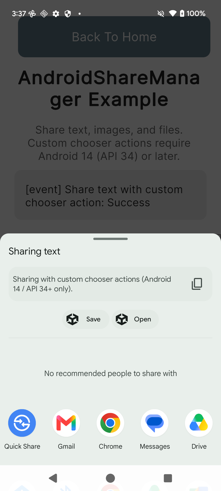
</p>

> **주의:** Android가 표시하는 Chooser 액션은 최대 5개입니다. 6개 이상 전달하면 경고가 로그에 기록되고, 초과한 액션은 표시되지 않을 수 있습니다. `ShareWithCallback`은 Chooser 액션을 지원하지 않습니다. 대신 `ShareText`에 `chooserActions`를 지정하세요.

---

### 제목·주제 포함 공유

```csharp
#if UNITY_ANDROID && !UNITY_EDITOR
AndroidShareManager.Instance.ShareText(new AndroidShareTextPayload
{
    text = "Unity에서 제목과 주제를 포함하여 공유하는 샘플입니다.",
    title = "Unity 공유 샘플",
    subject = "샘플 주제",
    mimeType = "text/plain"
});
#endif
```

<p align="center">
    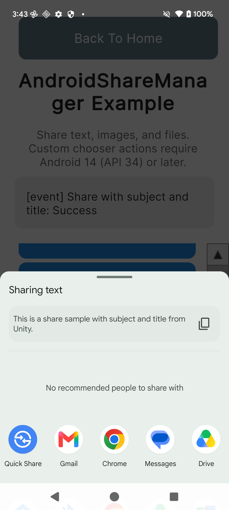
</p>

---

### 리치 프리뷰 공유

Chooser에 프리뷰 제목과 썸네일 이미지를 표시합니다. 썸네일 경로는 FileProvider가 접근 가능한 디렉터리의 파일을 가리켜야 합니다. 그렇지 않으면 Chooser는 썸네일 없이 열립니다.

```csharp
#if UNITY_ANDROID && !UNITY_EDITOR
string thumbnailPath = Path.Combine(Application.persistentDataPath, "share_preview_thumbnail.png");
// ShareText를 호출하기 전에 thumbnailPath에 PNG 파일을 저장하세요.

AndroidShareManager.Instance.ShareText(new AndroidShareTextPayload
{
    text = "Unity에서의 리치 프리뷰 공유 샘플입니다!",
    previewTitle = "Unity 리치 프리뷰 샘플",
    previewThumbnailPath = thumbnailPath
});
#endif
```

<p align="center">
    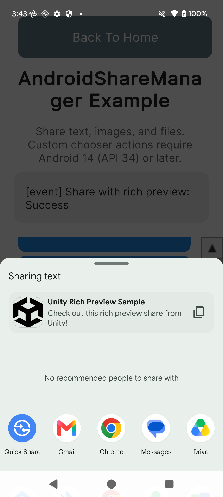
</p>

---

### 이미지 공유

```csharp
#if UNITY_ANDROID && !UNITY_EDITOR
string imagePath = Path.Combine(Application.persistentDataPath, "share_sample_image.png");
// ShareImage를 호출하기 전에 imagePath에 PNG 파일을 저장하세요.

AndroidShareManager.Instance.ShareImage(new AndroidShareImagePayload
{
    filePath = imagePath,
    mimeType = "image/png"
});
#endif
```

<p align="center">
    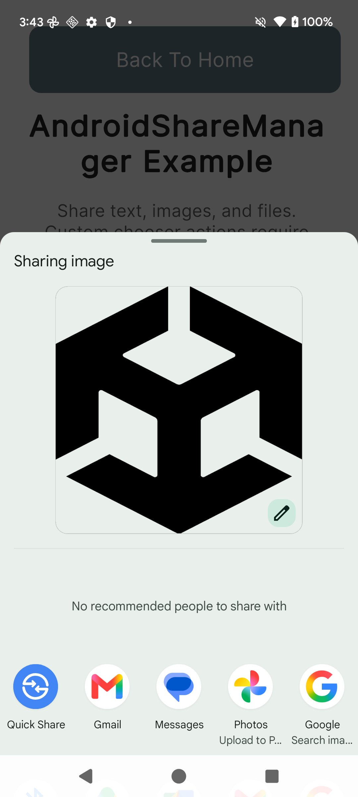
</p>

---

### 다중 이미지 공유

```csharp
#if UNITY_ANDROID && !UNITY_EDITOR
string imagePath1 = Path.Combine(Application.persistentDataPath, "share_sample_image_1.png");
string imagePath2 = Path.Combine(Application.persistentDataPath, "share_sample_image_2.png");
// ShareImages를 호출하기 전에 각 경로에 PNG 파일을 저장하세요.

AndroidShareManager.Instance.ShareImages(new AndroidShareImagesPayload
{
    filePaths = new[] { imagePath1, imagePath2 }
});
#endif
```

<p align="center">
    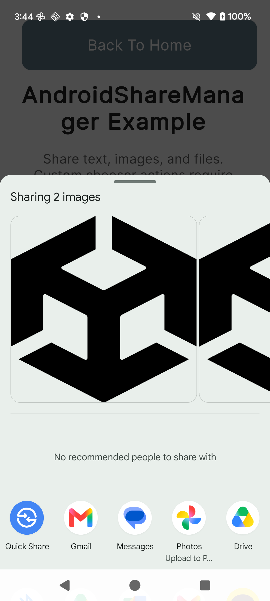
</p>

---

### 파일 공유

```csharp
#if UNITY_ANDROID && !UNITY_EDITOR
string filePath = Path.Combine(Application.persistentDataPath, "share_sample_file.txt");
File.WriteAllText(filePath, "Unity Native Toolkit에서 공유된 샘플 텍스트 파일입니다.");

AndroidShareManager.Instance.ShareFile(new AndroidShareFilePayload
{
    filePath = filePath
});
#endif
```

<p align="center">
    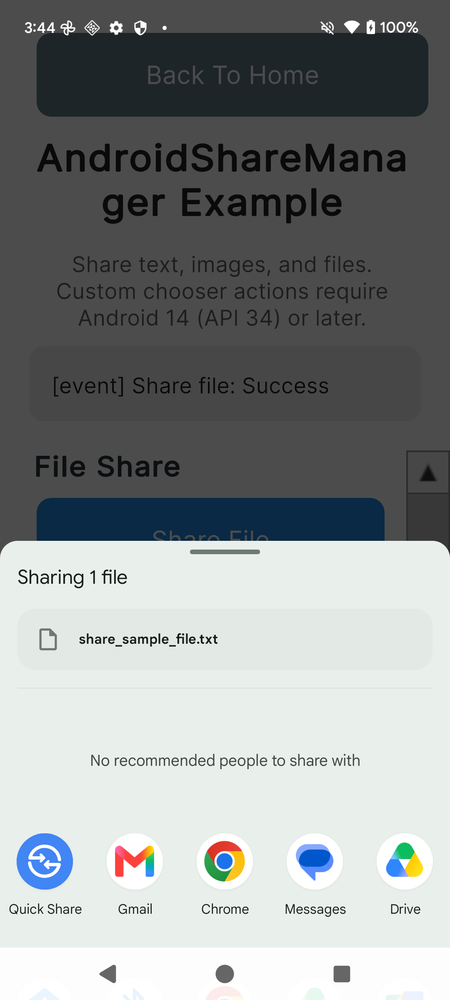
</p>

---

### 다중 파일 공유

```csharp
#if UNITY_ANDROID && !UNITY_EDITOR
string filePath1 = Path.Combine(Application.persistentDataPath, "share_sample_file_1.txt");
string filePath2 = Path.Combine(Application.persistentDataPath, "share_sample_file_2.txt");
File.WriteAllText(filePath1, "Unity Native Toolkit 샘플 파일 1.");
File.WriteAllText(filePath2, "Unity Native Toolkit 샘플 파일 2.");

AndroidShareManager.Instance.ShareFiles(new AndroidShareFilesPayload
{
    filePaths = new[] { filePath1, filePath2 }
});
#endif
```

<p align="center">
    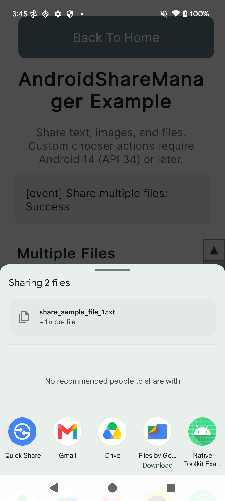
</p>

---

### 다이렉트 공유 타겟

Android 공유 시트의 다이렉트 공유 행에 표시되는 단축키를 등록합니다. [설정](#설정)에서 설명한 매니페스트와 `shortcuts.xml` 설정이 필요합니다. OS 레벨 캐싱으로 인해 등록 직후에 단축키가 표시되지 않을 수 있습니다.

```csharp
#if UNITY_ANDROID && !UNITY_EDITOR
AndroidShareManager.Instance.RegisterDirectShareTarget(new AndroidDirectShareTargetPayload
{
    id = "native_toolkit_sample_target",
    label = "Unity 샘플 타겟",
    iconBase64 = iconBase64 // base64 인코딩된 PNG/JPEG, 작은 크기 권장 (64x64)
});
#endif
```

<p align="center">
    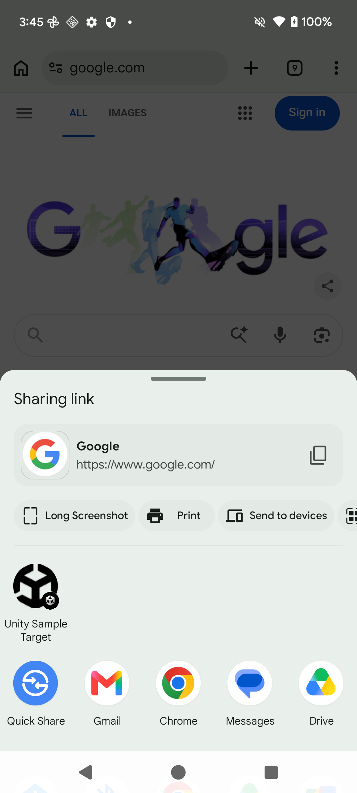
</p>

```csharp
#if UNITY_ANDROID && !UNITY_EDITOR
AndroidShareManager.Instance.RemoveDirectShareTargets(new AndroidRemoveDirectShareTargetsPayload
{
    ids = new[] { "native_toolkit_sample_target" }
});
#endif
```

<p align="center">
    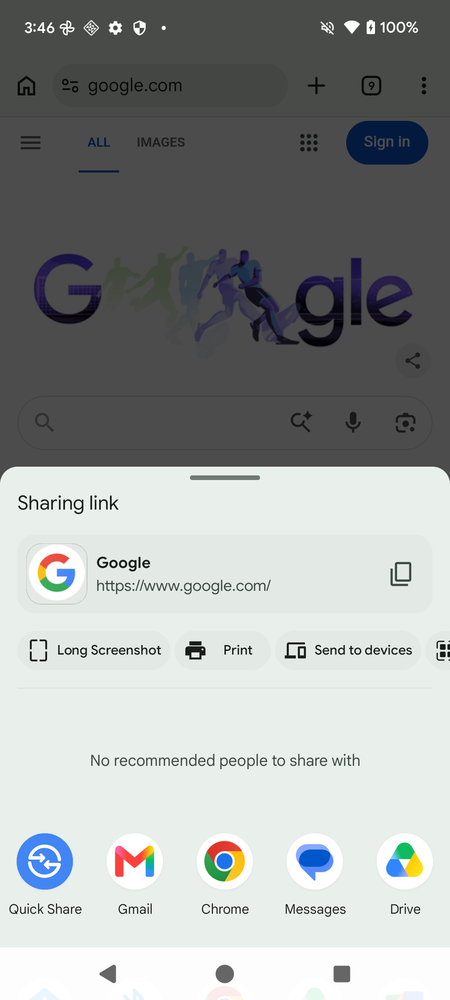
</p>

> **주의:** 아이콘 비트맵은 Android Binder를 통해 전달됩니다. Binder 트랜잭션 크기 제한을 초과하지 않도록 작은 크기(64×64 픽셀 권장)로 유지하세요.

---

### 콜백 포함 공유

텍스트를 공유하고 사용자가 앱을 선택했을 때 콜백을 수신합니다. `onStarted`는 Chooser가 실행될 때(성공·실패 여부 무관) 발생합니다. `onSelected`는 사용자가 앱을 선택했을 때 발생합니다(취소·복사·편집 시에는 발생하지 않음).

```csharp
#if UNITY_ANDROID && !UNITY_EDITOR
AndroidShareManager.Instance.ShareWithCallback(
    new AndroidShareTextPayload
    {
        text = "Unity에서의 콜백 포함 공유 샘플입니다. 앱을 선택하면 선택 결과를 수신합니다."
    },
    onStarted: result =>
    {
        string status = result.IsSuccess ? "성공" : "실패";
        Debug.Log($"[onStarted] ShareWithCallback: {status}");
    },
    onSelected: result =>
    {
        string pkg = result.SelectedPackageName ?? "(알 수 없음)";
        Debug.Log($"[onSelected] 선택된 앱: {pkg}");
    });
#endif
```

<p align="center">
    
</p>

> **주의:** `ShareWithCallback`은 `chooserActions`를 지원하지 않습니다. 대신 `ShareText`에 `chooserActions`를 지정하세요.

---

### 대기 중 콜백 취소

`ShareWithCallback`으로 시작한 앱 선택 대기를 취소합니다. 예를 들어 공유 시트가 선택 없이 닫힌 후 `onSelected` 콜백을 받고 싶지 않을 때 호출합니다. Manager는 자동으로 호출하지 않습니다. 화면 전환 후 오래된 콜백이 남지 않도록 [이벤트 수신](#이벤트-수신)의 예처럼 `OnDisable`에서 호출하세요.

```csharp
#if UNITY_ANDROID && !UNITY_EDITOR
AndroidShareManager.Instance.CancelPendingShareCallback();
#endif
```

---

### 이벤트 수신

화면 전환 후 오래된 참조가 남지 않도록 `OnEnable`에서 이벤트를 구독하고 `OnDisable`에서 구독을 해제하세요. 모든 결과는 Unity 메인 스레드에서 이벤트, 호출별 콜백의 순서로 전달됩니다.

```csharp
private void OnEnable()
{
#if UNITY_ANDROID && !UNITY_EDITOR
    AndroidShareManager.Instance.ShareOperationCompleted += OnShareOperationCompleted;
    AndroidShareManager.Instance.ShareCallbackReceived += OnShareCallbackReceived;
    AndroidShareManager.Instance.ShareChooserActionTapped += OnShareChooserActionTapped;
#endif
}

private void OnDisable()
{
#if UNITY_ANDROID && !UNITY_EDITOR
    AndroidShareManager.Instance.ShareOperationCompleted -= OnShareOperationCompleted;
    AndroidShareManager.Instance.ShareCallbackReceived -= OnShareCallbackReceived;
    AndroidShareManager.Instance.ShareChooserActionTapped -= OnShareChooserActionTapped;
    AndroidShareManager.Instance.CancelPendingShareCallback();
#endif
}

#if UNITY_ANDROID && !UNITY_EDITOR
private void OnShareOperationCompleted(AndroidShareOperationResult result)
{
    string status = result.IsSuccess ? "성공" : "실패";
    Debug.Log($"[event] {result.Operation}: {status}");
    if (!string.IsNullOrEmpty(result.ErrorMessage))
        Debug.LogError(result.ErrorMessage);
}

private void OnShareCallbackReceived(AndroidShareCallbackResult result)
{
    string pkg = result.SelectedPackageName ?? "(알 수 없음)";
    Debug.Log($"[event] ShareCallback: {pkg} 선택됨");
}

private void OnShareChooserActionTapped(AndroidShareChooserActionResult result)
{
    Debug.Log($"[event] Chooser 액션 탭됨: {result.ActionId}");
}
#endif
```

---

### 에러 처리

모든 공유 작업은 `ShareOperationCompleted`(와 호출별 콜백)를 통해 성공·실패를 보고합니다. `IsSuccess`가 `false`인 경우 `ErrorMessage` 필드에 설명이 포함됩니다. null인 Payload, 파일 목록, ID 목록, Chooser 액션은 이 방법으로 보고되지 않고, 메서드가 `ArgumentNullException`을 던집니다.

공유 API에 전달하는 파일은 존재해야 하며, FileProvider가 접근 가능한 디렉터리에 있어야 합니다. 존재하지 않는 경로는 `File not found: <path>`로, 그 디렉터리 밖의 파일은 `File cannot be shared: <path>. Ensure the file is in a supported directory.`로 실패합니다.

```csharp
#if UNITY_ANDROID && !UNITY_EDITOR
// ShareOperationCompleted로 에러가 보고됩니다 (IsSuccess = false)
// ErrorMessage: "File not found: /invalid/path/that/does/not/exist/sample.txt"
AndroidShareManager.Instance.ShareFile(new AndroidShareFilePayload
{
    filePath = "/invalid/path/that/does/not/exist/sample.txt"
});
#endif
```

---

## iOS

### 설정

#### 네임스페이스 가져오기

`IosShareManager`는 iOS 빌드 타겟이 선택되어 있는 한 에디터를 포함해 항상 컴파일됩니다. 에디터나 iOS가 아닌 기기에서 `Share`를 호출해도 크래시하지 않고 즉시 실패 결과를 반환합니다([에러 처리](#에러-처리-1) 참조).

```csharp
#if UNITY_IOS || UNITY_EDITOR
using JonghyunKim.NativeToolkit.Runtime.Share;
#endif
```

#### 이미지·파일 공유 시 경로

Android와 달리 iOS에는 FileProvider 제약이 없습니다. `Application.persistentDataPath` 아래의 파일은 그대로 공유할 수 있습니다.

```csharp
string path = Path.Combine(Application.persistentDataPath, "my_image.png");
```

---

### 텍스트 공유

```csharp
#if UNITY_IOS || UNITY_EDITOR
IosShareManager.Instance.Share(new IosShareContentPayload
{
    items = new[] { IosShareItem.Text("Shared from Unity Native Toolkit") }
});
#endif
```

<p align="center">
    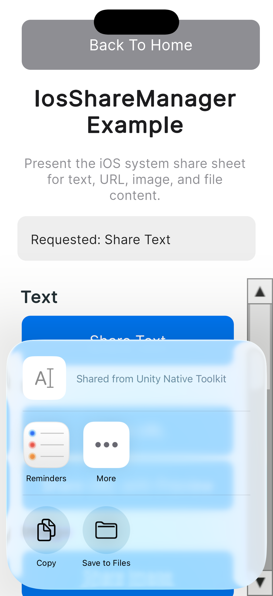
</p>

---

### URL 공유

```csharp
#if UNITY_IOS || UNITY_EDITOR
IosShareManager.Instance.Share(new IosShareContentPayload
{
    items = new[] { IosShareItem.Url("https://unity.com") }
});
#endif
```

<p align="center">
    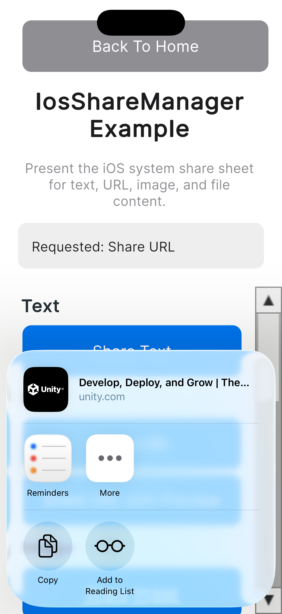
</p>

---

### 프리뷰 포함 URL 공유

`previewTitle`을 지정하면 공유 시트의 콘텐츠 프리뷰 영역에 표시되는 제목을 설정할 수 있습니다.

```csharp
#if UNITY_IOS || UNITY_EDITOR
IosShareManager.Instance.Share(new IosShareContentPayload
{
    items = new[] { IosShareItem.Url("https://unity.com") },
    previewTitle = "Unity"
});
#endif
```

<p align="center">
    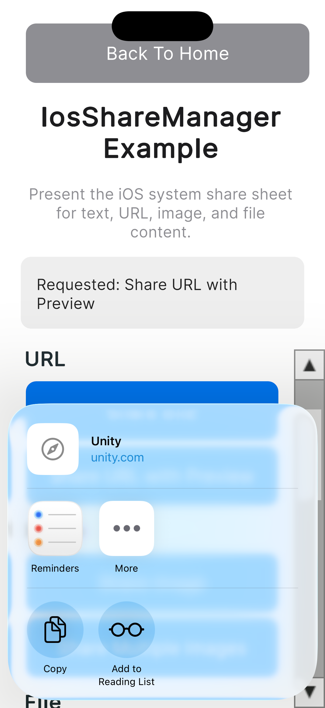
</p>

---

### 이미지 공유

```csharp
#if UNITY_IOS || UNITY_EDITOR
string imagePath = Path.Combine(Application.persistentDataPath, "share_sample_image.png");
// Share를 호출하기 전에 imagePath에 PNG 파일을 작성해 두세요.

IosShareManager.Instance.Share(new IosShareContentPayload
{
    items = new[] { IosShareItem.Image(imagePath) }
});
#endif
```

<p align="center">
    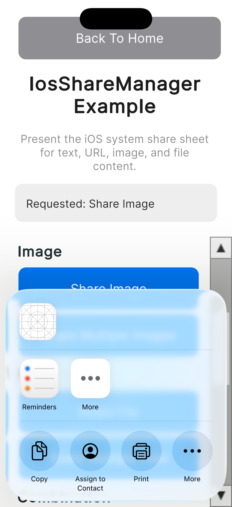
</p>

---

### 다중 이미지 공유

```csharp
#if UNITY_IOS || UNITY_EDITOR
string imagePath1 = Path.Combine(Application.persistentDataPath, "share_sample_image_1.png");
string imagePath2 = Path.Combine(Application.persistentDataPath, "share_sample_image_2.png");
// Share를 호출하기 전에 각 경로에 PNG 파일을 작성해 두세요.

IosShareManager.Instance.Share(new IosShareContentPayload
{
    items = new[] { IosShareItem.Image(imagePath1), IosShareItem.Image(imagePath2) }
});
#endif
```

<p align="center">
    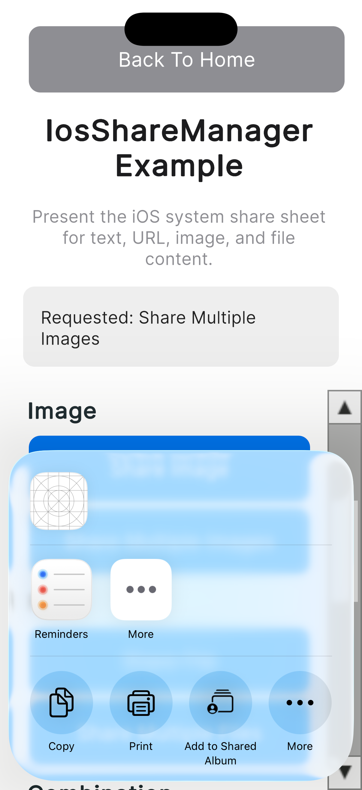
</p>

---

### 파일 공유

```csharp
#if UNITY_IOS || UNITY_EDITOR
string filePath = Path.Combine(Application.persistentDataPath, "share_sample_file.txt");
File.WriteAllText(filePath, "This is a sample text file shared from Unity Native Toolkit.");

IosShareManager.Instance.Share(new IosShareContentPayload
{
    items = new[] { IosShareItem.File(filePath) }
});
#endif
```

<p align="center">
    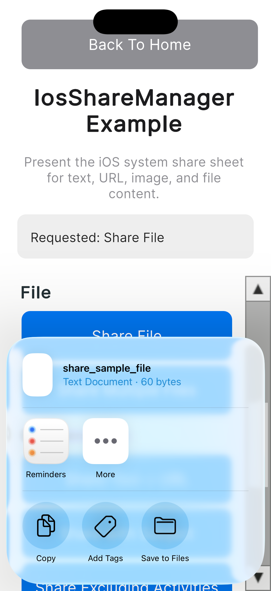
</p>

---

### 다중 파일 공유

```csharp
#if UNITY_IOS || UNITY_EDITOR
string filePath1 = Path.Combine(Application.persistentDataPath, "share_sample_file_1.txt");
string filePath2 = Path.Combine(Application.persistentDataPath, "share_sample_file_2.txt");
File.WriteAllText(filePath1, "Sample file 1 from Unity Native Toolkit.");
File.WriteAllText(filePath2, "Sample file 2 from Unity Native Toolkit.");

IosShareManager.Instance.Share(new IosShareContentPayload
{
    items = new[] { IosShareItem.File(filePath1), IosShareItem.File(filePath2) }
});
#endif
```

<p align="center">
    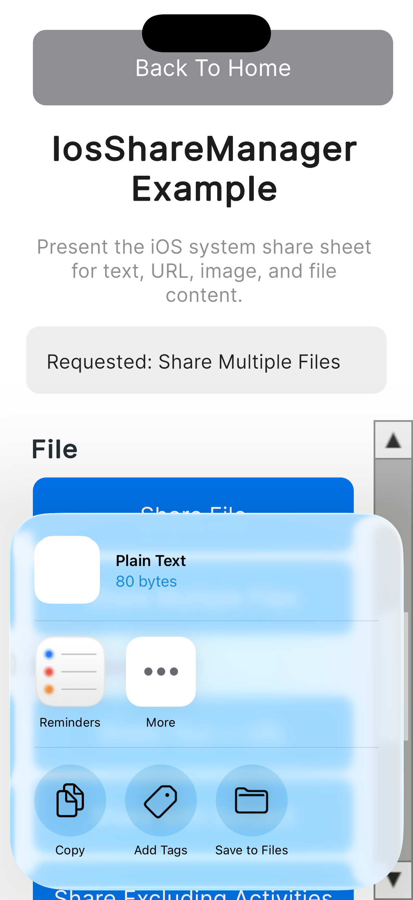
</p>

---

### 텍스트와 URL 공유

한 번의 `Share` 호출로 서로 다른 종류의 여러 아이템을 함께 공유할 수 있습니다.

```csharp
#if UNITY_IOS || UNITY_EDITOR
IosShareManager.Instance.Share(new IosShareContentPayload
{
    items = new[] { IosShareItem.Text("Check this out"), IosShareItem.Url("https://unity.com") }
});
#endif
```

<p align="center">
    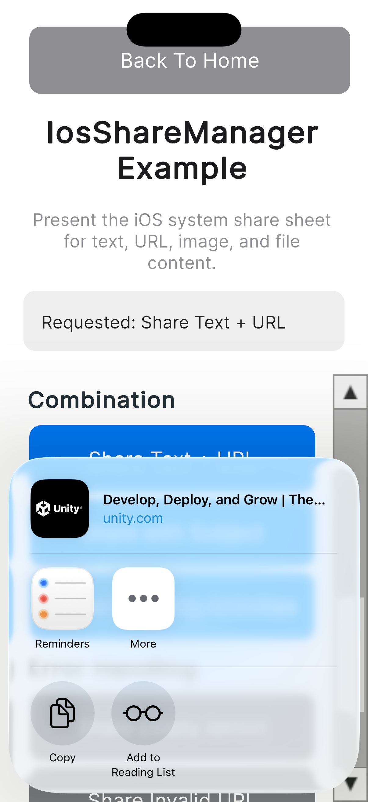
</p>

---

### 제목 포함 공유

`subject`는 Mail 등의 액티비티에서 메시지 제목으로 사용됩니다.

```csharp
#if UNITY_IOS || UNITY_EDITOR
IosShareManager.Instance.Share(new IosShareContentPayload
{
    items = new[] { IosShareItem.Text("Body text") },
    subject = "Sample Subject"
});
#endif
```

<p align="center">
    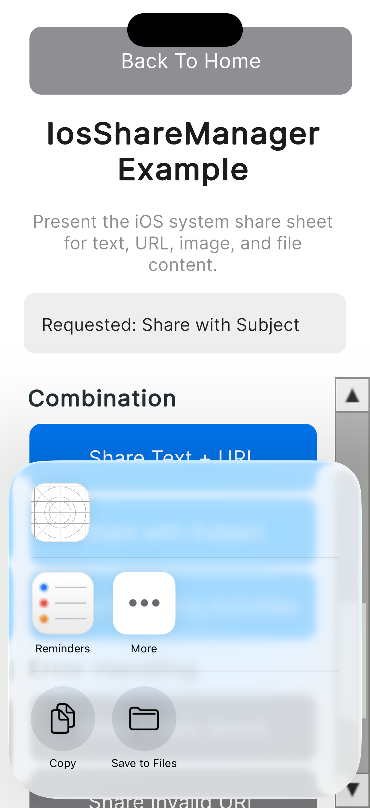
</p>

---

### 특정 액티비티 제외 공유

`excludedActivityTypes`를 지정하면 공유 시트에서 지정한 액티비티 타입(raw identifier)을 숨길 수 있습니다.

```csharp
#if UNITY_IOS || UNITY_EDITOR
IosShareManager.Instance.Share(new IosShareContentPayload
{
    items = new[] { IosShareItem.Url("https://unity.com") },
    excludedActivityTypes = new[]
    {
        "com.apple.UIKit.activity.CopyToPasteboard",
        "com.apple.UIKit.activity.PostToFacebook"
    }
});
#endif
```

<p align="center">
    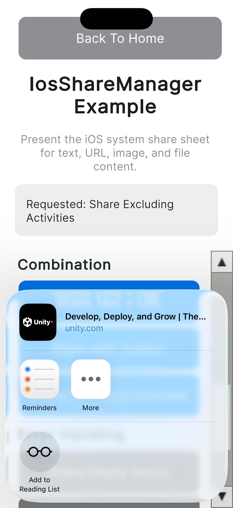
</p>

> **참고:** 특정 액티비티 타입이 실제로 공유 시트에 표시되는지 여부는 기기와 설치된 앱에 따라 달라집니다. Facebook과 같은 서드파티 액티비티는 테스트 기기에 설치되어 있지 않을 수 있으므로, `com.apple.UIKit.activity.CopyToPasteboard`(복사)를 주요 확인 대상으로 삼으세요.

---

### 결과 수신

화면 전환 후 오래된 참조를 피하기 위해 `OnEnable`에서 `ShareCompleted`를 구독하고 `OnDisable`에서 해제합니다. `ShareCompleted`는 `Share`에 전달한 개별 콜백보다 항상 먼저 발생합니다.

```csharp
private void OnEnable()
{
#if UNITY_IOS || UNITY_EDITOR
    IosShareManager.Instance.ShareCompleted += OnShareCompleted;
#endif
}

private void OnDisable()
{
#if UNITY_IOS || UNITY_EDITOR
    IosShareManager.Instance.ShareCompleted -= OnShareCompleted;
#endif
}

#if UNITY_IOS || UNITY_EDITOR
private void OnShareCompleted(IosShareResult result)
{
    if (!result.IsSuccess)
    {
        Debug.LogError($"Share failed: {result.ErrorMessage}");
        return;
    }

    if (result.Completed)
    {
        Debug.Log($"Share completed: activityType={result.ActivityType}");
    }
    else
    {
        Debug.Log("Share cancelled by the user.");
    }
}
#endif
```

> **참고:** 사용자의 취소는 에러로 취급되지 않습니다. `IsSuccess`는 `true`, `Completed`는 `false`가 되며 `ActivityType`은 `null`이 됩니다.

---

### 에러 처리

모든 `Share` 호출 결과는 `ShareCompleted`(및 `Share`에 전달한 개별 콜백)를 통해 보고됩니다. `IsSuccess`가 `false`인 경우 `ErrorMessage`는 항상 non-null입니다.

```csharp
#if UNITY_IOS || UNITY_EDITOR
// 아이템 없음: 공유 시트를 표시하지 않고 즉시 실패합니다.
// ErrorMessage: "No shareable items were provided."
IosShareManager.Instance.Share(new IosShareContentPayload
{
    items = Array.Empty<IosShareItem>()
});

// 유효하지 않은 URL 문자열: 네이티브 유효성 검사 오류로 실패합니다.
// ErrorMessage: "Invalid URL: not a valid url."
IosShareManager.Instance.Share(new IosShareContentPayload
{
    items = new[] { IosShareItem.Url("not a valid url") }
});

// 파일 없음: 네이티브 레이어가 파일을 찾지 못하면 실패합니다.
// ErrorMessage: "File not found at path: /nonexistent/share-missing.txt."
IosShareManager.Instance.Share(new IosShareContentPayload
{
    items = new[] { IosShareItem.File("/nonexistent/share-missing.txt") }
});

// 이미지 없음: 네이티브 레이어가 이미지를 로드하지 못하면 실패합니다.
// ErrorMessage: "Failed to load image at path: /nonexistent/share-missing.png."
IosShareManager.Instance.Share(new IosShareContentPayload
{
    items = new[] { IosShareItem.Image("/nonexistent/share-missing.png") }
});
#endif
```

---

## macOS

macOS 공유 기능은 `MacShareManager`를 통해 제공됩니다. 두 가지 진입점을 제공합니다. `Share`는 시스템 공유 서비스 피커(`NSSharingServicePicker`)를 표시하고, `ShareViaService`는 피커를 표시하지 않고 지정한 서비스 하나를 직접 실행합니다.

> **참고:** `Share`(피커)는 `NSSharingServicePicker.show(...)`가 `mouseDown` 이벤트 컨텍스트를 요구하므로, 버튼 클릭과 같은 사용자 시작 액션에서 호출해야 합니다. `ShareViaService`는 이 제약이 없으며, 결정적인 결과가 필요한 경우(예: 항상 Mail로 공유) 더 안정적인 방법입니다.

### 설정

#### 네임스페이스 임포트

`MacShareManager`는 macOS Standalone 빌드 타겟이 선택되어 있는 한 에디터를 포함하여 컴파일됩니다. 에디터나 macOS가 아닌 플레이어에서 `Share` 또는 `ShareViaService`를 호출해도 크래시하지 않고, 즉시 실패 결과를 반환합니다([에러 처리](#에러-처리-2) 참고).

```csharp
#if UNITY_STANDALONE_OSX || UNITY_EDITOR
using JonghyunKim.NativeToolkit.Runtime.Share;
#endif
```

#### 이미지·파일 공유 시 경로

macOS에는 Android와 같은 FileProvider 제약이 없습니다. `Application.persistentDataPath` 아래의 모든 파일을 직접 공유할 수 있습니다.

```csharp
string path = Path.Combine(Application.persistentDataPath, "my_image.png");
```

---

### 텍스트 공유

```csharp
#if UNITY_STANDALONE_OSX || UNITY_EDITOR
MacShareManager.Instance.Share(new MacShareContentPayload
{
    items = new[] { MacShareItem.Text("Shared from Unity Native Toolkit") }
});
#endif
```

<p align="center">
    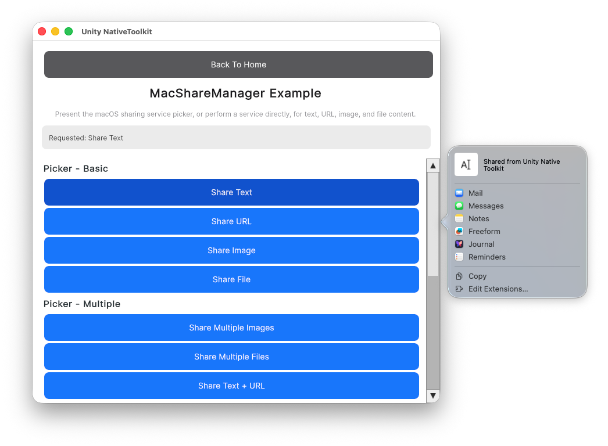
</p>

---

### URL 공유

```csharp
#if UNITY_STANDALONE_OSX || UNITY_EDITOR
MacShareManager.Instance.Share(new MacShareContentPayload
{
    items = new[] { MacShareItem.Url("https://unity.com") }
});
#endif
```

<p align="center">
    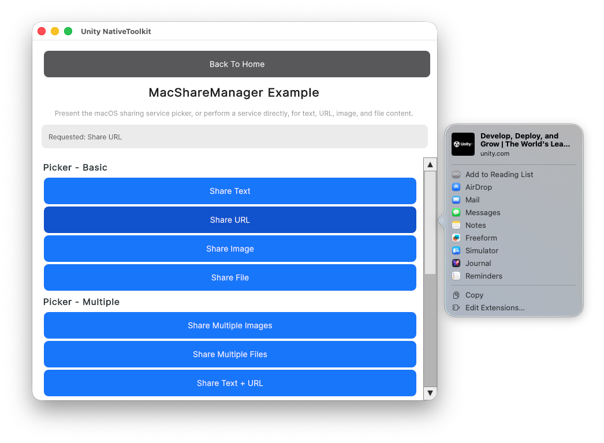
</p>

---

### 이미지 공유

```csharp
#if UNITY_STANDALONE_OSX || UNITY_EDITOR
string imagePath = Path.Combine(Application.persistentDataPath, "share_sample_image.png");
// Share를 호출하기 전에 imagePath에 PNG 파일을 씁니다.

MacShareManager.Instance.Share(new MacShareContentPayload
{
    items = new[] { MacShareItem.Image(imagePath) }
});
#endif
```

<p align="center">
    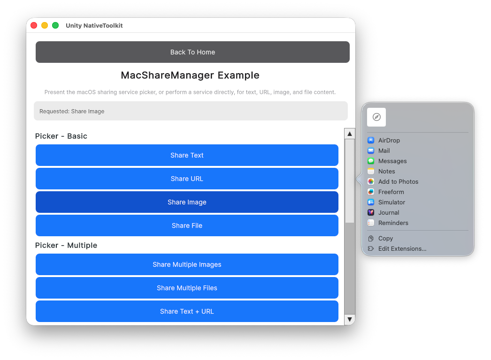
</p>

---

### 파일 공유

```csharp
#if UNITY_STANDALONE_OSX || UNITY_EDITOR
string filePath = Path.Combine(Application.persistentDataPath, "share_sample_file.txt");
File.WriteAllText(filePath, "This is a sample text file shared from Unity Native Toolkit.");

MacShareManager.Instance.Share(new MacShareContentPayload
{
    items = new[] { MacShareItem.File(filePath) }
});
#endif
```

<p align="center">
    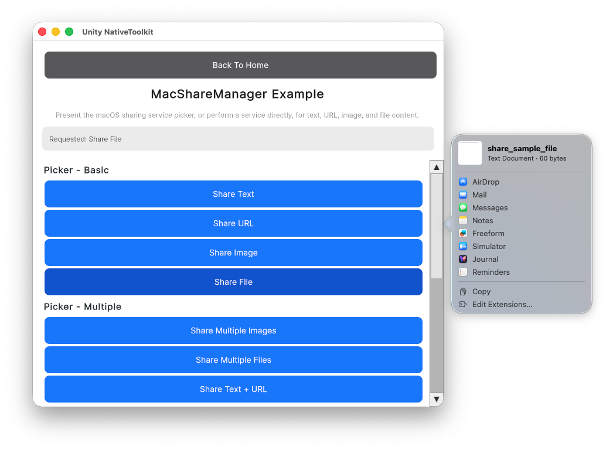
</p>

---

### 다중 이미지 공유

```csharp
#if UNITY_STANDALONE_OSX || UNITY_EDITOR
string imagePath1 = Path.Combine(Application.persistentDataPath, "share_sample_image_1.png");
string imagePath2 = Path.Combine(Application.persistentDataPath, "share_sample_image_2.png");
// Share를 호출하기 전에 각 경로에 PNG 파일을 씁니다.

MacShareManager.Instance.Share(new MacShareContentPayload
{
    items = new[] { MacShareItem.Image(imagePath1), MacShareItem.Image(imagePath2) }
});
#endif
```

<p align="center">
    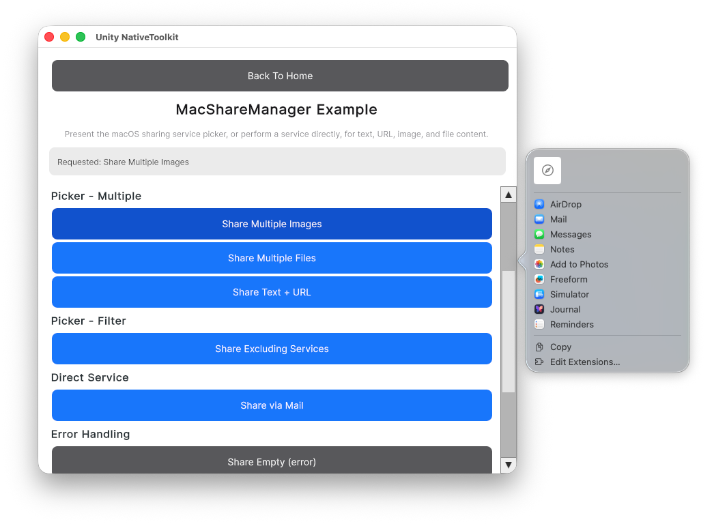
</p>

---

### 다중 파일 공유

```csharp
#if UNITY_STANDALONE_OSX || UNITY_EDITOR
string filePath1 = Path.Combine(Application.persistentDataPath, "share_sample_file_1.txt");
string filePath2 = Path.Combine(Application.persistentDataPath, "share_sample_file_2.txt");
File.WriteAllText(filePath1, "Sample file 1 from Unity Native Toolkit.");
File.WriteAllText(filePath2, "Sample file 2 from Unity Native Toolkit.");

MacShareManager.Instance.Share(new MacShareContentPayload
{
    items = new[] { MacShareItem.File(filePath1), MacShareItem.File(filePath2) }
});
#endif
```

<p align="center">
    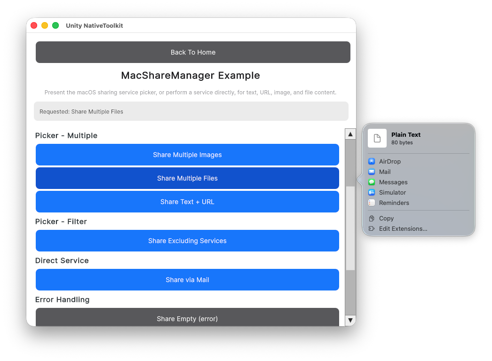
</p>

---

### 텍스트와 URL 공유

서로 다른 종류의 여러 아이템을 하나의 `Share` 호출로 함께 공유할 수 있습니다.

```csharp
#if UNITY_STANDALONE_OSX || UNITY_EDITOR
MacShareManager.Instance.Share(new MacShareContentPayload
{
    items = new[] { MacShareItem.Text("Check this out"), MacShareItem.Url("https://unity.com") }
});
#endif
```

<p align="center">
    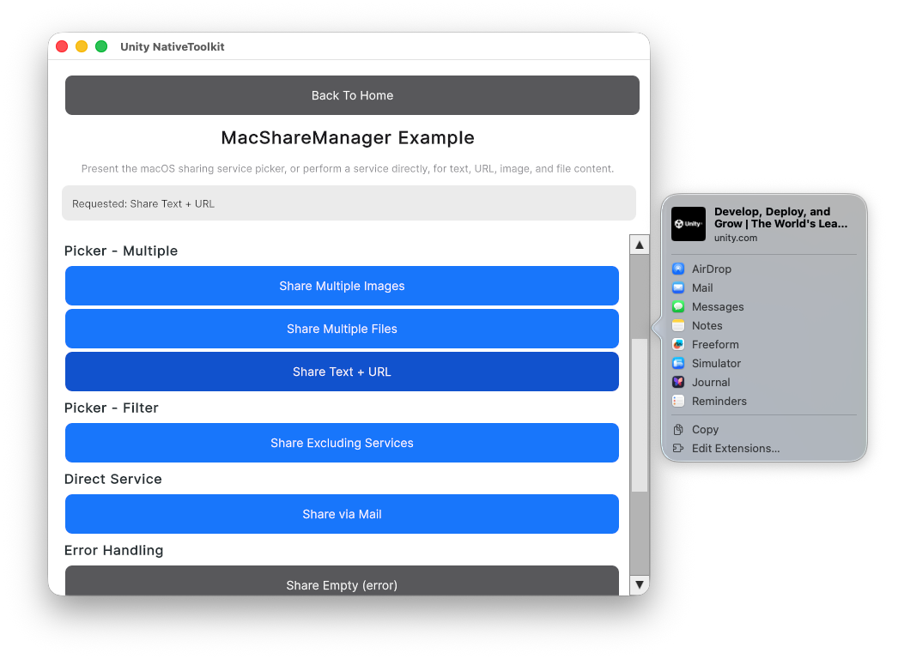
</p>

---

### 서비스 제외 공유

`excludedServiceTitles`는 지정한 문자열과 일치하는 표시 제목을 가진 서비스를 숨깁니다(`NSSharingService.title`에 대한 베스트 에포트 매칭).

```csharp
#if UNITY_STANDALONE_OSX || UNITY_EDITOR
MacShareManager.Instance.Share(new MacShareContentPayload
{
    items = new[] { MacShareItem.Url("https://unity.com") },
    excludedServiceTitles = new[] { "Add to Reading List" }
});
#endif
```

<p align="center">
    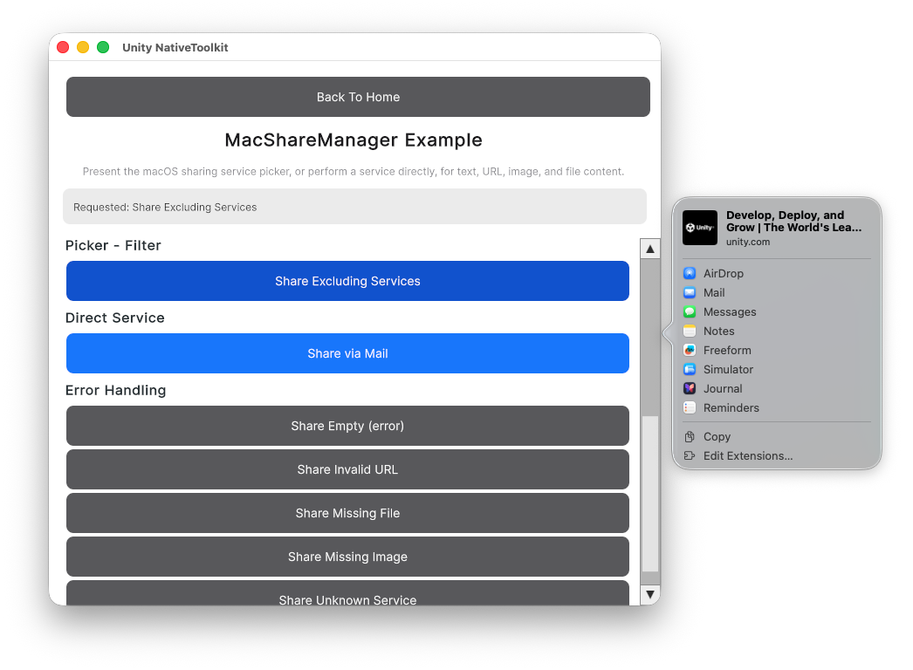
</p>

---

### 지정 서비스 경유 공유 (Mail)

`ShareViaService`는 피커를 표시하지 않고 지정한 하나의 공유 서비스를 직접 실행합니다. `recipients`와 `subject`는 대상 서비스가 이를 지원하는 경우(예: Mail)에 적용됩니다. 알려진 raw 서비스 식별자는 `MacShareServiceNames`를 사용하세요.

```csharp
#if UNITY_STANDALONE_OSX || UNITY_EDITOR
MacShareManager.Instance.ShareViaService(MacShareServiceNames.MailCompose, new MacShareContentPayload
{
    items = new[] { MacShareItem.Text("Body text") },
    recipients = new[] { "test@example.com" },
    subject = "Sample Subject"
});
#endif
```

<p align="center">
    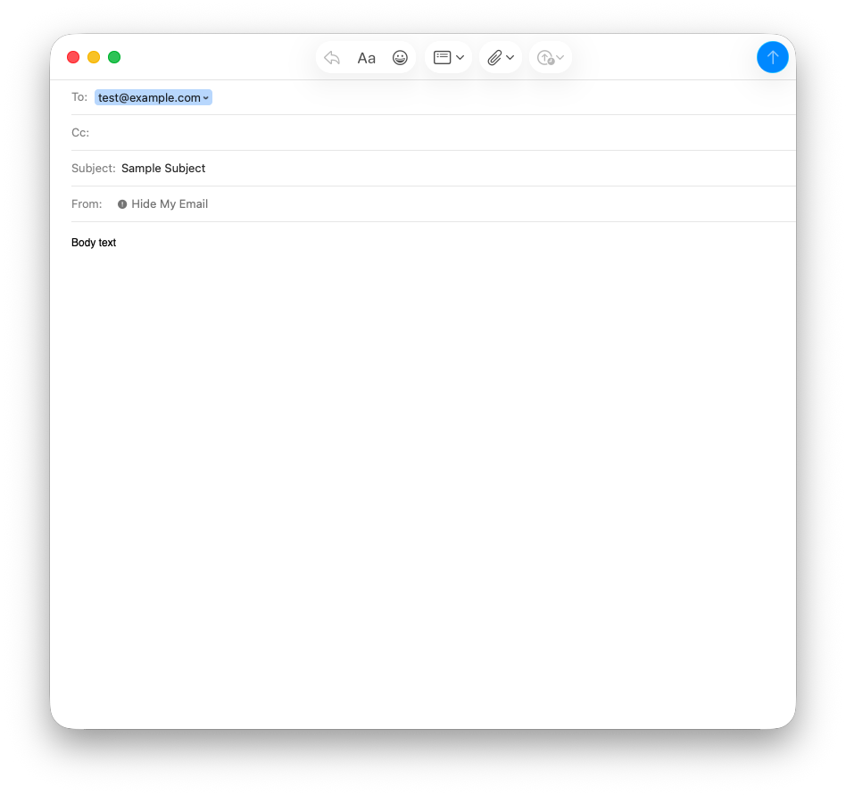
</p>

> **참고:** `MacShareServiceNames`에는 `MailCompose`와 같이 잘 알려진 raw `NSSharingService.Name` 식별자가 정의되어 있습니다. 이는 `ShareViaService`에 전달하는 입력 식별자이며, `MacShareResult.ServiceName`으로 반환되는 표시 이름이 아닙니다.

---

### 결과 수신

화면 전환 후 오래된 참조를 방지하기 위해 `OnEnable`에서 `ShareCompleted`를 구독하고 `OnDisable`에서 해제하세요. `ShareCompleted`는 `Share`와 `ShareViaService` 모두에서 발생하며, 두 메서드에 전달한 개별 콜백보다 항상 먼저 발생합니다.

```csharp
private void OnEnable()
{
#if UNITY_STANDALONE_OSX || UNITY_EDITOR
    MacShareManager.Instance.ShareCompleted += OnShareCompleted;
#endif
}

private void OnDisable()
{
#if UNITY_STANDALONE_OSX || UNITY_EDITOR
    MacShareManager.Instance.ShareCompleted -= OnShareCompleted;
#endif
}

#if UNITY_STANDALONE_OSX || UNITY_EDITOR
private void OnShareCompleted(MacShareResult result)
{
    if (!result.IsSuccess)
    {
        Debug.LogError($"공유 실패: {result.ErrorMessage}");
        return;
    }

    if (result.Completed)
    {
        Debug.Log($"공유 완료: service={result.ServiceName}");
    }
    else
    {
        Debug.Log("사용자가 공유를 취소했습니다.");
    }
}
#endif
```

> **참고:** 사용자 취소는 에러가 아닙니다. `IsSuccess`는 `true`, `Completed`는 `false`이며 `ServiceName`은 `null`이 됩니다.

---

### 에러 처리

모든 `Share` / `ShareViaService` 호출은 `ShareCompleted`(및 선택적 개별 콜백)를 통해 결과를 전달합니다. `IsSuccess`가 `false`일 때 `ErrorMessage`는 항상 non-null입니다.

```csharp
#if UNITY_STANDALONE_OSX || UNITY_EDITOR
// 아이템 없음: 피커를 표시하지 않고 즉시 실패합니다.
// ErrorMessage: "No shareable items were provided."
MacShareManager.Instance.Share(new MacShareContentPayload
{
    items = Array.Empty<MacShareItem>()
});

// 잘못된 URL 문자열: 네이티브 검증 오류로 실패합니다.
// ErrorMessage: "Invalid URL: not a valid url."
MacShareManager.Instance.Share(new MacShareContentPayload
{
    items = new[] { MacShareItem.Url("not a valid url") }
});

// 파일 없음: 네이티브 레이어가 파일을 찾지 못하면 실패합니다.
// ErrorMessage: "File not found at path: /nonexistent/share-missing.txt."
MacShareManager.Instance.Share(new MacShareContentPayload
{
    items = new[] { MacShareItem.File("/nonexistent/share-missing.txt") }
});

// 이미지 없음: 네이티브 레이어가 이미지를 로드하지 못하면 실패합니다.
// ErrorMessage: "Failed to load image at path: /nonexistent/share-missing.png."
MacShareManager.Instance.Share(new MacShareContentPayload
{
    items = new[] { MacShareItem.Image("/nonexistent/share-missing.png") }
});

// 알 수 없는 서비스: 지정한 서비스가 존재하지 않거나 실행할 수 없으면 실패합니다.
// ErrorMessage: "Sharing service unavailable: invalid.service."
MacShareManager.Instance.ShareViaService("invalid.service", new MacShareContentPayload
{
    items = new[] { MacShareItem.Text("Body text") }
});
#endif
```
